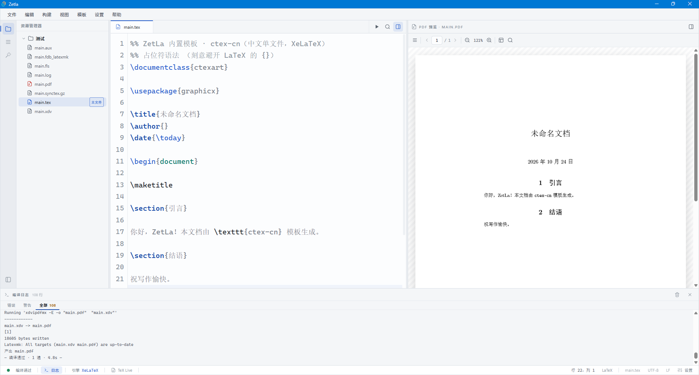

# 📝 Zetla

### 跨平台的桌面 LaTeX 工作台

> Windows 已发布 · Linux 适配中 · macOS 短期暂不支持（作者暂无 Mac 设备 😅）

[🚀 快速上手](#快速上手) · [✨ 功能](#功能) · [🆚 为什么选 Zetla](#为什么选-zetla) · [📚 详细文档](#详细文档) · [🤝 贡献](#贡献) · [📄 许可证](#许可证) · [🌟 Star History](#star-history)

⭐ 如果这个项目对你有帮助，欢迎 [Star 支持](https://github.com/Wastarch/Zetla)！

---

📸 应用预览

## 快速上手 🚀

只需 6 步，立刻开始写 LaTeX：

1. **安装 Zetla** 💾：从 [Releases](https://github.com/Wastarch/Zetla/releases/latest) 下载安装包（详见[使用指南 · 安装](docs/使用指南.md#安装)）。
2. **准备 TeX 环境** 🧰：首次启动自动检测；未安装可在引导面板一键安装 TeX Live，或接管已有安装（见[使用指南 · 首次启动](docs/使用指南.md#首次启动准备-tex-环境)）。
3. **新建或打开项目** 📂：`Ctrl+Shift+N` 从模板新建，或 `Ctrl+Shift+O` 打开项目文件夹。
4. **编写文档** ✍️：在 `.tex` 中用模板、代码片段、公式 / 符号面板高效写作。
5. **一键编译** ⚡：`Ctrl+B` 或点 ▶ 编译，内置 `latexmk` / `engine-direct`。
6. **查看 PDF** 👁️：编译后右侧自动预览，支持源码 ↔ PDF 双向跳转。

## 功能 ✨

Zetla 把 LaTeX 写作拆成一组**可视化面板**，覆盖项目管理、编辑器、可编排编译、公式 / 表格 / 图片 / 拼图、参考文献与 PDF 预览。

| 🗂️ 项目管理 | ✍️ 编辑器 | ⚙️ 可编排编译 |
| :---: | :---: | :---: |
| 模板库 · 多标签 · 自动保存 · GBK 不乱码 | 语法高亮 · 代码片段 · 公式/符号面板 | Tool/Recipe · 实时预览 · 双向跳转 |
| 🧮 公式表格 | 🖼️ 图片拼图 | 📚 参考文献 |
| 公式/符号面板 · 表格编辑 | 图片附件 · 拼图布局 | BibTeX 引用管理 |
| 🔄 自动更新 | 🎨 主题外观 | 🪟 桌面体验 |
| 自动更新 · 环境引导 | 亮暗主题 · 自定义标题栏 | 原生窗口 · 全局快捷键 |

> [!NOTE]
> 完整功能逐项说明见 [功能介绍](docs/功能介绍.md)。

## 为什么选 Zetla 🆚

不拼"能不能编译"，拼的是**开箱即用的面板化工作流**：

| 能力 | Zetla | Overleaf | TeXstudio | VS Code + LaTeX Workshop |
| :--- | :---: | :---: | :---: | :---: |
| 拼图 · 多图论文插图可视化排版 | ✅ 专属面板 | ❌ | ❌ | ⚠️ 需手写 |
| 首次启动 TeX 环境引导（一键装 / 接管 TeX Live） | ✅ 引导 | ✅ 云端内置 | ❌ 需自备 | ❌ 需自备 |
| 可编排编译流程（Tool / Recipe 可视化） | ✅ 可视化 | ⚠️ 仅云端 | ⚠️ 单命令 | ⚠️ 需配置 |
| 公式 / 符号可视化面板（KaTeX 实时渲染） | ✅ 面板 | ✅ Web | ⚠️ 基础 | ⚠️ 插件 |
| 内置项目模板库（一键新建） | ✅ 内置 | ✅ 模板 | ⚠️ 较弱 | ⚠️ 插件 |
| 中文 / GBK 编码零乱码（自动处理） | ✅ 自动 | ⚠️ | ⚠️ 手动 | ⚠️ 手动 |
| 自定义标题栏 + 全局快捷键（Tauri 原生） | ✅ 原生 | ❌ 浏览器 | ⚠️ 通用 | ⚠️ 通用 |
| 代码片段面板（可复用块管理） | ✅ 内置 | ⚠️ | ✅ | ✅ snippets |

> [!TIP]
> Zetla 的核心差异：**把公式、符号、拼图、编译、参考文献都做成开箱即用的面板**，加上首次启动自动引导 TeX 环境、中文 / GBK 零乱码——专为"不想折腾环境、又要桌面级体验"的中文 LaTeX 用户设计。

## 详细文档 📚

完整的功能介绍与使用细节已移至 `docs/` 目录：

| 文档 | 内容 |
| :--- | :--- |
| [功能介绍（完整）](docs/功能介绍.md) | 全部功能逐项说明 |
| [使用指南（完整）](docs/使用指南.md) | 安装、环境准备、编辑、编译、公式、表格、拼图、PDF 等全部用法与快捷键 |
| [常见问题](docs/常见问题.md) | 安装、编译、模板、拼图等高频疑问 |
| [从源码运行](docs/从源码运行.md) | 构建环境、打包、版本号与测试、目录结构 |

> [!TIP]
> 想快速上手直接看上方 **快速上手 🚀**；想深入研究某功能，按需打开上面的文档链接即可。

## 贡献 🤝

欢迎通过 [GitHub Issues](https://github.com/Wastarch/Zetla/issues) 反馈问题或提出建议。提交代码前请先确认改动符合项目当前阶段的范围。

## 许可证 📄

本项目采用 **GNU Affero General Public License v3（AGPLv3）**

- 你可以自由使用、研究、修改和分发本软件，包括商业用途
- 若你修改了 Zetla 并**通过网络服务器向公众提供服务**，必须向用户提供你所修改版本的完整源代码
- 衍生作品必须以 AGPLv3 发布，保持开源
- 完整许可证文本见 [LICENSE](LICENSE)
- 官方许可证文本：<https://www.gnu.org/licenses/agpl-3.0.txt>

Copyright (c) 2026 Zetla contributors

## Star History 🌟

<a href="https://star-history.com/#Wastarch/Zetla&Date">
 <picture>
   <source media="(prefers-color-scheme: dark)" srcset="https://api.star-history.com/svg?repos=Wastarch/Zetla&type=Date&theme=dark" />
   
 </picture>
</a>
