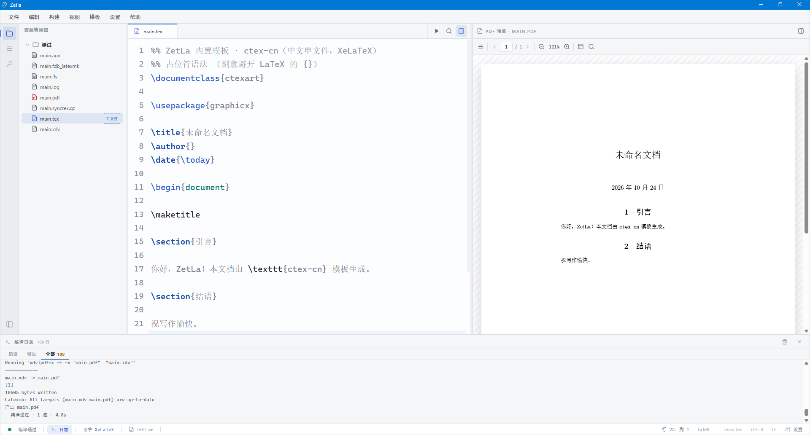

# Zetla

面向 Windows 的桌面 LaTeX 工作台，把项目管理、代码编辑、编译日志和 PDF 预览放进同一个应用里。

> 当前最新版本 `0.1.3`，处于 **开发阶段**。核心链路已经打通：打开项目 → 编辑 `.tex` → 一键编译 → 查看 PDF，源码与 PDF 支持双向跳转。


## 目录

- [Zetla](#zetla)
  - [目录](#目录)
  - [功能](#功能)
  - [安装](#安装)
  - [使用指南](#使用指南)
    - [首次启动：准备 TeX 环境](#首次启动准备-tex-环境)
    - [新建或打开项目](#新建或打开项目)
    - [编辑文档](#编辑文档)
    - [编译与排错](#编译与排错)
    - [查看 PDF](#查看-pdf)
    - [偏好设置](#偏好设置)
    - [快捷键](#快捷键)
  - [常见问题](#常见问题)
  - [从源码运行](#从源码运行)
    - [构建安装包](#构建安装包)
    - [版本号管理](#版本号管理)
    - [测试与检查](#测试与检查)
  - [目录结构](#目录结构)
  - [贡献](#贡献)
  - [许可证](#许可证)

## 功能

- **项目与编辑**：打开/新建项目、项目树右键操作、多标签编辑（撤销栈独立）、自动保存、GBK 文档不乱码
- **一键编译**：优先 `latexmk -xelatex`，缺少 Perl 时回退到多遍 `xelatex`；实时日志、结构化报错、点击错误跳转行列；引擎可选（XeLaTeX / pdfLaTeX / LuaLaTeX），支持自定义编译流程
- **双向跳转**：编辑器 Ctrl+点击跳转 PDF 对应位置并高亮，PDF Ctrl+点击回跳源码行列（SyncTeX）
- **大纲导航**：侧栏自动梳理 `\input`/`\include` 链中的章节结构，层级展示、点击直达
- **符号面板**：191 个常用符号按 9 类分组，搜索或点击即在光标处插入
- **PDF 预览**：基于 PDF.js，支持缩放、翻页、页内查找、缩略图与目录侧栏，可与编辑区拖拽分栏
- **环境引导**：启动自动检测 TeX；未安装可自动下载安装 TeX Live（基础/完整方案），也支持接管已有安装
- **桌面体验**：亮 / 暗双主题（可跟随系统）、窗口大小与位置记忆、布局记忆、启动恢复上次项目、菜单栏与状态栏

## 安装

1. 到 [Releases](https://github.com/Wastarch/Zetla/releases/latest) 下载 `Zetla_0.1.3_x64-setup.exe`。
2. 运行安装包。当前版本**未签名**，Windows SmartScreen 提示时选择「更多信息 → 仍要运行」。
3. 安装模式可以为「仅当前用户」，无需管理员权限。也可以为所有用户安装。
4. 卸载时若检测到 **Zetla 代装的 TeX Live**，会询问是否一并删除；默认保留，TeX 可继续被其他软件使用。

系统要求：

- **Windows 10/11**（当前主要开发与验收平台）
- **WebView2 Runtime**（Windows 10/11 通常已内置；安装包不随附，缺失时需先安装 Runtime）
- **TeX Live**：可选。不装也能启动，首次进入时可在应用内安装（见下一节）

> 国内网络下应用会自动尝试清华 TUNA、阿里云等镜像下载 TeX Live 安装器。

## 使用指南

<!-- 截图占位：首次启动的 TeX 环境引导面板 -->

### 首次启动：准备 TeX 环境

Zetla 每次启动都会检测 TeX，顺序为：Zetla 独立目录 → 系统 `PATH` → 常见安装位置。

- **已装 TeX Live / MiKTeX**：检测到即可直接编译，状态栏会显示引擎信息。
- **未装 TeX**：自动弹出引导面板，可选：
  - **自动安装 TeX Live**：进入向导后选择方案与目录
    - *基础方案*：约 1.5 GB，含 XeLaTeX 与中文支持（ctex / fandol），适合大多数文档，后续可用 `tlmgr` 补包
    - *完整方案*：约 5 GB，包含全部宏包与文档
    - 默认安装到 `%LOCALAPPDATA%\Zetla\tex\texlive`，也可选其他盘符；**只写入 Zetla 独立目录，不修改系统 PATH**
    - 安装中可随时取消，取消后会清理本次新建的目录
  - **接管已有安装**：点「指定/接管已有安装…」，选择 TeX Live 根目录、`bin` 或 `bin\windows` 均可
  - **手动安装**：按面板内的官网指引自行安装后，回到应用重新检测
- 之后随时可通过菜单「帮助 → TeX 环境检测…」或「偏好设置 → 编译设置 → 检测 / 引导…」重新打开该面板。

### 新建或打开项目

- **新建项目**：`Ctrl+Shift+N`（或菜单「文件 → 新建项目…」/ 侧栏「新建文档」）
  1. 选择模板：内置 `article`（英文单文件）与 `ctex-cn`（中文，XeLaTeX）
  2. 按模板变量填写标题、作者等信息
  3. 选择生成位置 → 自动生成 `main.tex` 并写入 `.ltex/config.json`（记录主文件与引擎）
  4. 创建完成后自动打开到编辑器
- **打开已有项目**：`Ctrl+Shift+O`，选择项目文件夹。
  - 主文件判定顺序：`.ltex/config.json` 的 `mainFile` → 根目录 `main.tex` → 含 `\documentclass` 的最浅 `.tex` → 首个 `.tex`
  - 项目树中主文件带 `main` 标记

### 编辑文档

- **多标签**：点击项目树文件即可打开；`Ctrl+W` 关闭；未保存的标签显示脏点 `●` 而不是关闭按钮
- **保存**：`Ctrl+S` 保存当前文件，`Ctrl+Shift+S` 全部保存；打开文件用 `Ctrl+O`
- **自动保存**：默认开启，每 30 秒写回未保存修改；编译期间默认暂停自动保存（可在设置中调整）
- **编码与换行**：自动识别 UTF-8 / GBK，状态栏只读展示编码与换行符；保存时保持原编码与 EOL，老文档不会乱码或改写换行
- **查找**：编辑器内 `Ctrl+F` 打开 CodeMirror 查找面板
- **注释**：`Ctrl+/` 切换行注释；撤销 / 重做 `Ctrl+Z` / `Ctrl+Y`
- **字号**：`Ctrl+滚轮` 缩放编辑器字体，或到「偏好设置 → 编辑器」调整字体与字号
- **项目树**：右键可新建文件/文件夹、重命名、删除、从模板新建；`Ctrl+C` / `Ctrl+X` / `Ctrl+V` 在树内复制、剪切、粘贴（粘贴目标为选中目录、选中文件的父目录或项目根）

### 编译与排错

- **编译**：`Ctrl+B`，或点击工具栏 / 状态栏的编译按钮；状态栏显示「编译中…」与进度条
  - 编译前会自动保存已修改文档（可在设置中关闭）
  - 状态栏文案按钮在编译中点击即**终止编译**
- **流水线**：优先 `latexmk -xelatex` 自动多轮；系统中没有 Perl 时回退为多遍 `xelatex`
- **日志面板**：开始编译时自动展开，分「全部 / 错误 / 警告」三个页签
  - 「全部」实时输出编译器原始日志
  - 「错误 / 警告」为解析后的结构化列表，点击条目直接跳到对应文件与行列
  - 需要原始 `.log` 文件时可用菜单「帮助 → 查看日志文件」
- **引擎说明**：MVP 固定 XeLaTeX，引擎跟随项目 `.ltex/config.json`；状态栏引擎标签为只读展示

### 查看 PDF

- 编译成功后自动加载项目主文件对应的 PDF；也可用菜单「文件 → 打开 PDF…」打开任意 PDF
- **缩放**：默认「适合宽度」，可选 100% / 125% / 150%，或 `Ctrl+滚轮` 连续缩放（以指针位置为锚点）
- **翻页**：工具栏页码输入与上下翻页；连续滚动时自动同步当前页
- **页内查找**：指针在预览区内时按 `Ctrl+F`，支持命中高亮与上/下一个
- **侧栏**：缩略图与目录（大纲）切换，点击即跳页
- **分栏**：拖动编辑区与预览之间的分隔条调整比例，布局会被记住

### 偏好设置

`Ctrl+,` 打开，共五个面板：

| 面板 | 主要选项 |
| --- | --- |
| 通用 | 启动恢复上次项目、记住窗口大小与位置、恢复布局 |
| 编译设置 | TeX 发行版检测、编译前自动保存、引擎与多轮信息（只读） |
| 编辑器 | 字体、字号、自动换行、`Ctrl+滚轮` 缩放、括号匹配/折叠 |
| PDF 预览 | 默认缩放、保留滚动位置、渲染引擎（pdf.js） |
| 外观与保存 | 主题（亮色 / 暗色 / 跟随系统）、自动保存开关、间隔、编译期间暂停 |

配置文件位置：`%APPDATA%\Zetla\config.json`。

### 快捷键

| 操作 | 快捷键 |
| --- | --- |
| 新建项目（模板向导） | `Ctrl+Shift+N` |
| 打开项目 | `Ctrl+Shift+O` |
| 打开文件 | `Ctrl+O` |
| 保存 / 全部保存 | `Ctrl+S` / `Ctrl+Shift+S` |
| 关闭标签 | `Ctrl+W` |
| 编译 | `Ctrl+B`（1.2 秒内再按一次立即编译；`Ctrl+B` 后按 `0` 切换资源树） |
| 撤销 / 重做 | `Ctrl+Z` / `Ctrl+Y` |
| 切换行注释 | `Ctrl+/` |
| 编辑器查找 | `Ctrl+F` |
| 偏好设置 | `Ctrl+,` |
| 项目树复制 / 剪切 / 粘贴 | `Ctrl+C` / `Ctrl+X` / `Ctrl+V` |
| 编辑器字号缩放 | `Ctrl+滚轮` |
| PDF 缩放 / 页内查找 | `Ctrl+滚轮` / `Ctrl+F`（指针在预览内） |

## 常见问题

**安装时被 SmartScreen 拦截？**
安装包尚未做代码签名，属正常现象。点「更多信息 → 仍要运行」。若企业策略禁止，可自行从源码构建。

**启动后提示未检测到 TeX？**
两种方式：在引导面板里自动安装 TeX Live；或先手动安装，再用「指定/接管已有安装…」选择 TeX Live 根目录 / `bin` / `bin\windows`，最后重新检测。

**编译报错找不到 `xelatex` 或 `latexmk`？**
说明当前引擎不在检测路径中。打开「偏好设置 → 编译设置 → 检测 / 引导…」重新检测或接管安装目录；确认安装包含 XeLaTeX 与 `latexmk`（TeX Live 完整安装自带）。

**自动安装 TeX Live 很慢 / 占空间？**
基础方案约 1.5 GB，完整方案约 5 GB，耗时取决于网络。安装器会自动尝试国内镜像；中途取消会清理本次新建目录。后续补包可用 TeX Live 自带的 `tlmgr`。

**打开 GBK 老文档会乱码吗？**
不会。读取时自动识别 UTF-8 / GBK，保存时保持原编码与原换行符。

**卸载后配置和 TeX 还在吗？**
应用配置在 `%APPDATA%\Zetla\config.json`；应用内安装的 TeX Live 在 `%LOCALAPPDATA%\Zetla\tex\`，卸载时可选择是否保留。

**MVP 还没有哪些功能？**
自定义查找/替换面板（当前用编辑器内置面板）、多编译引擎、辅助文件清理、SyncTeX 正反向搜索、暗色主题、绘图组件、用户模板目录、自动更新等。相关入口在界面上会置灰，并标注对应版本计划。

## 从源码运行

环境要求：

- **Node.js 20+**（Vite 8 要求）
- **Rust stable** 与 Cargo
- **Visual Studio 2022 Build Tools**，包含 MSVC 和 Windows SDK

```powershell
git clone https://github.com/Wastarch/Zetla.git
cd Zetla
npm install
npm run tauri dev
```

首次启动需要编译 Rust 后端，耗时会比后续启动长。

> 如果 `cargo` 找不到 `link.exe`，请在 “Developer PowerShell for VS 2022” 中运行构建命令。

### 构建安装包

正式包使用 **Inno Setup 6**（需本机安装 Inno Setup；编译器 `ISCC.exe` 会自动从注册表/常见目录查找，也可用 `INNO_SETUP_ISCC` 指定）：

```powershell
# 1) 只编 release exe（不触发 NSIS 下载）
npm run tauri build -- --no-bundle

# 2) 调 ISCC 生成安装包
npm run package:inno
```

也可以一步完成：

```powershell
npm run package:win
```

安装包输出到：

```text
build/installer/Zetla_<version>_x64-setup.exe
```

版本号唯一源是 `package.json` 的 `version` 字段：`scripts/sync-version.mjs` 会在每次 `dev`/`build`/`tauri` 前自动把它同步到 `tauri.conf.json`、`Cargo.toml` 与前端 `src/version.ts`，安装包名随之切换（详见[版本号管理](#版本号管理)）。安装脚本在 `src-tauri/windows/inno/zetla.iss`。卸载时会读取 `%LOCALAPPDATA%\Zetla\tex-install.txt` 与 `<texdir>\.zetla-tex`，询问是否同时删除 Zetla 代装的 TeX Live（默认保留，静默卸载一律保留）。

> NSIS 配置仍保留在 `tauri.conf.json` / `windows/nsis-hooks.nsh` 作为备用，但正式发布不再使用。

### 版本号管理

版本号只需维护一处：**`package.json` 的 `version` 字段**。

```powershell
# 方式一：一条命令改版本并全量同步（推荐）
node scripts/sync-version.mjs 0.2.0

# 方式二：先手改 package.json 的 version，再同步
npm run version:sync
```

`npm run dev` / `build` / `tauri` 每次都会自动前置同步，日常开发无感知。同步落点如下，**请勿手改**：

| 落点 | 用途 |
| --- | --- |
| `src-tauri/tauri.conf.json` | Tauri 应用版本：关于页显示、安装包文件名 |
| `src-tauri/Cargo.toml`、`src-tauri/Cargo.lock` | Rust crate 版本 |
| `package-lock.json` | npm 锁文件根版本 |
| `src/version.ts` | 前端常量 `APP_VERSION`（生成文件） |

### 测试与检查

```powershell
# 前端类型检查
npx tsc --noEmit

# 前端生产构建
npm run build

# Rust 单元测试
cd src-tauri
cargo test
```

## 目录结构

```text
Zetla/
├─ src/                 # React 前端：编辑器、预览、项目树、环境引导等
├─ src-tauri/           # Rust/Tauri 后端：编译、文件、配置、安装器等
│  ├─ src/commands/     # Tauri commands
│  ├─ templates/        # 内置 LaTeX 模板
│  └─ windows/inno/     # Inno Setup 正式包脚本
├─ scripts/             # 打包与版本同步脚本（package-inno.mjs / sync-version.mjs）
├─ docs/                # 开发文档与开发计划
├─ public/              # 静态资源
└─ build/               # 打包脚本与打包文档
```

## 贡献

欢迎通过 [GitHub Issues](https://github.com/Wastarch/Zetla/issues) 反馈问题或提出建议。提交代码前请先确认改动符合项目当前阶段的范围。

## 许可证

本项目采用 **PolyForm Noncommercial License 1.0.0**。

- 允许个人学习、研究、实验、爱好项目等非商业用途
- 商业使用需要获得版权持有人的单独书面授权
- 商业授权暂通过 [GitHub Issues](https://github.com/Wastarch/Zetla/issues) 联系
- 完整许可证文本见 [LICENSE](LICENSE)
- 官方许可证地址：<https://polyformproject.org/licenses/noncommercial/1.0.0>

> PolyForm Noncommercial 1.0.0 是 source-available 许可证，不是 OSI 认可的开源许可证。

Copyright (c) 2026 Zetla contributors