# Zetla 打包说明

> 使用 Inno Setup 打包

## 打包步骤

### 1. tauri 输出 release 版本 `.exe` 可执行文件

使用 `--no-bundle` 参数，Tauri 只编译 Rust 并生成 exe，跳过所有安装包制作步骤，也就不会触发 NSIS 下载：

```shell
 npm run tauri build  -- --no-bundle
```

### 使用`Inno Setup` 制作安装包

1. 打开 `Inno Setup`，选择使用脚本引导创建一个脚本
   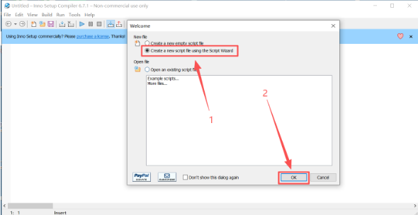
2. 点击next
   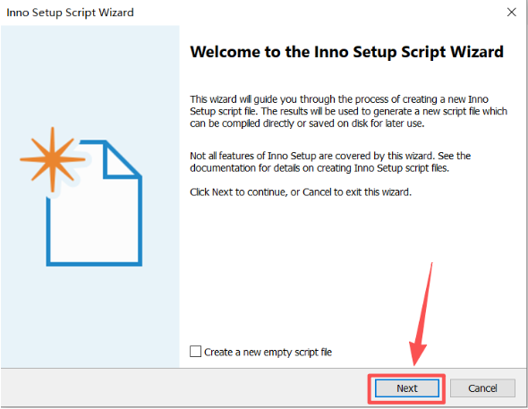
3. 填写应用程序的基础信息，分别是
   - Application name：应用名称（必填）： Zetla
   - Application Version：应用版本号（必填）： 0.0.1
   - Application publisher：应用发布者，可以填公司或组织名称（选填）： max
   - Application website：应用网址，可以填应用首页/下载页或者公司网址（选填）:
然后点击 next
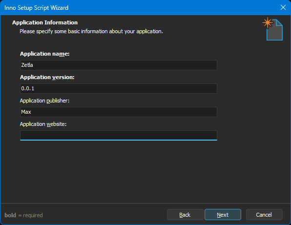

4. 这一步设置安装目录
   - Application destination base folder：默认安装目录为Program Files
   - Application folder name：应用文件夹名称，默认和之前的应用名称一样，不管名称中文英文，文件夹名称都推荐改成英文，避免一些兼容性的异常错误
   - Allow user to change the application folder：允许用户修改安装目录，默认允许
   - The application doesn’t need a folder：这个应用不需要文件夹，意思就是单文件应用，选了这个以后上面的设置就都失效了，一般别选
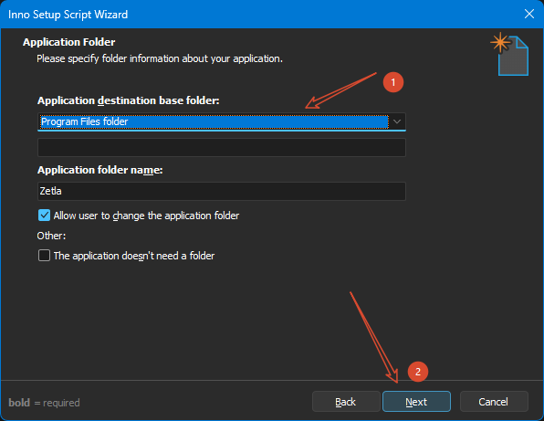

5. 接下来配置打包文件
   - Application main executable file：主exe文件，我们的应用入口，也就是之前在vs中生成的debug或者release下面的exe，正式肯定是使用release下面的
   - Allow user to start the application after Setup has finished：就是安装完后的那个启动程序选项
   - The application doesn’t have a main executable file：该应用没有主执行文件，一般用不到
   - Other application fles：一般来说我们生成后release里面还会生成一些配置文件或者dll（使用costura.fody可打包为一个exe），如果应用大一些还会有各种素材、配置、数据等文件，这些不会放到主exe里面，但是也需要打包
     - Add file(s)：添加单个文件
     - Add folder：添加文件夹
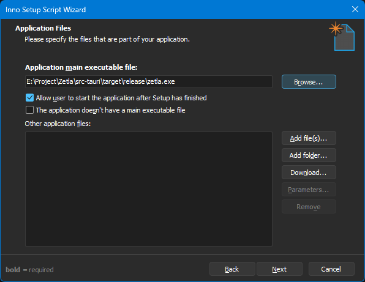

6. 设置关联文件，一般都没有，取消即可，下面两个空分别是文件类型名称和后缀名称
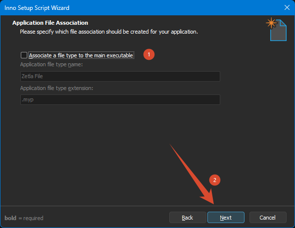

7. 这里分别是设置开始菜单快捷方式和桌面快捷方式。开始菜单快捷方式默认是创建一个应用程序名称的文件夹，取消勾选后可以详细设置。

   - Allow user to change the Start Menu folder name：允许用户改变开始菜单文件夹名
   - Allow user to disable Start Menu folder creation：允许用户不创建开始菜单快捷方式
   - Create an Internet shortcut in the Start Menu folder：创建一个网页快捷方式在文件夹
   - Create an Uninstall shortcut in the Start Menu folder：创建卸载程序的快捷方式在文件夹

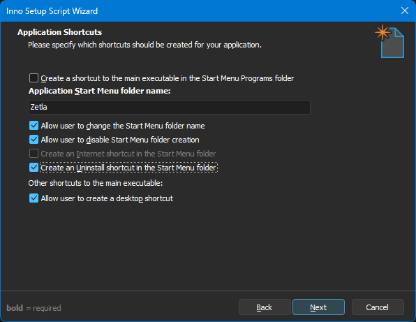

8. 设置应用文档，暂且用不上

   - License file：许可证文件
   - Information file shown before installation：安装前显示的信息文件
   - Information file shown after installation：安装后显示的信息文件

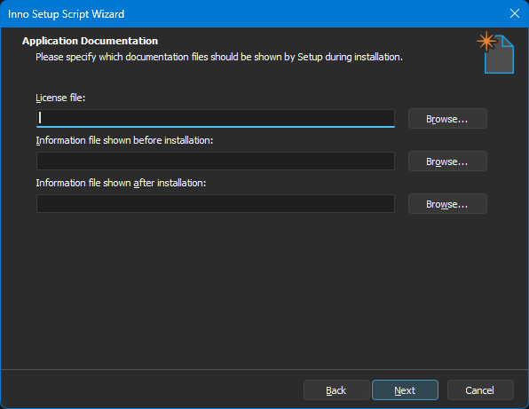

9. 设置安装模式，默认为管理员安装

Administrative install mode (install for all users)：管理安装模式（为所有用户安装）
Non administrative install mode (install for current user only)：非管理安装模式（仅限当前用户安装）
Allow user to override the install mode via the command line：允许用户通过命令行覆盖安装模式
Ask the user to choose the install mode at startup：在启动时询问用户选择安装模式

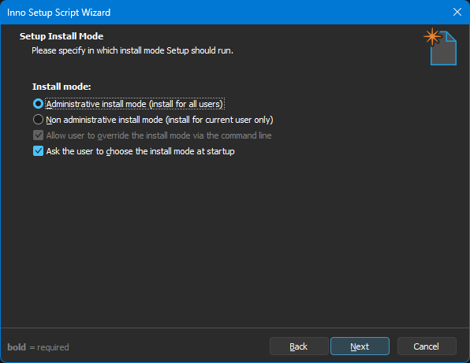

10. 配置注册表，通过导入reg配置文件的方式，由于注册表可以在应用中设置，感觉这里没必要

下面的卸载时的设置可以根据需要调整，也可以在应用内处理

Delete keys which are empty on uninstall：卸载时删除空密钥
Also delete keys which are not empty：同时删除非空密钥
Delete values on uninstall：卸载时删除值
Create only if Windows’ version is at least：仅当Windows版本至少为时创建
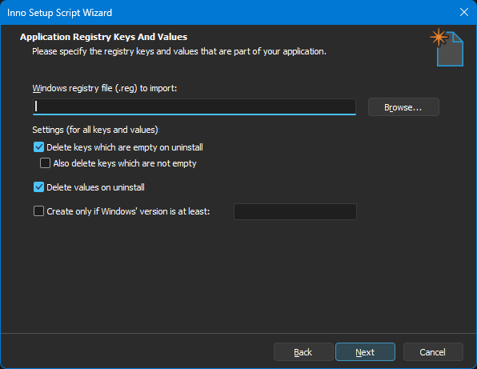

11. 设置安装引导语言，由于我们之前添加了中文语言包，这里把它勾上，next

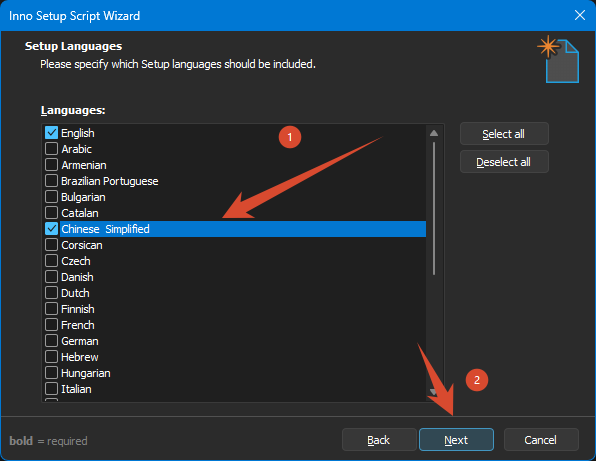


12. 终于到编译设置了

Custom compiler output folder：编译输出路径，推荐设置一个专门的输出路径，方便查看
Compiler output base file name：编译后安装包的文件名称
Custom Setup icon file：编译后安装包的图标，选择之前vs中使用的
Setup password：设置密码，没见过安装软件需要密码的

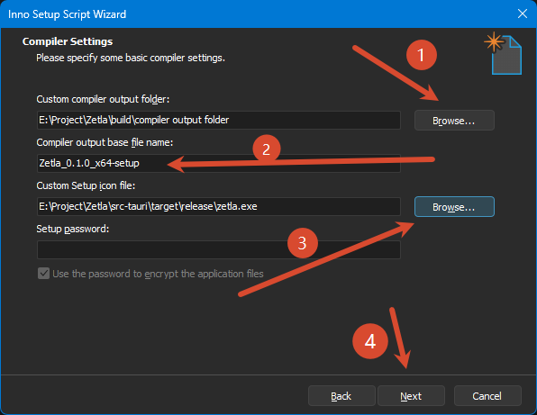


13. 设置安装引导界面风格，切换了一下除了黑色模式其他都差别不大， 默认吧
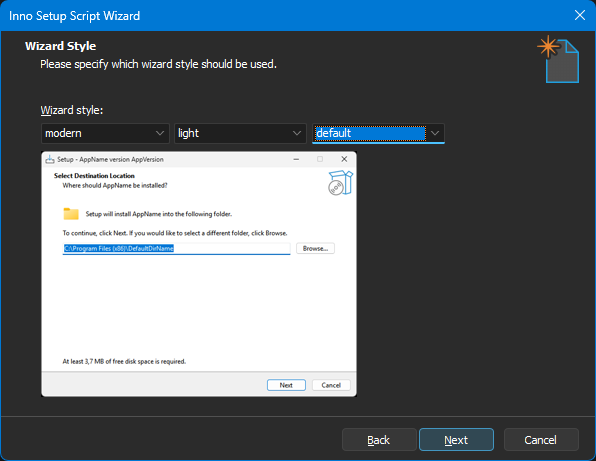

14. 默认使用#define compler指令来简化脚本，这样以后手动更改脚本容易些

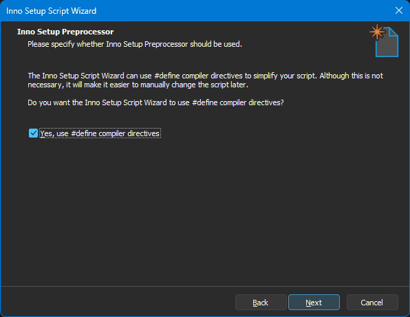

15. Finish~ over~
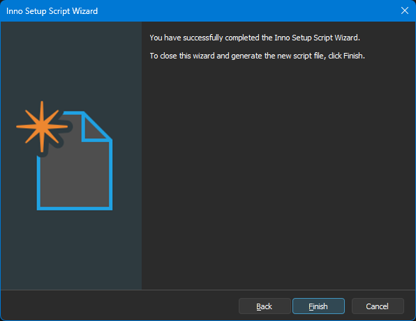

16. 完成后可以看到脚本代码已经生成了，提示我们可以现在编译，点击是
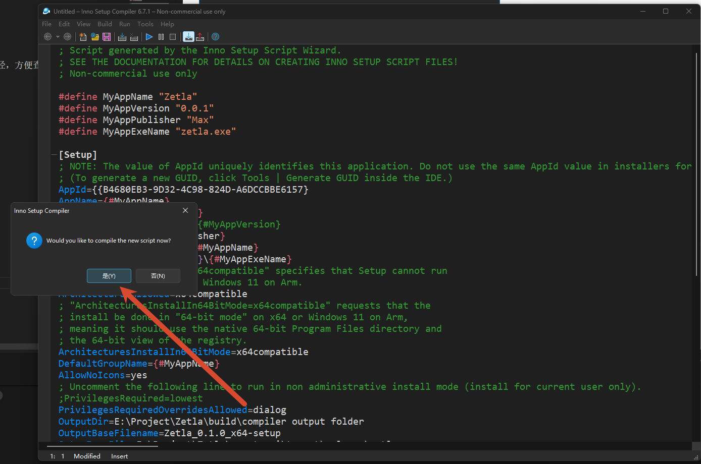

17. 编译之前提示我们保存脚本，保存到之前设置的输出路径里面

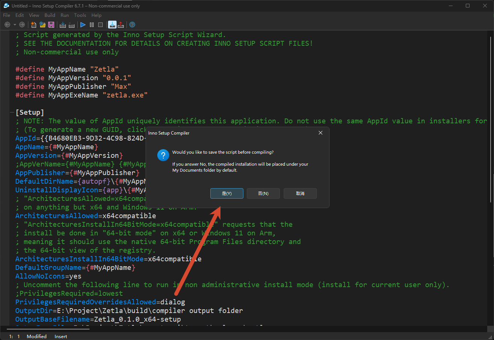
18. 编译成功


19. 输出文件夹如下
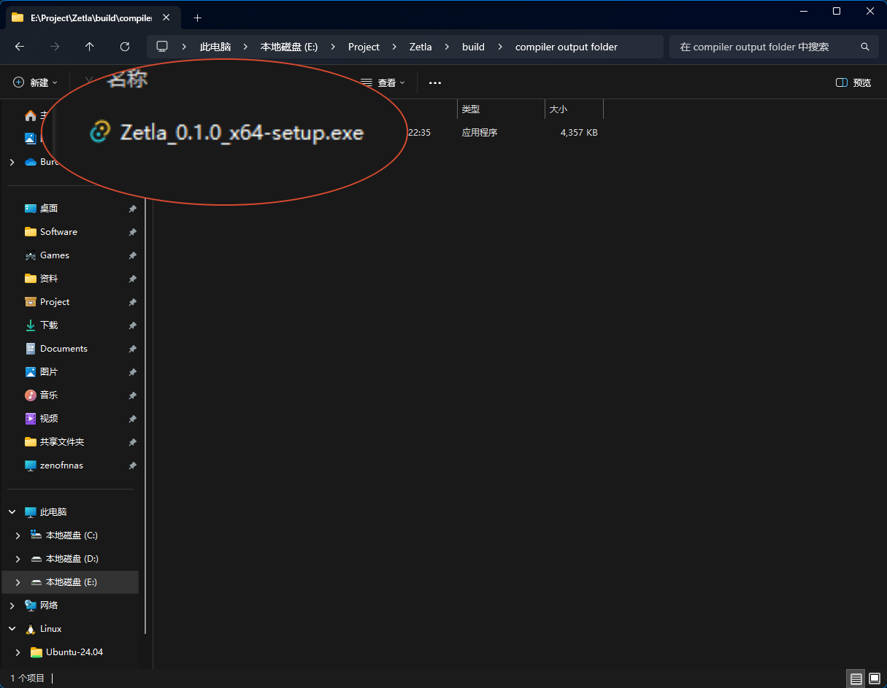


## 打包文件

打包文件在 `build` 文件夹下，打包文件名为 `Zetla.exe`
