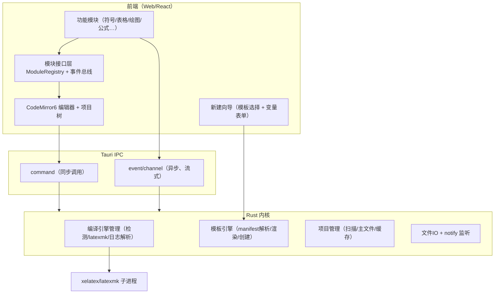
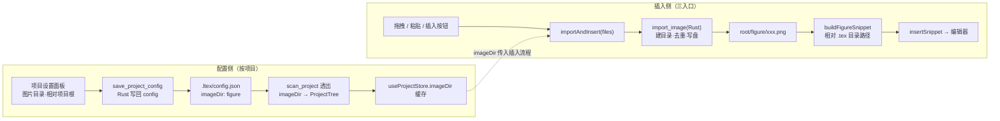

# LaTeX 工作台 · 开发文档（Tauri 版）

> 文档状态：技术方案 · 研发可执行 · v 0.4
> 读者：AI 辅助的个人开发者（自己 / 身边协作）
> 对应 PRD：v1.0（模块化本地 LaTeX 效率工具）
> MVP 基准：`docs/MVP.md` —— **M0 = MVP 完整闭环，只保留核心链路**
> 目标平台：**Windows 优先** · Linux/WSL 次之 · macOS 延后
---

## 0. 决策摘要

| 决策点 | 结论 | 理由 |
|---|---|---|
| 产品形态 | 独立桌面 App（非 VS Code 插件） | 用户明确要求 |
| 外壳框架 | **Tauri 2.x** | Rust 后端 + Web UI，避开 Electron 重壳 |
| 前端框架 | React + Vite + TypeScript | AI 出码最稳、可视化生态最强 |
| 编辑器组件 | **CodeMirror 6**（备选 Monaco） | 轻量、模块化哲学与本产品一致、易嵌自定义模块 |
| 绘图画布 | **fabric.js** | 对 WebKit 兼容较好，拖拽/连线/缩放成熟 |
| 内核语言 | Rust（Tauri 后端即内核） | 进程/IO/文件监听强，适合编译引擎管理 |
| 前端状态 | zustand + 自建事件总线 | 轻量、模块间解耦 |
| 项目结构 | **模板清单（manifest）驱动，不硬编码** | 任意类型项目（论文/简历/幻灯片…）都靠模板声明生成 |
| MVP 策略 | **M0 = MVP 完整闭环，只保留核心链路** | 尽快可自测可用，非必要功能一律后置（见 §0.1 与 `docs/MVP.md`） |
| 渲染一致性 | 接受 Tauri 跨端差异，风险集中在 Linux | Windows 用 WebView2（Chromium），主战场最稳 |

**关键取舍**：Tauri 用系统 WebView，不捆绑引擎 → Windows(Chromium)/macOS(Safari)/Linux(WebKitGTK) 渲染存在差异。主目标 Windows 是 Chromium，风险最低；Linux 端 WebKitGTK 最老，是差异集中区，开发时每轮在 Linux 顺带验证。

### 0.1 MVP 范围边界（M0 = MVP）

**M0 即交付 MVP**：完成「**打开项目 → 新建 TeX 文档 → 编写代码 → 一键 XeLaTeX 编译 → 查看 PDF 预览**」完整闭环；只保留核心链路，砍掉所有非必要功能，保证第一版可自测可用（依据 `docs/MVP.md`）。

| 范围 | 内容 |
|---|---|
| ✅ 必须实现（M0 全量交付） | 项目树、多标签编辑器、一键编译 + 日志报错跳转、PDF 预览、三栏布局 + 底部日志面板、基础 IPC 文件读写与子进程管理、2 套内置单文件模板新建文档、记住上次打开项目、窗口尺寸记忆、GBK 编码兼容、30 秒自动保存 |
| ❌ 一律后置（M0 不做） | 自定义模板导入/另存为模板、Synctex 双向跳转（M1-4 已接）、暗色主题（M1-2 已接）、图片管理、绘图、**设置页扩展（模块开关 M1-1 已接、多引擎/编译流程 M1-3 已接、密度取消、多语言仍后置）**、自动更新、aux 一键清理、公式面板、表格编辑器、代码格式化、拼写检查、多编译引擎切换、多语言 |

---

## 1. 技术栈总览

| 层 | 技术 | 用途 | 选型理由 |
|---|---|---|---|
| 内核 | Rust + Tauri 2 | 编译引擎、项目、模板、文件 IO、事件 | 进程/IO 强，天然做内核 |
| 通信 | Tauri IPC（command/event/channel） | 前端 ↔ 内核 | 框架自带，无需额外 sidecar 进程 |
| UI 壳 | React + Vite + TS | 主界面、侧边栏、状态栏、新建向导 | AI 出码可靠、生态大 |
| 编辑器 | CodeMirror 6 | LaTeX 源码编辑 | 模块化、轻量、可深度定制 |
| 画布 | fabric.js | TikZ 可视化绘图模块 | WebKit 兼容好、图元/拖拽成熟 |
| 状态 | zustand + 事件总线 | 模块间解耦通信 | 轻量 |
| 表格 | 自研网格组件（或 AG-Grid 备选） | 可视化表格编辑 | P0 自研足够，避免重依赖 |
| PDF 预览 | **PDF.js**（`pdfjs-dist` / `@react-pdf-viewer`） | webview 内嵌 PDF 渲染 + synctex | 跨平台 Canvas 渲染，可自定义点击/高亮 |
| 模板渲染 | P0 自研轻量占位替换；进阶可上 handlebars（自定义分隔符） | 模板文件变量替换 | 避开 LaTeX 大括号冲突 |

**依赖清单**

- Rust：`tauri`、`serde/serde_json`、`tokio`、`walkdir`、`notify`（文件监听）、`regex`（日志解析）、`dirs`、`tracing`、`reqwest`（安装包下载）、`zip`（install-tl.zip 解压）、`flate2`（M1-4 解压 `.synctex.gz`，miniz_oxide 纯 Rust 后端）；synctex 同步为**自研解析器**（`commands/synctex.rs`，不依赖外部 synctex 二进制，格式按 TeX Live 实测产物定稿）；模板条件 `condition` 见 M2-3（引 handlebars）
- 前端：`@tauri-apps/api`、`@tauri-apps/plugin-dialog`、`react`、`vite`、`typescript`、`@uiw/react-codemirror`、`fabric`、`zustand`、`pdfjs-dist`（或 `@react-pdf-viewer/core`）
- 打包：Windows = **Inno Setup 6**（正式包，`src-tauri/windows/inno/zetla.iss`；NSIS 配置保留备用），Linux=deb/AppImage

---

## 2. 总体架构

PRD 三层与本实现三层一一对应：

```
┌──────────────────────────── 前端（Web UI + 模块层）────────────────────────────┐
│  功能模块层：符号 │ 表格 │ 图片 │ 绘图(fabric) │ 模板 │ 公式 │ 预览 │ 引用 │ AI   │
│  模块接口层：ModuleRegistry（注册/钩子/依赖）+ 事件总线(TS)                     │
│  编辑壳：CodeMirror6 + 项目树 + 新建向导 + 状态栏                               │
├──────────────────────────── Tauri IPC（command/event/channel）────────────────┤
│                          Rust 内核（稳定，少改）                                │
│   编译引擎管理 · 模板引擎 · 项目管理 · 文件IO/监听 · 事件总线(Rust)            │
└─────────────────────────────────────────────────────────────────────────────┘
```



### 进程边界说明（简化决策）

- **不需要独立 sidecar 进程**。Tauri 的 Rust 后端就是内核，与 Web 前端天然分进程（WebView 进程隔离），编译时再 spawn `xelatex/latexmk` 子进程。
- **通信两通道**：
  - `command`（同步/短任务）：读文件、扫描项目、列模板、创建项目、执行编译启动、写配置。
  - `event` / `channel`（异步/流式）：编译进度、日志增量、文件变更通知。

---

## 3. Rust 内核设计

内核只做五件稳定的事：文档模型、编译引擎管理、模板引擎、项目管理、事件分发。不做任何"业务功能"。

### 3.1 职责划分

| 模块 | 职责 | 关键点 |
|---|---|---|
| 文档模型 | 单文件编辑/持久化/结构解析（**详见 §3.4**） | 多文件标签、编码/原子写、外部变更、符号索引 |
| 编译引擎管理 | 发行版检测、引擎选择、多遍编译、日志解析、错误定位 | 核心价值，见 3.3 |
| 模板引擎 | 模板清单解析、变量校验、渲染、按结构生成项目 | 纯声明式，见 §5 |
| 项目管理 | 项目树扫描、多文件、主文件识别、缓存清理 | 主文件优先读 `.ltex/config.json`，回退启发式 |
| 文件 IO/监听 | 读写、notify 监听变化（**notify → M1，MVP 只做读写**） | 回发文件变更事件 |

### 3.2 通信接口清单（Tauri commands）

> 标注 `[MVP]` = M0 必须交付；`[后置]` = MVP 一律不做，按阶段后置。

```
# 环境/编译
detect_tex_distribution() -> TexDistInfo        [MVP] // 发行版、引擎、版本 + Perl 可用性（M0-3 落地；M0-15a 增强：受管目录→注册表 PATH→PATH 三级探测；M0-15b/c 追加 TeX Live 自带 Perl 检测）
                                                      // 未检测到时首弹引导面板并拦截编译（M0-15a）；完整自动安装 → M0-15b/c（用户指令提前，原 M1-1）
install_tex(distro, installDir, scheme) -> ()   [M0-15b/c] // 自动安装 TeX Live（profile 静默安装，basic / full 可选）；立即返回，进度/结果走 tex_install_* 事件；安装器非零退出先继续校验引擎
cancel_tex_install() -> ()                      [M0-15b/c] // 取消安装：杀安装器进程树 / 中断下载 / 回滚本次新建目录
adopt_tex_install(root) -> TexInstallResult     [M0-15b/c] // 接管已有 TeX Live（root / bin / bin\windows 均可）；校验引擎后写 config/台账/标记
compile_project(root, mainFile, engine, steps?) -> ()   [MVP] // 启动编译，立即返回；M0-9 已实现（引擎来自 .ltex/config.json；M1-3 起可为设置页显式值；steps 空=自动，非空=按序直跑的固定流程，如 ["latex","bibtex","latex","latex"]）
cancel_compile() -> ()                          [MVP] // 取消当前编译（kill 子进程，无残留）；全局单并发
parse_tex_log(logPath) -> Result<Vec<TexError>, String>  [MVP] // 日志→结构化错误（M0-11 已实现：编译时自动产出，此命令供复用）

# 模板（MVP 只交付最小子集，见 §5「MVP 收敛口径」；M0-7 已完成）
list_templates() -> Vec<TemplateMeta>           [MVP] // 仅扫描内置 2 套单文件模板（article/ctex-cn，随 bundle.resources 打包）
get_template(id) -> TemplateManifest            [MVP] // 取清单；id 白名单校验防穿越
create_project(templateId, vars, targetPath) -> ProjectInfo [MVP] // 渲染→写 main.tex→写 .ltex/config.json；主文件已存在报错不覆盖
list_user_templates / import_template / save_project_as_template [后置 M3] // 用户模板目录、导入、另存为模板

# 项目/文档
scan_project(path) -> ProjectTree               [MVP] // 树形结构 + 主文件识别（读 config，回退启发式）+ engine（M0-9）
read_file(path) -> FileDoc                      [MVP] // {content, encoding, eol}，自动解码（含 GBK）
write_file(path, content, options)              [MVP] // 原子写；options 可指定 encoding/eol
create_entry(path, kind) / remove_entry(path) / rename_entry(from, to)  [MVP] // 项目树右键：新建 .tex/文件夹、删除、重命名
copy_entry(from, to)                              [MVP] // 树复制粘贴：文件/目录递归复制（冲突报错不覆盖；剪切复用 rename_entry）
watch_project(root) / unwatch_project()         [MVP] // M0-9a：项目目录增减监听（500ms 防抖）→ project_changed → 资源树刷新
load_app_config() / save_app_config(config)     [MVP] // M0-14a 已落地：%APPDATA%\Zetla\config.json schema v1（见 §6.2-A）；M0-13 追加 window/session/layout
revert_file(path) -> FileDoc                    [M1-9 ✅] // 外部变更后放弃缓冲、重新读盘（配合 notify）；前端 useBuffers.revertBuffer 调用
get_symbol_index(path) -> SymbolIndex           [后置 M2-2] // 章节/label/ref/cite/graphics 索引（见 §3.4-C）
clean_aux(root, extensions) -> {removed,paths}  [M1-9 ✅] // 清理 aux/log 缓存（递归按后缀白名单删，不碰源/PDF；extensions 为空=内置默认清单，命中受保护后缀不删）

# PDF 预览（见 §7.1；M0 仅用 pdfPath 加载，M1-4 加 synctex 命令）
synctex_view(inputFile, line, col, pdf) -> SyncTexHit | null  [M1-4] // 正向：源码→PDF（pt，y 自页顶向下；pdf 仅用于定位同目录 .synctex(.gz)）
synctex_edit(pdf, page, x, y, root?) -> SyncTexHit | null     [M1-4] // 反向：PDF→源码（Ctrl+点击；命中路径不存在时按 root 重锚）

# 事件（Rust → 前端，经 event/channel）
compile_progress {stage, pct, current}          [MVP] // 实时日志行
compile_finished {status, errors, pdfPath?, passes, durationMs}  [MVP] // 编译结果 + 结构化错误（errors 于 M0-11 填充）
project_changed {root}                         [MVP] // 项目目录文件增减（notify 防抖）→ 资源树刷新（M0-9a）
file_changed {path, kind}                       [M1-9 ✅] // 来自 notify（文件被外部修改，提示重载；前端比对内存内容避免自身保存回显误报）
symbols_updated {path, index}                   [后置 M2-2] // 文档结构索引变更（防抖重算）
```

### 3.3 编译引擎管理（内核核心价值）

1. **发行版检测**：`PATH` 中探测 `xelatex`/`pdflatex`/`latexmk`。M0-15a 起增加搜索优先级：**`config.tex.engineBinDir`（Zetla 受管/手动指定）→ `config.tex.installDir` 常见 bin 布局 → 注册表用户/系统 PATH（winreg 只读，进程 PATH 未刷新时兜底）→ 进程 PATH**；同目录列表作为子进程 PATH 前置注入（latexmk/biber 等内部工具依赖）。
   - Windows 优先用 **TeX Live**：自带 Perl，一次装齐，无需后续下载宏包。
2. **多遍编译管线**（M0-9 已实现）：
   - 引擎取 `.ltex/config.json` 的 `engine`（`scan_project` 一并返回，缺省 `xelatex`）；**M1-3 起**：设置页「默认编译引擎」显式指定（xelatex/pdflatex/lualatex）时**全局覆盖**项目配置，`"auto"`（默认）仍跟随项目（口径：显式值 ?? 项目 config ?? xelatex，由前端 `effectiveEngine()` 计算后传入 `compile_project`）。
   - **输出目录 = `main.tex` 所在目录**（不传 `-output-directory`；`outputDir` 配置留 M1）。
   - 首选 `latexmk -xelatex|-pdf|-lualatex -synctex=1 -interaction=nonstopmode -file-line-error <mainFile>`（自动处理 bibliography/目录多遍）。
   - 兜底手写：`<engine> ×1 → biber（存在 .bcf）→ <engine> ×2`。
   - **M1-3 自定义编译流程**：设置页「编译流程」选预设或自定义步骤序列时**绕过 latexmk**（它自行判定遍数、无法指定），按序直跑：`latex` 步跑一次引擎，`bibtex`/`biber` 步跑参考文献工具（本机缺失则跳过该步骤并提示，不致命）；选「自动（latexmk）」（默认，steps 为空数组）行为与 M0-9 完全一致。`compile_project` 新增 `steps: Option<Vec<String>>`（None/空=自动；归一化与 Rust 配置同源：剔非法步骤、截断至 8 步）。
   - `tokio` spawn 子进程，`stdout/stderr` 合并逐行推 `compile_progress`；Windows 加 `CREATE_NO_WINDOW`。
   - 全局 `CompileState{busy, child, cancelled}` 保证单并发，`cancel_compile` 取走句柄 kill。
   - **编译前置（M0-9b ✅）**：前端 `startCompile()` 先 `saveAllBuffers()` 落盘脏缓冲；保存后仍脏（保存失败）则中止编译，避免编译磁盘上的旧内容。
   - **产物入树（M0-9a ✅）**：`notify` 递归监听项目根，500ms 防抖 → `project_changed {root}` → 资源树 `refresh(true)`（静默）；只认 `Create/Remove`，忽略 `.ltex`、隐藏项与原子写 `*.tmp`；编译期间丢弃事件，`compile_finished` 统一刷一次。
3. **日志解析**：`regex` 从 `.log` 提取 `{file, line, message}`，映射**大白话解释 + 修复建议**（见 §6 错误 schema）。
4. **错误定位**：编译完成把错误列表发前端，点击 → 跳 CodeMirror 对应行（R3）。
5. **缓存清理**：`clean_aux(root, extensions) -> {removed, paths}`（**[M1-9 ✅]**）递归遍历项目根，按后缀白名单删除 LaTeX 中间产物；`extensions` 为空回退内置默认清单（`.aux/.log/.bbl/.blg/.toc/.out/.lof/.lot/.idx/.ilg/.ind/.fls/.fdb_latexmk` 及 `.synctex.gz` 后缀）；**不触碰** `.tex` 源文件与 `.pdf` 产物（内置 `PROTECTED_SUFFIXES` 兜底，`.tex/.bib/.cls/.sty/.pdf` 等受保护后缀即便被加入自定义列表也绝不删除，防误删源/产物/资源）。返回删除数量与被删路径清单。菜单栏「构建 → 清理辅助文件」在打开项目时可用，调用后弹 toast 提示清掉几项（命令签名见 §3.2）。**M1-9d（2026-10-28）**：设置「编译设置 → 编译完成后清理辅助文件」开关（默认关，经 `BuildConfig.clean_aux_after_compile` 持久化），编译成功分支自动调用、删 >0 才写日志+toast+再刷树，失败/取消不清理；**M1-9e（2026-10-28）**：设置「自定义清理的辅助文件」chip 编辑器可增删后缀白名单（空=内置默认），菜单手动清理与编译后自动清理共用同一清单（见 §4.6）。

### 3.4 文档模型（编辑层 / 持久层 / 结构解析）

> **边界**：文档模型管**单个文件**的编辑、持久化与结构；多文件集合、主文件、编译归项目模型（§3.3 / §5）。

#### A. 编辑层（前端 CodeMirror 6，内存态）

| 功能 | 优先级 | 说明 |
|---|---|---|
| 多文件标签页（multi-buffer） | P0 | 论文多 chapter 必需，每个文件一个独立 `EditorState` |
| 打开/编辑/保存/另存为 | P0 | 基础读写 |
| 脏状态（未保存标记）+ 关闭前提示 | P0 | 防丢内容 |
| 撤销/重做 | P0 | CM6 自带 |
| 行号 / 自动缩进 / 括号匹配 / 自动配对 | P0 | `{ } $` 自动配对；`\begin/\end` 配对放 P1 |
| 查找/替换（含正则） | P0 | 先单文件，多文件搜索放 P2 |
| 代码折叠（章节/环境） | P1（→ M1） | 长文档导航；**MVP 暂不做**（`MVP.md` Phase 1-2） |
| 语法高亮（LaTeX grammar） | P0 | CM6 LaTeX 语言包 |
| 程序化跳转（定位到行） | P0 | 错误定位 R3、synctex 都依赖它 |
| 命令/引用补全（`\command`、`\ref/\cite`） | P1 | 依赖 C 层符号索引 |
| 大纲/章节树导航 | P1 | 侧栏点击跳章节 |
| 多光标/多选择 | P1 | CM6 自带，配快捷键 |
| 代码片段 snippets | P1 | `\begin{document}` 等 |
| 只读模式 | P1 | 查看生成文件 |
| synctex 双向跳转 | P1（M1-4） | 点 PDF 跳源码、点源码跳 PDF，见 §7.1 |

#### B. 持久层（Rust，文件态）

| 功能 | 优先级 | 说明 |
|---|---|---|
| 读/写/原子写 | P0 | 写临时文件再 rename，避免写一半损坏 |
| 编码检测与转换 | P0 | 中文老文档常是 GBK：读取时解码，保存默认 UTF-8（可配置） |
| 换行符保持（LF/CRLF） | P0 | Windows 老文件常见 CRLF，不破坏原格式 |
| 外部变更检测 | P1（→ M1） | notify 发现文件被外部改动 → 提示"重载/对比"，配合 `revert_file`；**MVP 不做** |
| 二进制资源处理 | P0 | 图片走复制/转换，不进文本编辑器 |
| 自动保存 | P0（MVP） | 30 秒轮询检测脏文件自动落盘（固定策略，无配置）；可配置化 → M3 |
| 崩溃恢复/备份 | P1 | `.ltex` 存未保存缓冲，异常退出可恢复 |
| 同一项目多窗口冲突 | P2 | 个人阶段简化，先不做 |

#### C. 结构解析（共享内核能力，给模块用）

对应 PRD 的"代码结构解析"，是被多个模块共用的内核能力，P0 先用正则/轻量扫描（**不写完整 LaTeX AST**，语法复杂、投入产出不划算；不够再升级）。

- 解析对象：**章节结构**（`\part/chapter/section...`）、**环境**（`\begin/\end`）、**`\label` / `\ref` / `\cite`**、**`\includegraphics`**、**数学环境**。
- 产出**符号索引**，供大纲、`\ref/\cite` 补全、引用/公式/图片模块、错误定位、synctex 复用。
- 更新时机：打开文件算一次；编辑时防抖（debounce）重算，经 `symbols_updated` 事件推送。

```ts
// 符号索引（types/ 与 Rust struct 对齐）
interface SymbolIndex {
  sections:     { level: number; title: string; line: number }[];
  labels:       { key: string; kind: string; line: number }[];   // \label
  refs:         { key: string; cmd: string; line: number }[];    // \ref \eqref
  cites:        { key: string; line: number }[];                 // \cite
  graphics:     { path: string; line: number }[];                // \includegraphics
  environments: { name: string; beginLine: number; endLine: number }[];
}
```

### 3.5 关键 Rust 依赖与骨架（示意）

```rust
// src-tauri/src/main.rs（示意）
fn main() {
    tauri::Builder::default()
        .invoke_handler(tauri::generate_handler![
            detect_tex_distribution, install_tex, cancel_tex_install, adopt_tex_install,
            compile_project, cancel_compile, parse_tex_log,
            list_templates, get_template, create_project,
            import_template, save_project_as_template,
            scan_project, read_file, write_file, clean_aux
        ])
        .run(tauri::generate_context!())
        .expect("tauri error");
}
```

> **MVP 注册子集（M0）**：只需注册 §3.2 标 `[MVP]` 的命令 + 文件操作 `create_entry/remove_entry/rename_entry` + 配置 `load_app_config/save_app_config` + 环境安装 `install_tex/cancel_tex_install/adopt_tex_install`（M0-15b/c）；`synctex_view/synctex_edit`（M1-4）、`get_symbol_index`（M2-2）、`clean_aux`/`revert_file`（M1-9）、`import_template`/`save_project_as_template`（M3）等随对应切片到达时再加入 `generate_handler![]`。

---

## 4. 前端设计（Web UI + 模块层）

### 4.1 三层落位

- **编辑壳（稳定）**：CodeMirror6 + 项目树侧栏 + **新建向导（模板选择 + 变量表单）** + 状态栏。不掺业务。
- **模块接口层（低频、谨慎）**：`ModuleRegistry` + 事件总线。定义模块生命周期。
- **功能模块层（高频新增）**：符号/表格/图片/绘图/模板/公式/预览/引用/AI。

### 4.2 模块接口层设计（决定扩展顺滑度）

```ts
// module-interface.ts（示意）
export interface LatexModule {
  id: string;                    // 唯一 id，如 "diagram"
  name: string;
  version: string;
  requires: string[];            // 依赖的内核能力，如 ["editor", "symbol"]
  deps?: string[];               // 依赖的其他模块 id
  hooks: ModuleHooks;            // 能力钩子
  component?: React.LazyExoticComponent; // 懒加载 UI
}

export interface ModuleHooks {
  onInsertSnippet?: (ctx) => void;   // 向编辑器插入代码
  onCompileDone?: (result) => void;  // 编译完成介入
  onFileChanged?: (ev) => void;
  onModuleEnabled?: (ctx) => void;
  onModuleDisabled?: (ctx) => void;
}
```

**接口设计原则（来自 PRD 5.3）**：
- 模块间不直接调用，一律走事件总线。
- 模块懒加载：`React.lazy` + 用到才 import。
- 模块可单独启停（设置里开关）。
- 接口向后兼容，内核升级不破坏模块。

```ts
// 注册示意
registry.register({
  id: "diagram", name: "绘图", version: "0.1",
  requires: ["editor", "symbol"],
  hooks: { onInsertSnippet: ({editor, sel}) => { /* 插入 TikZ 代码 */ } },
  component: lazy(() => import("@/modules/diagram/DiagramPanel")),
});
```

> **M1-1 落地口径（2026-10-23，as-built）**：按上文设计实现并已接线，与示意差异如下——
> - 类型落位 `src/types/module.ts`（随 `@/types` 出口）：`LatexModule` / `ModuleHooks` / `ModuleContext` / `ModuleEntryView`；新增 `slot` 字段声明 UI 挂载槽位（M1-1 仅接通 `"sidebar"`，后续按需扩展）；`ModuleContext.insertSnippet(code)` 经 `editor/activeView.ts` 命令桥替换选区插入，返回是否成功
> - 注册表 `src/core/moduleRegistry.ts`（全局单例 `moduleRegistry`）：`register`/`unregister`（同 id 热替换）；`enable`/`disable` 校验 `deps`（依赖未启用拒绝启用、被依赖拒绝停用）与 `requires`（内核能力 editor/compile/preview/project）；`setOverrides(map)` 接收设置页覆盖值（sameMap 空转）；`dispatch` 按注册序派发且异常隔离；`listSlot(slot)` 供 UI 查询
> - **M1-8 协议扩展（2026-10-26 已实现，向后兼容）**：`LatexModule` 增可选 `view?: ModuleViewDecl`（`{ id, icon, label, hint?, order? }`），让模块**自带侧栏视图**——`moduleRegistry.listViews()` 输出已启用且声明 `view` 的模块（先按 `view.order`、再按注册序），`viewModule(id)` 反查提供视图的模块；`modules/useModuleList.ts` 增 `useModuleViews()`（复用 `module:enabled/disabled` 总线订阅）；`ActivityBar` 在内置四项后追加模块视图图标，`Sidebar` 按 `view.id` 渲染该模块 `component`（`Suspense` 懒加载），模块停用则图标消失、当前视图回退 `explorer`（`Sidebar` 内 `useEffect` 判定，未知视图同时给空态 + 「去设置启用」）；`core/store.ts` 的 `SidebarView` 放宽为 `BuiltinSidebarView | (string & {})`，`BUILTIN_SIDEBAR_VIEWS` 常量保留内置四项校验；`MenuBar`「视图」菜单动态追加模块视图项，chord `Ctrl+B 5/6/7…` 按 `listViews()` 顺序直达。首个使用者为 M1-8 表格模块（`id/view: "table"`，`Ctrl+B 5`）；「公式」视图（M1-12a）可后续迁入同一机制，不在 M1-8 范围
> - 持久化：`AppSettings.modules` ↔ `AppConfig.modules`（camelCase `Record<string, boolean>` / `BTreeMap<String, bool>`；空 = 各模块 `defaultEnabled`；未知 id 不清洗）
> - 设置开关：偏好设置新增「模块」页签，开关**反映注册表真实态**、即时启停（保存落盘 / 取消回滚均同步）；依赖或能力不满足置灰 + tooltip
> - UI 挂载：`src/modules/ModuleDock.tsx`（通用坞，lazy + Suspense；M1-6b 起**当前未挂载**，侧栏第三视图改为符号面板专用入口，坞保留给后续 slot 模块）；DEV 演示模块 `src/modules/demo/` 已于 M1-6b **移除**（用户指令「去掉示例模块（开发自检）」），设置页只保留真实业务模块
> - 运行时：`src/core/useModuleRuntime.ts`（App 根部挂一次）；总线事件表见 §4.3（`module:enabled` / `module:disabled` 已启用）
> - 排障（2026-10-23 实例）：`tauri dev` 运行中改 `src/` 后页面无响应时先 Ctrl+R；若 Vite watcher 漏收改动（普通 URL 仍服务旧转换），`touch src/main.tsx` 可触发 full-reload 强制客户端重载。**M1-6b 起 demo 已移除**，`模块` 页签现含「符号面板」「公式」两项业务模块（DEV/release 一致）

### 4.3 事件总线

- **前端总线**：zustand store + 轻量 pub/sub，模块间解耦通信（`bus.emit/on`）。
- **跨进程**：Rust 事件映射到前端 `listen()`（@tauri-apps/api/event）。
- 统一事件命名：`compile:progress`、`compile:done`、`file:changed`、`module:enabled`、`project:created`…

### 4.4 顶部菜单栏（**M0-13 前移** · `src/ui/MenuBar.tsx`）

> 用户提需求提前交付：自绘 32px 单行菜单栏，**保留系统原生标题栏**（自绘 titlebar + 窗口按钮仍留 M0-13）。对齐 `docs/UI/code.html` `.menubar/.drop/.mi`。

- **7 菜单**：文件 / 编辑 / 构建 / 视图 / 模板 / 设置 / 帮助。**只接通已有能力**，其余 `.mi.off` 置灰 + `title` 标注接通切片——不做假入口（构建 M0-9/11、日志 M0-11、查找替换/缩放 M1、明暗主题 M1-2）。**M0-10 已解除「构建→编译并查看 PDF」与「视图→显示/隐藏 PDF 预览」置灰；M0-14a 已解除「设置→偏好设置」并绑定 Ctrl+,；M1-2 已解除「视图→切换到暗色/亮色主题」置灰**（见 §6.3）。
- **命令桥 `src/editor/activeView.ts`**：模块级持有当前 `EditorView`；方案 A 多实例常驻下由 `EditorWorkspace` 在激活标签变化时登记（`LaTeXEditorHandle.getView()` 新增）。菜单「撤销/重做/切换注释」经 `@codemirror/commands` 派发；复制/粘贴不接（编辑区内键盘已接管）。**M1-1 修正**：`getActiveView()` 改为**经句柄实时解析**（`editorHandle.getView()`），不再快照返回值——CM6 的 EditorView 由 `@uiw/react-codemirror` 在容器 ref → setContainer → 再渲染后的 layout effect 中创建，切标签那一刻句柄已就绪但 view 可能尚未创建，快照到 null 会永久失准（表现为模块 `insertSnippet` 报「无活动编辑器」、菜单撤销静默失效）
- **快捷键**：菜单项 `sc` 只显示**真实已绑定**的键——新增 Ctrl+W 关标签、Ctrl+Shift+S 全部保存、Ctrl+Shift+O 打开项目、Ctrl+Shift+N 新建项目；Ctrl+B→0 chord 切换资源树（单 Ctrl+B 留给 M0-9 编译）。编辑器内 Mod-s 由 CM 先行处理。
- **退出**：`dirtyCount()` > 0 时 `plugin-dialog` 原生确认 → `getCurrentWindow().close()`（capability 增 `core:window:allow-close`）。
- **共用动作下沉**：`useBuffers` 增 `saveAllBuffers()/dirtyCount()`，侧栏与菜单共用一份逻辑。
- **打开图片 / PDF（M1-7b，2026-10-26）**：文件菜单新增项，`openFileDialog` 过滤 `EXT_IMG + pdf` → `useBuffersStore.openFiles()`；图片/PDF 进**代码标签页查看器**（`EditorBuffer.kind` 分流），右侧 PDF 预览仅由编译触发；非 `text` 标签下编辑类菜单项置灰、「关闭标签」仍可用。
- **状态来源**：菜单可用性由 zustand 订阅驱动（`activePath` / `sidebarVisible` / 活动缓冲 `kind`），不自存业务状态。

### 4.5 侧栏资源管理器 + 全局状态栏（**M0-13 前移** · VSCode 风格）

> 用户提需求提前交付，对齐 `docs/UI/UI.html`（用户已更新的 mockup）。相比 M0-6 版本：**侧栏只保留文件树**，编辑器内部状态行整体并入全局状态栏。

**侧栏 `src/project/Sidebar.tsx` + `src/project/ProjectTree.tsx`**
- `.side-head` **只保留「资源管理器」标签**（无右侧内容、无项目名）。
- **根目录行**：根目录名与图标组移入树容器，作为所有树节点的**父行**（由 `ProjectTree` 渲染，随树滚动，`paddingLeft: 8` 与 depth 0 对齐；子节点从 depth 1 起）。
- **展开态复用 `openDirs`**：`openProject` 时种入 `new Set([root])` → 根行默认展开；点根行即 `toggleDir(root)`（收起/展开整棵树）。`refresh()` 保留 `openDirs`，展开态不丢。
- **图标组**（根行右侧，`opacity: 0` → 根行 `:hover` / `:focus-within` 时显）：`file-plus` 新建文件、`folder-plus` 新建文件夹（均 → `openEntryDialog`，**VSCode 语义**：空文件 / 空目录；模板向导仍走 文件/模板 菜单与树右键）、`refresh` 刷新、`collapse-all` 全部折叠。
- **新建文件不限 `.tex`（M0-6b）**：三处入口文案统一「新建文件」，`EntryDialog` 提供类型快选 chips（`.tex`/`.bib`/`.cls`/`.sty`/`.md`/`.txt`/无后缀，默认 `.tex`，模块级 `lastExt` 会话级记忆）+ 最终文件名预览；后缀规则：输入含后缀以输入为准，否则拼接所选类型；`createEntry(dir, kind, name, ext)` 统一以 Rust `kind="file"` 落盘（不再依赖其 `.tex` 自动补全），文本类（含无后缀）建完自动开标签，图片/PDF 只建不打开。
- **全部折叠语义**：只折叠根以下目录，**根行保持展开**（`collapseAll()` 置为 `new Set([root])`）；根行被手动收起时点击它先展开根行。按钮仅在「根行展开且没有其他目录可折叠」（`openDirs.has(root) && openDirs.size === 1`）时置灰。根行自身的 `toggleDir(root)` 仍可整棵收起，且再展开时保留子目录的展开态（同 VSCode）。
- **根行右键**复用「空白」菜单（新建/模板/粘贴/刷新），**不含**重命名/删除/剪切 —— 避免误操作项目根。
- **已移除**：`.side-title`「项目资源」标题、`.proj-name` 项目名卡片、`.side-foot` 项目概要面板（主入口/引擎/辅助工具/编译日志）、`.side-foot-act` 底部「保存全部」按钮（该能力保留在 菜单→全部保存 与 `Ctrl+Shift+S`）。

**状态栏 `src/ui/StatusBar.tsx`**
- 右侧新增两项：**光标位置**「行 L，列 C」（`.caret-info`）与 **语言标识**「LaTeX」。
- 光标数据不留在组件内：`useBuffers` 增 `cursor: CursorPos` + `setCursor()`，`EditorWorkspace` 的 `onCursorChange` 与激活切换时写入，状态栏订阅展示。这样切标签时立即回填该缓冲的光标，不依赖首次移动。
- **已移除**：`.editor-status` 编辑器内部状态行（行/列、空格 2、完整路径、脏点、编码/换行/语言/Tab宽、跳转行输入框）；mockup 中的「主题」按钮本就未实现。**M0-14a 已恢复最右侧「设置」按钮**（`openSettings()`，对齐 mockup；此前 M0-13 前移时因设置未实现而摘除）。
- 编码 / 换行保持只读展示（真实切换按钮 M1）。
- **M1-14j 语言标识不写死**：语言 chip 由 `<span>` 改为按钮，文案取自 `src/editor/langByExt.ts` 的 `LANG_META[...].label`（LaTeX / BibTeX / BibTeX 样式 / TeX 日志 / 纯文本）；来源链为 `useLangOverride.byPath[path] ?? langOf(path)`（手动指定优先，仅本次会话）。点击弹 `InsertCtxMenu`（复用 `.ctx/.mi` 样式与视口夹取）：五档语言 + 「恢复自动识别」，自动识别项标注「（自动识别）」、当前项 accent 高亮，手动指定时 chip 走 `.sbtn.on`。title 交代识别来源与扩展名（`LaTeX · 按扩展名自动识别 · .tex · 点击切换文档语言`），未收录扩展名提示「按纯文本渲染」。编辑器侧同源取值，切档即重建词法/配色/补全（`plain` 不挂语言 → basicSetup 默认高亮为 fallback，不染色）。
- **M0-9 接通**：左侧编译文案按钮 = 开始编译（运行中点击即取消，`disabled` 条件为「无主文件且未在编译」）；「日志」按钮开合底部日志面板（`.sbtn.on` 高亮）；**M1-3 起**引擎 chip 显示**生效引擎**（设置页显式值 ?? 项目 `.ltex/config.json`），点击打开 设置 → 编译设置 切换（此前置灰只读）。

**编译日志面板 `src/ui/LogPanel.tsx`（M0-9）**
- 位置（**M1-16 改为 VSCode 式停靠**）：`App.tsx` 右侧主列 `.main-col`（= `.main-row` 编辑区/预览 + 日志面板）的**底部**，**不横跨侧栏**——活动栏 + 侧栏保持整列高度，面板只占编辑器/预览下方那一块；`height: 0 ⇄ logHeight` 过渡，上边界 `5px` 拖拽把手（`.log-resizer`，视觉压在 `border-top` 上、命中区上下各放宽 3px）改高度（用户指令 2026-10-29）。
- 高度：`useAppStore.logHeight`（默认 212，钳制 120–560，且不超过「窗口高 − 180 编辑区 − 140 状态栏/菜单」），经 `settings.layout.logHeight` 防抖落盘、启动恢复；拖拽期间 `.logpanel.dragging` 关掉过渡避免跟手延迟，`body.row-resizing` 接管光标。
- 头部：`终端图标 + 编译日志 + 行数 + 清空 + 收起`；正文等宽 11px、自动贴底滚动，空态提示「点击 ▶ 或 Ctrl+B」。
- 数据：`useAppStore.compileLog`（上限 800 行，`appendLog/clearLog`）；编译开始自动打开面板、清空上一轮日志并切「全部」页（用户指令 2026-10-24）；**编译失败**时 `compile_finished` 桥接自动切「错误」页（M0-12），**成功/取消不动作**、留在「全部」。
- **M0-11 扩展点**：同一面板内加「错误 / 警告 / 全部」筛选与结构化错误列表，当前只渲染原始行。

**偏离 mockup 之处**：① 用户后续要求将「根目录名 + 图标组」从 `.side-head` 移入树容器作为父行（mockup 仍是头部一行式），以实现为准；② 原 `.editor-status` 的「跳转到行」输入框随之移除，M1 复原为状态栏点击跳转（M0-12 错误定位走 `openFiles` + `setActive`，不受影响）；③ `.kv` / `.side-actions .wide` / `.log-link` / `.side-foot-act` 相关样式已清理。

**活动栏 `src/project/ActivityBar.tsx`（M1-5a · 用户指令「资源管理器左侧加个侧边栏，可以切换显示」）**

- 位置：`.workspace` 第一个子元素，**常驻左侧**（固定 44px；侧栏折叠时仍在，用于切回），样式 `.activity` / `.activity-btn` / `.activity-gap`（`zetla.css`）。
- 视图：`useAppStore.sidebarView: "explorer" | "outline" | "math"`（**仅会话内记忆，不落盘**——Rust `LayoutConfig` 无此字段；M1-12a 起原 `"symbol"`/`"formula"` 两视图合并为 `"math"`）。
- 交互：点某图标 → `selectSidebarView(v)`：**同视图再点 = 折叠侧栏**，异视图 = 切换并展开；底部「折叠/展开侧栏」按钮（`panel-left` 图标）为纯显隐切换（`toggleSidebar`）。选中态 = 图标 `--accent` + `--accent-soft` 底色 + 活动栏左缘 2px 竖条。
- 图标：`folder` 资源管理器 / `menu` 大纲 / `formula` 公式（**M1-12a 起符号面板与公式合并为第三图标「公式」单视图**，内部含 快捷工具/公式模板/搭建 三页签；两者均不再进入模块坞列表）。
- 快捷键/菜单：`Ctrl+B 0` 显隐侧栏，`Ctrl+B 1` 资源管理器、`Ctrl+B 2` 大纲、`Ctrl+B 3` 公式（视图菜单同步「✓」标记，走 `setSidebarView` 不折叠；原 `Ctrl+B 4` 随合并释放）。
- 布局口径：`App.tsx` 常量 `ACTIVITY_W = 44`（须与 `.activity` 的 `width` 一致）参与 `avail` 计算与侧栏拖拽换算（`sidebarWidth = clientX − 44`，仍 170–560）。
- **模块视图沿革**：M1-5a 曾以 `ModuleDock fill` 作为第三视图（用户指令「把模块也放到侧边栏」）；M1-6b 按用户指令改为**符号面板专用入口**，M1-10 增设公式专用入口（第四视图）；**M1-12a 两者合并为「公式」单视图**（`MathView`，输入/输出双区，见下）。`ModuleDock` 保留但当前未挂载，`.mod-dock*` 样式随之保留。

**公式侧栏 `MathView`（`src/project/MathView.tsx`，M1-12a · 输入/输出双区）**：用户 2026-10-25 指令「重新设计符号和公式面板，改为一个侧栏」+ 参照 `docs/Formula.html` 双区结构落地。侧栏 `math` 视图 = 上下两区：
- **输入区域**（上，弹性占满）：区域头（标题 + 插入偏好齿轮 popover——行内 `$…$` / 编号 `equation` / 无编号 `equation*`，写 `settings.formula` 即时生效并落盘）→ 页签（**快捷工具** = symbol 模块 / **公式模板** = formula 模块公式库 / **搭建** = `FormulaBuilder` 独立懒加载）→ 面板挂载区（`.math-input-body`，懒加载组件经 `Suspense` 撑满）→ **编写区**（`MathCompose.tsx`：多行 textarea，聚焦蓝框 + 空态 LaTeX 水印；Ctrl+Enter 提交；光标变更经 `cursorSeq` 同步选区）。
- **输出区域**（下，固定基准高 246px）：区域头（标题 + 预览缩放 − 100% +，50–200%）→ KaTeX 实时预览（`FormulaKaTeX` + `display`；`\Box` 经 `mathTex.serializeSlotsText` 转 `\za…` 槽位命令、`injectSlots` 渲染为可点选方框，**点击方框 → 编写区光标定位到该 `\Box`**，MathType 式）→ 动作条（**插入编辑器**主按钮 / 复制 LaTeX；均走 `mathInsert.submitCompose`：按行内/编号包裹后 `insertSnippetWithSlots` 写入主编辑器光标，自动选中首个 `\Box`、Tab 跳下一槽）。
- **页签按模块启停生成**：symbol 停用 → 无「快捷工具」；formula 停用 → 无「公式模板/搭建」；双停用 → `.side-empty` 空态 + 「去设置启用」。模块注册在 App 根部 effect（晚于本组件挂载），`useMathModules` 补一拍重读防首帧误判（沿用 M1-6b 口径）。
- **M1-12b 增补**：输入区域在面板挂载区与编写区之间挂**二级工具栏**（`MathToolbar.tsx`：颜色 ▾ `\color{}` 声明插入 / 字体 ▾ \mathbb 等 7 种 / 字号 ▾ \tiny…\huge / 环境 ▾ equation/align/cases/matrix/pmatrix/bmatrix/vmatrix 共 8 种——后三者走 `composeStore.wrapSelection` 有选区包选区、无选区包 `\Box` 并选中；清空；**源码 | 可视化**两段开关；编写区字号缩放 11–20）。**可视化模式** = 编写区换为 KaTeX 只读渲染（`serializeSlotsText` 槽位协议，点空槽 → 切回源码并定位光标到该 `\Box`）。**搭建页签按定案不套双区**（工具栏/编写区/输出区隐藏，FormulaBuilder 占满输入区——其自含预览与插入按钮即输入+输出一体）。**Sidebar 经 `lazy(MathView)` 整体懒加载**：katex（编写区可视化 + 输出区预览）随 MathView chunk 首开公式侧栏时按需拉取，explorer/outline 视图不受影响；`submitCompose` 增加 `needsRawInsert` 判定——编写区含 display 级环境（align/gather/cases…，与 `needsDisplayMode` 同口径）时原样插入不套 $/equation（matrix 等 inline 环境仍可套）。
- **状态 `composeStore`（`src/modules/formula/composeStore.ts`，会话级 zustand 不落盘）**：`text/selStart/selEnd/cursorSeq/mode/fontSize/previewZoom/recent`；**M1-12b 起为选区模型**——`insert()` 替换当前选区后把光标落到片段尾（点击符号/模板）、`wrapSelection(prefix, suffix)` 有选区包选区/无选区包 `\Box` 并选中（工具栏字体/字号/环境用）、`pushRecent()` 跨页签共享最近使用（上限 12，M1-12c 起公式库「最近」页签消费）；`edit/setSelection/setCursor/clear` 均经 `cursorSeq` 同步 textarea 选区（IME 组词期间不碰选区）。
- ** bundle 口径**：输出区懒加载（`lazy(MathOutput)`）使 katex 维持在独立 chunk（≈260KB / gzip 78KB，首开公式侧栏按需拉取），主 bundle 不回归；`slotCmd` 从 `builderTypes` 抽为独立小模块（`slotCmd.ts`，builderTypes re-export 兼容），避免模板库经静态链进主 bundle。
- **M1-12a 边界**：本切片只立双区外壳 + 编写/提交链路；符号面板与公式库的「单击写入编写区 / 右键直插菜单」改写分别在 M1-12b / M1-12c（届时 `SymbolPanel` 重写、`FormulaPanel` 去收藏并改写入编写区）。

**大纲面板（`src/outline/`，M1-5 已实现待冒烟 · 纯前端）**：M1-5a 起侧栏为**视图容器**——`explorer` 视图 = `资源管理器 → ProjectTree`；`outline` 视图 = `OutlinePanel` 独占（面板自带标题行，容器 `.side-view` 去掉其 `border-top`）；`symbol` 视图 = 「符号面板」标签 + `SymbolPanel` 独占（`.side-view > .symbol-panel` 撑满剩余高度、网格内部滚动）。`src/outline/useOutline.ts` 从主文件出发**递归读 `\input`/`\include` 链**（visited 去重、`depth≤14`、`size≤200KB` 跳过），正则提取 `\part`…`\subparagraph` 章节标题 + 行号（`cleanTitle` 展平字体命令/去 `\label`/`\index`/`\footnote`/去转义/截断 140 字）；`runToken` 递增丢弃过期扫描结果。面板 `src/outline/OutlinePanel.tsx` 头部含标题 + 计数 + 刷新按钮（⟳），列表按 `depth` 缩进、标层级圆点（`LEVEL_DOT`），点击 → 复用 M0-12 `jumpToError` 打开/切标签并跳行选中；子文件章节标 `base(file)`。本面板**不依赖 `get_symbol_index`**（该命令仍属 M2-2），属 §3.4-A「大纲/章节树导航」的轻量前端实现。

**符号面板（`src/modules/symbol/`，M1-6 / M1-12b · 经 ModuleRegistry 注册）**：业务模块之一（M1-1 的 demo 自检模块已于 M1-6b 移除），用于**验证 registry 全通路**——`registerSymbolModule()` 在 `useModuleRuntime` 启动期（DEV+release 均）注册 `id:"symbol"`、`requires:["editor"]`、`defaultEnabled:true`、`slot:"sidebar"`、`component: lazy(SymbolPanel)`；设置页「模块」页签经 `useModuleList()` 读取注册表，开关即时经 `setOverrides` 启停；**M1-12a 起挂载于公式侧栏「快捷工具」页签**（`MathView` 的 `.math-input-body`，停用时该页签不生成）。**符号库 `symbols.json`**：191 条、**M1-12b 起重分类为 Formula.html 10 分类体系**（常用符号 128 / 希腊字母 39 / 大型运算 14 / 括号取整 10 + 8 个模板分类由 TPLS 提供；cmd 唯一），字段 `name/cmd/category/glyph`（`glyph` 为 Unicode 预览，缺省时面板显示 `cmd`）。**`symbolItems.ts`（M1-12b 新建）**：符号 + 模板统一为 `InsertItem`（key/kind/cat/name/glyph/latex/slots/note）共 **215 项**；模板项由 `TPLS` 生成（`latex = tpl.latex(slotLabels.map(() => SLOT_MARK))`，\Box 数 = 槽位数），提供 `itemsByCat/searchItems`（搜索命中 name/latex/note/cat，符号额外匹配字形）。**面板 `SymbolPanel.tsx`（M1-12b 重写）**：搜索框（回车写入首项）+ **10 分类大钮（2 行 × 5，图标 + 名称 + ▾；点击内嵌展开该类网格、再点收起出提示行；默认展开「常用符号」；搜索态隐藏分类条）** + 符号/模板混合网格（模板钮左侧 accent 细条区分，title 含 latex/槽位数/点击规则）。**交互（用户 2026-10-25 定稿）**：**单击 → 写入侧栏编写区**（`composeStore.insert` 替换选区 + `pushRecent` + 1.2s 回显）；**右键 → `InsertCtxMenu`**（`src/ui/InsertCtxMenu.tsx`，复用 `.ctx/.mi` + 视口夹取 + 栏外/Esc/失焦关闭）：直接插入到编辑器（主项 accent 高亮，`insertSnippetWithSlots`——模板 \Box 自动选首槽 + Tab 导航，即 M1-6 旧单击行为）/ 插入到编写区 / 复制 LaTeX。

**公式模块与图形化公式搭建器（`src/modules/formula/`，M1-10/M1-11 已实现待冒烟 · 经 ModuleRegistry 注册）**：`registerFormulaModule()` 注册 `id:"formula"`、`requires:["editor"]`、`defaultEnabled:true`、`slot:"sidebar"`、`component: lazy(FormulaPanel)`（幂等）；**M1-12a 起公式库挂载于公式侧栏「公式模板」页签、搭建器升为「搭建」页签**（`MathView` 内，停用时对应页签不生成；原第四视图 `Ctrl+B 4` 入口随合并释放）。公式库页签（`FormulaPanel.tsx`，M1-12c 收敛）：**全部 / 最近 / 自定义**（＋ 新建；`formulas.json` 81 条 9 分类；**收藏已移除**——`settings.formula.favorites` 字段保留兼容、UI 不暴露；自定义增删改落盘 `AppSettings.formula`，自定义按 id 覆盖内置的合并口径不变），插入按「行内公式 / 公式编号」偏好包裹（`$…$` / `equation` / `equation*`，`isEnv` 条目原样；偏好入口为侧栏头部齿轮 popover，M1-12a 起三页签共享，面板内不再自持开关）。**M1-12c 交互定稿落地**：**单击 → 写入侧栏编写区**（`composeStore.insert` + `pushRecent` + 回显）；**右键 → `InsertCtxMenu` 直插**（直接插入到编辑器——公式非 isEnv 按偏好包裹、isEnv/符号/模板原样 / 插入到编写区 / 复制 LaTeX）；**「最近」读 `composeStore.recent`**（符号/模板/公式写入跨页签共享；公式 id 命中库内定义时取最新 latex，自定义被编辑后不显陈旧；条目统一 `Row` 形状渲染 KaTeX 预览，搜索框对三个页签均生效）。**搭建器**（`FormulaBuilder.tsx` + `builderTypes.ts`，M1-12a 起为公式侧栏第三页签、独立懒加载 chunk）：单根槽嵌套树（`FSlot` 槽位 / `FText` 文本 / `FStruct` 结构实例；槽内 children 可多节点并列混排），**M1-12b 起 24 个结构模板**（原 21 + 偏导/不定积分/二重积分）分 4 组（结构 7 / 运算 10 / 括号 3 / 矩阵 4），模板声明 `slotLabels` + `latex(slots)` 生成函数（矩阵/cases 经 `grid()` 按行列拼 `&`/`\\`）与 `cat` 字段（符号面板 10 分类归属，与 group 正交）；点模板插入活动槽并自动深入新结构首槽，符号条（希腊字母 + 高频运算符白名单，数据源复用 `symbols.json`）与输入框回车填入活动槽并推进到下一空槽（文本同槽续写合并），树列表点击任意槽改选，清空槽/重建随时重置；更新走不可变整路径 clone。**垂直布局**（2026-10-25 用户指令「渲染太小…把公式预览就放在 fbuilder-tree 那里然后其他的部件排在下面」；**2026-10-25 反馈迭代「同一种类只保留一个，点击之后展开该类别下的公式结构…节省空间」再收敛**）：**类别钮（结构/运算/括号/矩阵 4 个，同类只留一个；点击展开该类结构、再点收起，收起态显示提示行）** → 展开类结构网格（单类 ≤8 项 = 2 行，限高 84px）→ **公式预览主区（flex:1，≥120px）** → 树列表（限高 92px 滚动）→ 符号条 → 操作行 → 插入。**渲染预览**（`FormulaKaTeX.tsx`）：`katex.renderToString` + `throwOnError:false`/`strict:false` 宽容渲染；`needsDisplayMode(tex)` 按内容对 display 类环境（align/gather/cases/multline/flalign/eqnarray/CD/split/alignedat）切 displayMode（矩阵系列 inline 可渲染不切）；katex 默认 `trust:false`，`\text{}` 内 HTML 转义（实测 `<script>` 安全），`dangerouslySetInnerHTML` 仅此组件使用；彻底失败或列表预览（`strict`）整段 katex-error 时回退源码 `<code>`。消费三处：搭建器预览主区（渲染 flex:1 居中 + 源码小字，空槽 `\Box` 渲染为空心方框）、公式库列表项（`strict`）、**M1-12a 起公式侧栏输出区域实时预览**（`display` + 槽位点选定位编写区光标）。**预览槽位点选**（MathType 式，2026-10-25 追加；**2026-10-25 反馈迭代修底行点击 + 选槽聚焦输入框**）：预览渲染区中的空心方框鼠标点击即选中对应槽（树列表同步高亮 + `scrollIntoView` 滚入可见；后续符号条/输入框/模板作用于该槽；**选中即 `inputRef.focus()`，点完槽直接键盘输入**，插模板深入首槽后同样聚焦）。**底行点击修复**：KaTeX 把多行结构（矩阵/cases）每列渲染为 `vlist-t2` 双行 inline-table，底行内容溢出首行单元格、被第二行那个空单元格（`.vlist` 带 `position:relative`、文档序在后 → 定位层树序绘制在上）盖住并吞掉鼠标事件（Edge headless 复现：`elementsFromPoint` 命中 `span.vlist`，CDP 真实点击 9 槽仅 6 中、底行全丢）；修法为 `.fx .zetla-slot` 加 `position:relative; z-index:1`（槽位提升到定位层之上，视觉零变化；矩阵/cases/frac/sqrt/二项式/求和等 10 类结构 CDP 实测全中）。协议两半：`builderTypes.serializeSlots(root)` → `{ tex, slotIds }`，空槽（DFS 序）→ `slotCmd(i)`（`\za`…`\zz`、`\zaa`… bijective base-26 **纯字母**——`\zs1` 形式会被 KaTeX 拆成 `\zs`+`1` 两个 token，数字后缀不可用）；`FormulaKaTeX.injectSlots(html, slotIds)` 对 renderToString 产物做**字符串后处理**——按出现序把 KaTeX 宽容渲染的未定义命令红字 span（`<span class="mord text[ mtight]" style="color:#cc0000;">` 双层，正则兼容可选 mtight）替换为 `.zetla-slot[data-slot]` 节点，effect 绑 click 与 `is-active` 高亮（`hostRef` + querySelectorAll 重绑）。选型理由：不用 `\htmlClass`（KaTeX 0.19 起 HTML 扩展宏默认不注册，实测输出红字原文），不用视觉坐标排序（KaTeX HTML 层按布局序生成——frac 分母先于分子，DOM 序 ≠ 语义序）——class/data-slot 精准定位无顺序依赖。插入编辑器仍走 `serialize()` 纯 `\Box` 协议。**槽位导航**（`src/editor/slotRange.ts` 协议纯函数 + `src/editor/mathSlots.ts` 编辑器侧）：空槽序列化为 `\Box`（LaTeX 内核命令，编译合法）；`insertSnippetWithSlots` 插入后自动选中第一个 `\Box`（直接打字即替换）；CM6 keymap `Tab` 在当前选区恰为 `\Box` 时选中下一个（文档内循环，仅剩当前槽则不拦截交还默认缩进）；**鼠标左键无修饰键点击视口 `\Box` 装饰内即选中**（MathType 式点选，`cursor:pointer`；Shift/Ctrl/Alt 放行，不破坏扩展选区与 Ctrl+点击 synctex）；ViewPlugin 给视口内 `\Box` 加 `cm-math-slot` 装饰；**无持久状态**，每次交互从选区与文档实时推算，抗编辑漂移。公式库插入亦走 `insertSnippetWithSlots`（自定义公式含 `\Box` 时同样可 Tab 导航）。搭建树不落盘（会话内有效）。纯前端改动（新增 `katex` 依赖，js/css/fonts 随 FormulaPanel 懒加载 chunk）；序列化/更新/推进/槽位命中/display 判定/`slotCmd` 唯一性/`injectSlots` 替换顺序与越界退化均经 node 断言；**底行点击修复与类别收起经 Edge headless + CDP 真实鼠标事件端到端验证（前后对比 6/9 vs 9/9）**。


```
LaTeX工作台/
├─ src/                          # Web 前端
│  ├─ main.tsx / App.tsx
│  ├─ editor/                   # CodeMirror6 封装、LaTeX 高亮配置
│  ├─ core/                     # 编辑壳：项目树、新建向导、状态栏、事件总线、registry
│  ├─ compile/                  # M0-9：编译事件桥（useCompile）+ startCompile/cancelCompile
│  ├─ modules/
│  │  ├─ symbol/                # 符号面板（P0）
│  │  ├─ table/                 # 可视化表格（P0）
│  │  ├─ image/                 # 拖拽图片（P0）
│  │  ├─ diagram/               # 绘图组件（M2，fabric）
│  │  ├─ template/ formula/ preview/ bib/ ai/ ...
│  ├─ ipc/                      # invoke/event 封装（类型安全）
│  └─ types/                    # 协议类型（与 Rust 对齐）
├─ src-tauri/
│  ├─ src/
│  │  └─ commands/              # 按域分文件：core/compile/fsdoc/project/template.rs
│  │                            #   template.rs = 模板引擎（manifest 解析/渲染/创建）
│  ├─ templates/                # 内置模板包（bundle.resources 打包随 App 发布；M0-7 已落 2 套）
│  ├─ capabilities/             # 权限配置（fs/shell/dialog）
│  ├─ tauri.conf.json
│  └─ Cargo.toml
└─ package.json
```

> **目录说明**：`docs/MVP.md` Phase 0 建议的 `src/{types, ipc, store, components}` 已在 M0-1 落位为现有结构——`src/types/`（协议类型）、`src/ipc/`（invoke/listen 封装）、`src/core/`（zustand store + 事件总线 + 编辑壳组件）、`src/editor/`（CM6 封装）、`src/modules/`（功能模块，MVP 仅占位）。**保持现有结构，不再改名**。

---

### 4.6 编辑器增强（小地图 / 窗口最小尺寸 / 正式版禁用原生右键菜单）

- **编辑器缩略图（小地图，🔧 已实现待冒烟）**：引入 `@replit/codemirror-minimap`（CM6 低层 Facet `showMinimap.of(config|null)`，传 null 即关）；`LaTeXEditor.tsx` 在 `editor.minimap` 为真时挂载，`minimapOn` 依赖驱动、按亮/暗主题自动跟随（读取 `.cm-content` 的 computed style 取色/字体）；缩略图按语法 token 着色（同编辑器）。宽度无官方配置项，经 patch-package 改包内 `Scale.MaxWidth=120→100`（生成 `patches/@replit+codemirror-minimap+0.5.2.patch` + `package.json` 的 `postinstall` 自动 re-apply，幂等），并导出 `Scale` 供本项目以 `LaTeXEditor.tsx` 顶部 `MINIMAP_MAX_WIDTH = 100` 常量统一收口（改此即调）。设置页「编辑器 → 显示小地图」开关绑定 `editor.minimap`（默认 true）；仅文本型缓冲显示（图片/PDF 走各自查看器）。
- **窗口最小尺寸（🔧 已实现待冒烟）**：`tauri.conf.json` 窗口项 `minWidth: 1024` / `minHeight: 640`（逻辑像素，由窗口管理器约束；初始 1280×720）。`useWindowMemory.ts` 导出 `MIN_WINDOW_SIZE`，恢复几何时以 `Math.max` 钳制，防止历史会话记忆里存着更小尺寸导致窗口被拉到下限以下。
- **正式版禁用原生右键菜单（🔧 已实现待冒烟）**：`src/main.tsx` 顶部 `if (import.meta.env.PROD)` 守卫，捕获阶段 `document.addEventListener("contextmenu", e => e.preventDefault(), true)` —— 仅生产构建生效，dev 保留原生菜单便于调试；自绘菜单（`CtxMenu`/`ProjectTree`/`InsertCtxMenu` 自身已 `preventDefault`/`stopPropagation`）不受影响。PDF 预览若走独立 webview/iframe 需另行处理（当前未涉及）。

## 5. 模板系统（项目结构解耦）

> 目标：项目结构**不硬编码**，由模板清单（manifest）声明；新建项目时按清单生成文件/目录。纯声明式，加模板不改内核。

### 5.0 MVP 收敛口径（M0 只做最小子集）

MVP 的模板诉求只有一条：**「新建 TeX 文档 → 自动生成可编译的 main.tex → 打开到编辑器 → 标记为项目主编译文件」**。因此 M0 对模板系统做如下收敛（设计方向不变，实现取子集，保证向前兼容）：

1. **只内置 2 套单文件模板**：`article`（单文件英文文档）、`ctex-cn`（中文 LaTeX 文档），放 `src-tauri/templates/`，随包发布。
2. **向导极简（M0 收敛）**：新建文档 → 选择模板 → 生成 `main.tex` → 自动打开并写入 `.ltex/config.json` 的 `mainFile`。**MVP 只做标题/作者可选填**；**复杂变量表单（M1-9 ✅）**：`TemplateWizard.tsx` 按 `variables[].type` 全类型动态渲染（`text`→多行、`string/number`→单行输入、`select`→下拉、`bool`→勾选、`date`→日期、分组 `group` 折叠、必填 `required` 校验、`default` 初始化），`create_project(id, values, target)` 透传 `Record<string,unknown>`。
3. **schema 只解析子集**：`schemaVersion / id / name / build / structure.files[]`，未知键一律忽略（§5.2 原则 3 不变），后续扩到完整 schema 无需迁移旧模板。
4. **明确后置**：用户模板目录扫描、自定义模板导入、"另存为模板"、模板市场（→ M3）。（**M1-9 ✅** 已交付：多文件模板 thesis-cn/beamer-cn/resume-cn + 模板内 `<% if %>`/`<% else %>`/`<% endif %>` 条件块渲染；文件级 `condition` 字段仍留 **M2-3**。）

> 内核"项目结构由 manifest 驱动、不硬编码"的原则**不变**，MVP 只是先把模板库收敛到 2 套单文件模板。
>
> **✅ M0-7 落地**：实现于 `src-tauri/src/commands/template.rs`（清单全解析、未知键忽略）。打包 = `tauri.conf.json` `bundle.resources: ["templates"]`（**目录形式**；`templates/**` 尾缀 glob 会触发 tauri-build「未匹配任何文件」错误）+ dev 兜底（CWD/`src-tauri/templates`）。渲染细节：未提供变量回退 manifest 默认值再回退空串；未闭合的 `<%=` 原样保留；`guard_id`（id 白名单）+ `safe_join`（拒空/绝对/`..`）防穿越；目标已存在主文件 → 报错不覆盖。
>
> **✅ M1-9 落地**：内置模板由 2 套扩至 **5 套**（新增 `thesis-cn`/`beamer-cn`/`resume-cn` 三套多文件/条件模板）；渲染器新增 `<% if KEY %>…<% else %>…<% endif %>` 可嵌套条件块（见 §5.4）；前端 `TemplateWizard.tsx` 全类型动态变量表单（见 §5.6）；`file_changed` 外部改动重载（见 §3.2 事件）与 `clean_aux` 缓存清理（见 §3.3-5）同期交付。

### 5.1 设计原则

1. **manifest 是项目结构的唯一真相源**。内核不假设任何项目类型（论文/简历/幻灯片/报告/书籍都行）。
2. **领域相关字段全部进 `variables`**（学位、学校、期刊名、岗位…），schema 顶层不出现任何领域专有字段。
3. **未知键一律忽略** → 模板可加自定义元数据，向前兼容，内核升级不破坏旧模板。
4. **三类模板来源**：内置模板（随包发布）、用户模板（用户目录）、"把当前项目另存为模板"（主要自定义入口）。
5. **最小模板内核前移到 M0**（否则无法新建项目；MVP 按 §5.0 收敛为 2 套单文件模板）；丰富模板库放 M1-9、模板市场放 M3。

### 5.2 通用模板清单 schema（内核只认这些键）

```json
{
  "schemaVersion": "1.0",
  "id": "thesis-cn",
  "name": "中文毕业论文",
  "description": "基于 ctex 的中文毕业论文模板",
  "category": "thesis",
  "tags": ["论文", "中文", "ctex"],
  "version": "1.0",

  "build": {
    "engine": "xelatex",
    "mainFile": "main.tex",
    "outputDir": "build",
    "synctex": true
  },

  "dependencies": {
    "packages": ["ctex", "booktabs", "graphicx", "biblatex"],
    "assets": ["thesis.cls", "my.sty"]
  },

  "variables": [
    {"key": "title",  "label": "标题", "type": "string", "required": true},
    {"key": "author", "label": "作者", "type": "string", "default": ""},
    {"key": "degree", "label": "学位", "type": "select",
     "options": ["学士","硕士","博士"], "default": "硕士"}
  ],

  "structure": {
    "dirs":  ["chapters", "figures", "bib"],
    "files": [
      {"target": "main.tex",           "source": "main.tex.tmpl", "render": true},
      {"target": "chapters/intro.tex", "source": "chapters/intro.tex.tmpl", "render": true},
      {"target": "ack.tex",            "source": "ack.tex.tmpl",
       "render": true, "condition": "include_ack"}
    ]
  }
}
```

**字段说明**

| 字段 | 说明 |
|---|---|
| `schemaVersion` | 清单格式版本，用于未来兼容 |
| `id/name/version` | 模板标识与展示名；`description/category/tags` 仅用于分组展示 |
| `category` | 自由字符串标签（thesis/journal/resume/slides/report/book/custom…），内核不据此分支 |
| `build.engine` | 引擎：xelatex / pdflatex / lualatex |
| `build.mainFile` | 主文件（编译入口） |
| `build.outputDir` | 产物目录（aux/pdf/log） |
| `build.synctex` | 是否启用源码↔PDF 同步 |
| `dependencies.packages` | 声明的系统宏包（环境检测/缺失提示用） |
| `dependencies.assets` | 随模板打包、需原样复制的 cls/sty/资源 |
| `variables[]` | 表单变量；类型 `string/text/select/multiselect/bool/number/date`，可选 `required/default/options/group/placeholder/help` |
| `structure.dirs[]` | 需创建的空目录（文件所在目录可自动创建，此处用于空目录） |
| `structure.files[]` | `target` 项目内路径、`source` 模板包内路径、`render` 是否渲染、`condition`（P1）变量为真才生成 |

### 5.3 模板包目录布局（**[M1-9 ✅]** 5 套内置）

```
templates/                        # bundle.resources 目录形式打包 + dev 兜底
├─ article/                       # M0 单文件英文
│  ├─ manifest.json
│  └─ main.tex.tmpl
├─ ctex-cn/                       # M0 单文件中文
│  ├─ manifest.json
│  └─ main.tex.tmpl
├─ thesis-cn/                     # M1-9 多文件论文（ctexbook）
│  ├─ manifest.json
│  ├─ main.tex.tmpl               # 含 \input{chapters/...}
│  └─ chapters/{intro,related,method,conclusion}.tex.tmpl
├─ beamer-cn/                     # M1-9 多文件幻灯片（beamer+ctex）
│  ├─ manifest.json
│  ├─ main.tex.tmpl               # 含 \usetheme{<%= theme %>}
│  └─ sections/{sec1,sec2}.tex.tmpl
└─ resume-cn/                     # M1-9 单文件简历（ctexart，含条件块）
   ├─ manifest.json
   └─ main.tex.tmpl               # 含 <% if jobtitle %>…<% endif %>
```

> 三套 M1-9 模板均带 `variables[].group` 分组（「基本信息」「外观」「联系方式」「正文」），前端向导按 group 折叠渲染；`thesis-cn` 含 `select`（学位/主题）/`date`/`number` 多类型，`beamer-cn` 含 `bool`（是否含备注页），`resume-cn` 用条件块按 `jobtitle` 有无决定是否渲染头衔行。

### 5.4 占位符与渲染规则（关键：避开 LaTeX 大括号）**[M1-9 ✅]**

- LaTeX 里 `{{ }}` 很常见，**禁止用 `{{var}}`**；统一用 ERB 风格 **`<%= var %>`**（与 LaTeX 语法零冲突）。
- **变量替换**：`<%= key %>` → 取 `vars[key]`，缺失回退 manifest `default`，再回退空串；数字/布尔自动转字符串。
- **条件块（M1-9 ✅）**：`<% if KEY %>…A…<% else %>…B…<% endif %>`（`else` 可省略；`if` 块可**嵌套**）。真值判定同 `is_truthy`：非空字符串 / 非零数字 / `true` / 非空数组为真，其余为假；`KEY` 缺失视为假（走 else/空）。
- **未闭合保护**：未闭合的 `<%=` 或 `<%` 原样保留（不吞后续内容）；`{{ }}` 与 LaTeX 原生语法不受影响。
- 渲染仅作用于 `render:true` 的 `.tmpl`；cls/sty/图片等一律原样复制。
- 不引入外部模板引擎（handlebars 等），自研约 60 行递归渲染器（`render_inner` + `split_if_block`，见 §5.7），零依赖、易审计。

### 5.5 通用性验证（同一 schema，差异极大的项目）

**简历**：单文件、无 chapters，变量为姓名/电话/邮箱。

```json
{
  "schemaVersion": "1.0", "id": "resume-cn", "name": "中文简历",
  "category": "resume",
  "build": {"engine": "xelatex", "mainFile": "resume.tex", "outputDir": "build"},
  "dependencies": {"packages": ["ctex", "geometry", "enumitem"]},
  "variables": [
    {"key": "name",  "label": "姓名", "type": "string", "required": true},
    {"key": "phone", "label": "电话", "type": "string"},
    {"key": "email", "label": "邮箱", "type": "string"}
  ],
  "structure": {
    "dirs": [],
    "files": [{"target": "resume.tex", "source": "resume.tex.tmpl", "render": true}]
  }
}
```

**Beamer 幻灯片**：主文件 `slides.tex`，变量为标题/演讲者/主题。

```json
{
  "schemaVersion": "1.0", "id": "beamer-cn", "name": "中文 Beamer 幻灯片",
  "category": "slides",
  "build": {"engine": "xelatex", "mainFile": "slides.tex", "outputDir": "build"},
  "dependencies": {"packages": ["ctex", "beamer"]},
  "variables": [
    {"key": "title",  "label": "标题", "type": "string", "required": true},
    {"key": "author", "label": "演讲者", "type": "string"},
    {"key": "theme",  "label": "主题", "type": "select",
     "options": ["Madrid","Berlin","Copenhagen"], "default": "Madrid"}
  ],
  "structure": {
    "dirs": ["figures"],
    "files": [{"target": "slides.tex", "source": "slides.tex.tmpl", "render": true}]
  }
}
```

### 5.6 新建项目流程（前端向导 ↔ Rust 模板引擎）

```
选模板:  list_templates() → TemplateMeta[]
填表单:  get_template(id) → manifest.variables → 前端按 type 渲染表单
创建:    create_project(id, vars, targetPath)
   ├─ 读 manifest，校验必填变量
   ├─ 按 structure.dirs 建目录
   ├─ 遍历 structure.files：render=true 用 vars 渲染（含条件块），否则原样复制；文件级 `condition` 字段当前忽略（留 M2-3）
   ├─ 复制 dependencies.assets（cls/sty）
   ├─ 写 .ltex/config.json（engine / mainFile / outputDir / templateId / 模块开关）
   └─ 返回 ProjectInfo → 前端打开项目
```

### 5.7 Rust 模板引擎骨架（示意）

> **✅ M0-7 已实现**：实际位于 `src-tauri/src/commands/template.rs`；下方为早期示意，实现时各结构体加 `#[serde(rename_all = "camelCase")]`（manifest JSON 与 `src/types/template.ts` 同为 camelCase），并为字段补 `#[serde(default)]` 兼容简写清单。
>
> **✅ M1-9 已增强**：渲染器在 `render_vars` 基础上扩展为 `render_template`（`render_inner` 递归遍历 + `split_if_block` 解析条件块），支持 `<% if %>`/`<% else %>`/`<% endif %>` 嵌套；`TemplateVar` 新增 `group/placeholder/help` 字段，`VarType` 覆盖 `string/text/select/multiselect/bool/number/date`；`create_project_in` 的必填校验、目录创建、`safe_join` 防穿越与 `.ltex/config.json` 写入均在 M0-7 落地，M1-9 仅扩展模板内容与渲染能力。

```rust
// src-tauri/src/commands/template.rs
use serde::{Deserialize, Serialize};
use std::path::Path;
use std::collections::HashMap;
use serde_json::Value;

#[derive(Debug, Deserialize, Serialize)]
pub struct TemplateManifest {
    pub schema_version: String,
    pub id: String,
    pub name: String,
    #[serde(default)]
    pub description: Option<String>,
    #[serde(default)]
    pub category: Option<String>,
    #[serde(default)]
    pub tags: Vec<String>,
    #[serde(default)]
    pub version: String,
    pub build: BuildConfig,
    #[serde(default)]
    pub dependencies: Dependencies,
    #[serde(default)]
    pub variables: Vec<TemplateVar>,
    pub structure: Structure,
}

#[derive(Debug, Deserialize, Serialize)]
pub struct BuildConfig {
    pub engine: String,
    pub main_file: String,
    #[serde(default = "default_build_dir")]
    pub output_dir: String,
    #[serde(default)]
    pub synctex: bool,
}
fn default_build_dir() -> String { "build".into() }

#[derive(Default, Debug, Deserialize, Serialize)]
pub struct Dependencies {
    #[serde(default)]
    pub packages: Vec<String>,
    #[serde(default)]
    pub assets: Vec<String>,
}

#[derive(Debug, Deserialize, Serialize)]
pub struct TemplateVar {
    pub key: String,
    pub label: String,
    #[serde(rename = "type")]
    pub var_type: VarType,
    #[serde(default)]
    pub required: bool,
    #[serde(default)]
    pub default: Option<Value>,
    #[serde(default)]
    pub options: Vec<String>,
    #[serde(default)]
    pub when: Option<String>,     // P1：表单条件显示
}

#[derive(Debug, Deserialize, Serialize)]
#[serde(rename_all = "lowercase")]
pub enum VarType { String, Text, Select, Multiselect, Bool, Number, Date }

#[derive(Debug, Deserialize, Serialize)]
pub struct Structure {
    #[serde(default)]
    pub dirs: Vec<String>,
    pub files: Vec<FileSpec>,
}

#[derive(Debug, Deserialize, Serialize)]
pub struct FileSpec {
    pub target: String,
    pub source: String,
    #[serde(default = "default_true")]
    pub render: bool,
    #[serde(default)]
    pub condition: Option<String>, // P1
}
fn default_true() -> bool { true }

#[tauri::command]
pub fn create_project(
    template_id: String,
    variables: HashMap<String, Value>,
    target_path: String,
) -> Result<ProjectInfo, String> {
    let manifest = load_template(&template_id)?;
    let root = Path::new(&target_path);
    validate_vars(&manifest, &variables)?;                 // 必填校验
    for d in &manifest.structure.dirs {
        std::fs::create_dir_all(root.join(d)).map_err(|e| e.to_string())?;
    }
    for f in &manifest.structure.files {
        if let Some(cond) = &f.condition {
            if !truthy(&variables, cond) { continue; }    // P1 条件文件
        }
        let src = template_dir(&manifest.id).join(&f.source);
        let dst = root.join(&f.target);
        if let Some(p) = dst.parent() { std::fs::create_dir_all(p)?; }
        if f.render {
            let tpl = std::fs::read_to_string(&src).map_err(|e| e.to_string())?;
            let out = render_vars(&tpl, &variables);      // 替换 <%= key %>
            std::fs::write(&dst, out).map_err(|e| e.to_string())?;
        } else {
            std::fs::copy(&src, &dst).map_err(|e| e.to_string())?;
        }
    }
    for a in &manifest.dependencies.assets { /* 复制 assets */ }
    write_project_config(root, &manifest)?;               // 写 .ltex/config.json
    Ok(ProjectInfo::from(&manifest, &target_path))
}
```

### 5.8 项目产物与配置（生成后）

```
项目根/
├─ .ltex/config.json    # engine/mainFile/outputDir/templateId/模块开关（由模板写入）
├─ <mainFile>           # 由 build.mainFile 决定，不固定叫 main.tex
├─ ...其余结构完全由 manifest 决定（可能没有 chapters/ 或 bib/）
└─ <outputDir>/         # 编译产物（aux/pdf/log），由 build.outputDir 决定
```

> **M0-9 实际口径**：`build.outputDir` 仅写入 config 备用，**编译产物一律落在 `main.tex` 同目录**（用户定稿）；按 outputDir 输出留 M1。

`.ltex/config.json` 是扫描与编译的权威入口：`scan_project` 优先读 `mainFile`；读取不到时回退到"`\documentclass` 优先、被 `\input/\include` 引用"启发式。

---

## 6. 数据模型与协议（前后端对齐）

### 6.1 错误对象 schema（R3 大白话解释）

```ts
interface TexError {
  file: string;           // 源文件（绝对路径）
  line: number;           // 行号（解析不到为 0，不可点击跳转）
  severity: "error" | "warning";  // 交叉引用/文献未定义算 warning，其余 error
  col?: number;
  raw: string;            // 原始报错（Missing $ inserted）
  readable: string;       // 大白话："公式环境里缺了数学模式，写 $ 开头"
  fix?: string;           // 修复建议
  hint?: string;          // 常见错误规则命中（如缺 $ / 缺 \end{} / 宏包缺失）
}
```

常见错误规则表（先内建 20~30 条高频）：缺 `$`、缺 `\end{...}`、未定义引用、宏包缺失、`\usepackage` 找不到、中文字体缺失等。实现位于 `src-tauri/src/commands/logparse.rs`：编译统一带 `-file-line-error`，优先解析 `file:line: message`，缺失时回退 `!` + `l.N`；按 `file:line:raw` 去重，最多 100 条。

### 6.2 编译结果 schema

```ts
interface CompileResult {
  status: "ok" | "error" | "cancelled";
  pdfPath?: string;
  logPath?: string;       // M0-11：本次 .log 路径（存在才返回）
  errors: TexError[];
  passes: number;         // 实际几遍（latexmk 取 Run number 最大值）
  durationMs: number;
}
```

### 6.3 应用配置 / 偏好设置 schema（M0-14a）

- 文件：`%APPDATA%\Zetla\config.json`（Rust `config_dir()/Zetla/config.json`；与偏好设置页底部 hint 一致）
- 命令：`load_app_config() -> AppConfig` / `save_app_config(config: AppConfig)`（`src-tauri/src/commands/config.rs`，camelCase + serde default）
- 读写口径：**缺文件 / JSON 损坏 → 回退默认值（不回写）**；越界值归一化（字体族/字号/间隔/缩放白名单外 → 默认；`layout.sidebarWidth` 钳制 170–560、`previewRatio` 钳制 0.2–0.75、`pvSideWidth` 越界回退 132、M1-16 `logHeight` 钳制 120–560）；写盘=建目录 + `.json.tmp` 临时文件替换
- schema v1（M0-13 已追加 `window` / `session.lastProject` / `layout` / `general`，缺字段 serde default 兼容旧文件；`window.*` 用 **Option/null=未记录**以沿用 tauri.conf 初始窗口）：

```ts
interface AppSettings {
  schemaVersion: 1;
  editor: { fontFamily: "IBM Plex Mono" | "Consolas" | "Cascadia Mono"; fontSize: number /* 8–32（Ctrl+滚轮缩放连续区间） */; lineWrapping: boolean; mouseWheelZoom: boolean };
  autosave: { enabled: boolean; intervalSeconds: 5 | 15 | 30 | 60; pauseWhileCompiling: boolean };
  build: { saveBeforeCompile: boolean; compileOnSave: boolean /* 用户追加（2026-10-26）：手动保存 .tex 后自动触发编译，默认关，自动保存不触发 */; engine: "auto" | "xelatex" | "pdflatex" | "lualatex" /* M1-3：默认编译引擎，"auto"=跟随项目 .ltex/config.json */; steps: ("latex" | "bibtex" | "biber")[] /* M1-3：编译流程步骤序列，空=自动 latexmk；如 ["latex","bibtex","latex","latex"] */ };
  pdf: { defaultZoom: "fit-width" | "100" | "125" | "150" };
  window: { width: number | null; height: number | null; x: number | null; y: number | null; maximized: boolean };
  session: { lastProject: string | null; openFiles: string[] /* M0-13c：上次打开的标签页（按打开顺序） */; activeFile: string | null /* 须在 openFiles 内 */ };
  layout: { sidebarVisible: boolean; sidebarWidth: number; previewVisible: boolean; previewRatio: number; pvSideWidth: number /* PDF 预览内缩略图/目录侧栏 110–380 */; logHeight: number /* M1-16：底部日志面板高度 120–560 */ };
  general: { restoreLastProject: boolean; rememberWindow: boolean; restoreLayout: boolean; theme: "light" | "dark" | "auto" /* M1-2 暗色主题 + M1-2b auto=跟随系统（prefers-color-scheme）；缺字段/非法值均按 light */ };
  tex: { distro: "miktex" | "texlive" | null; installDir: string | null; engineBinDir: string | null }; // M0-15a：Zetla 代装记录（null=未记录；distro=null 时目录为「手动指定引擎目录」）
  modules: Record<string, boolean>; // M1-1：模块启停（键=模块 id，如 "symbol"/"formula"）
  formula: { favorites: string[] /* M1-10：收藏的公式 id（去重/上限 100） */; custom: FormulaDef[] /* 用户自定义（按 id 去重/上限 200） */; numbered: boolean /* 插入带编号 equation */; inline: boolean /* 行内 $…$ */ }; // M1-10：公式模块配置
  table: { style: "booktabs" | "grid" | "plain"; numbered: boolean; placement: string; labelPrefix: string; escape: "smart" | "full" | "off"; headerRow: boolean; maxRows: number; maxCols: number }; // M1-8：表格模块配置
}
```

- 默认：编辑器 IBM Plex Mono / 13px / 自动换行开；自动保存开 / 30s / 编译期间暂停开；编译前保存开；**保存时自动编译关**；build 引擎 auto + 流程空（= 沿用 M0-9 行为）；PDF 适合宽度；layout 侧栏开/258px/预览开/0.5/PDF 侧栏 132px；general 三开关全开 + 主题 light；window 全 null（用 tauri.conf 初始 1280×960）；tex 全 null：归一化去空白、distro 白名单 miktex/texlive（非法 → 整条清空）、distro=null 允许保留手动目录；table 三线表 + 智能转义 + 带表头 + 带编号 + `htbp` + `tab:` 前缀 + 上限 100×20
- **M0-14a 用户追加 · Ctrl+滚轮缩放字体**：设置→编辑器开关默认开；按住 Ctrl 在编辑区滚动 → 字号 ±1px（`deltaY` 累积阈值 100，clamp 8–32），即时生效 → 500ms 防抖旁路落盘；编辑区内 Ctrl+滚轮一律 preventDefault（防整页缩放）；字号设置页可选 8–32 连续值
- **M0-14a 用户追加 · 软换行（2026-10-23）**：`EditorView.lineWrapping` 直接放进 `LaTeXEditor` 的 `extensions`（依赖 `lineWrapping`），不再用挂载后 `useEffect + Compartment`（首挂载时 view 未就绪会漏配）；字号/字体/换行变化后 rAF 调 `requestMeasure()`，放大后按新字宽重算折行。只影响显示，行号/光标/保存/复制/编译按原逻辑行，不向文档写换行符
- **M0-13 窗口/布局/会话记忆口径**：`src/window/useWindowMemory.ts`——settings 加载后恢复布局（→`useAppStore`）→ 窗口几何（**Logical 尺寸/位置 + 最大化**；保存位置不在任一显示器则忽略）→ 上次项目（`openProject` 失败静默清空 + toast）→ **M0-13c：重开上次的编辑器标签页**；运行期 `onResized/onMoved` **500ms 防抖** + `onCloseRequested` flush 记录 outer 几何（物理坐标 ÷ scaleFactor）；布局字段与 `useProjectStore.root` 订阅变化即防抖写盘；**旁路写盘一律走 `settings store.persist(patch)`（以 `persisted` 为基底），避免设置页即时预览草稿被串写**；日志面板显隐不持久化（默认决策；**M1-16 起面板高度 `layout.logHeight` 持久化**）。**窗口最小尺寸 1024×640（逻辑像素）**：`tauri.conf.json` 窗口项 `minWidth/minHeight` 由窗口管理器约束，恢复几何时再按 `MIN_WINDOW_SIZE` 兜底钳制（历史记忆可能存着更小值）；初始尺寸 1280×720。
- **M0-13c 会话标签页恢复（用户追加 2026-10-24，已实现待冒烟）**：`session = { lastProject, openFiles: string[], activeFile: string | null }`（Rust `SessionConfig` 同构；`normalize_session` 去空白/去重/截断 50、active 悬空置空）。**写**：root 变化与标签页结构变化（开/关/切，内容编辑不进 key）均触发 500ms 防抖旁路落盘——`persist` 顶层浅合并会整对象替换 `session`，三字段必须一起写。**恢复**：随「恢复上次项目」开关门控；项目打开成功后按 root 前缀过滤（跨项目残留/失效文件剔除）→ 按原顺序 `openFiles` 重开 → `setActive(activeFile)`；项目打开失败则三字段一并清空。PDF 侧不变：`openProject` 本就自动加载主文件旁已有产物。取舍：未保存内容不记忆（恢复磁盘内容）、光标/撤销栈不记忆
- 自动保存口径：`useAutosave` setTimeout 链按设置启停/变速；**静默成功、失败汇总一条 toast**；`pauseWhileCompiling` 时跳过本轮；同文件写入 in-flight 去重；Ctrl+S 行为不变；`startCompile` 在 `saveBeforeCompile=false` 且存在脏文件时提示「本次编译使用磁盘上的内容」
- **用户追加项（2026-10-26）· 保存时自动编译**：`build.compileOnSave: boolean`（默认 `false`）。设置页「编译设置 → 保存时自动编译」开关（提示：手动保存 .tex 后自动触发编译）。实现：所有保存路径最终统一走 `saveBuffer`，在其成功分支钩子——仅当 `silent=false`（手动保存、非自动保存）且保存的是 `.tex` 时，按开关触发一次 **400ms 防抖编译**（合并「全部保存」多次调用为一次）；`compileOnSave` 默认关，不影响既有行为。Rust `BuildConfig.compile_on_save`（camelCase、默认 false、归入 `normalize`）+ 单测断言；`tsc` 与 `cargo test commands::config` 16/16 通过
- **M1-8 表格配置（2026-10-26 已实现）**：`table` 分组（`TableSettings` ↔ Rust `TableConfig`，camelCase，`normalize_table` 归一化）。UI 在设置页「模块」页签下方「表格（M1-8）」分组：默认线型（三线表/全框线/无线）、默认转义（智能/全/不）、默认带表头、带编号、浮动位置、标签前缀。归一化口径：`style`/`escape` 白名单非法回退 `booktabs`/`smart`；`placement` 去空白且仅允许 ASCII 字母与 `!`（否则 `htbp`）；`labelPrefix` 超 24 字符回退 `tab:`；`maxRows/maxCols` clamp 1–100 / 1–20（面板「＋行/＋列」按设置上限守卫，模型硬上限固定 100×20）。新建表格按设置初始化；已插入表格不受影响
- **M1-2 暗色主题（已实现待冒烟）**：`general.theme` ↔ Rust `AppConfig.general.theme: String`（serde default `"light"`，非法值同样回落 light；camelCase）。运行时同步链：`useSettingsEffects` 把主题写到 `<html data-theme>`（`index.html` 预置 `data-theme="light"` 保证首帧不闪白）→ `zetla.css` 亮/暗双 token 块（`color-scheme` 同步声明，驱动原生滚动条/表单控件）→ CM6 编辑器另走 `LaTeXEditor` 的 `theme` prop 与 `syntaxHighlighting(LATEX_HIGHLIGHT[theme])`（TS 单一来源双份配色，避免读 CSS 变量的时序竞争）。入口两处：设置页「外观与保存 → 主题」下拉（即时预览 + 保存落盘）、菜单「视图 → 切换到暗色/亮色主题」（`settings.setTheme` 运行时立即生效 + 即时落盘，以 `persisted` 为基底不串写设置页草稿）。已知取舍：配置异步加载，暗色用户启动首帧有约一次 IPC 的亮色闪烁。PDF 纸面 `--paper` 与 accent 面白字有意不随主题反转
- **M1-2b 外观跟随系统（用户追加 2026-10-24，已实现待冒烟）**：`general.theme` 第三值 `"auto"`=跟随系统（`AppTheme = "light" | "dark" | "auto"`；Rust `THEMES` 白名单含 auto，非法值归一化为 light——修复原先 theme 无归一化、非法值直穿前端导致 token 全丢的隐患）。**解析集中一处**：`resolveTheme(theme)`（auto → `matchMedia("(prefers-color-scheme: dark)")`），产出 `EffectiveTheme`（light/dark）写入 store 运行时态 `effectiveTheme`（不落盘）；`<html data-theme>` 与 CM6 只消费生效主题，DOM 上永不出现 `"auto"`。跟随链路：auto 时 `useSettingsEffects` 监听 `matchMedia` 的 `change`，系统切换明暗实时重算（切回固定值即摘监听）。入口：设置页主题下拉加「跟随系统」；菜单「视图 → ✓ 主题跟随系统」（勾选=当前 auto）+「切换到亮色/暗色主题」（按生效主题取反，auto 时点击=固定当前外观）。默认值仍 light，既有用户开箱行为不变；首帧闪烁取舍同 M1-2
- **M1-3 多编译引擎 + 自定义编译流程（已实现待冒烟）**：`build.engine`（"auto"=跟随项目 `.ltex/config.json`，缺省 xelatex；显式 xelatex/pdflatex/lualatex **全局覆盖**）+ `build.steps`（`CompileStep[]`：latex/bibtex/biber；空=自动 latexmk；如 `["latex","bibtex","latex","latex"]` = LaTeX → BibTeX → LaTeX → LaTeX）。归一化：引擎白名单外 → auto；steps 剔非法步骤并截断至 8 步（`normalize_build_steps`，与 Rust 配置同源）。生效链：`useCompile.startCompile` 用 `effectiveEngine(build.engine, tree.engine)` 计算后随 `steps` 传入 `compile_project`；固定流程时 Rust 绕过 latexmk 按序直跑（latex 步跑引擎、bibtex/biber 步跑参考文献工具，本机缺失则跳过该步骤并提示）。UI：设置页「编译设置 → 默认编译引擎 / 编译流程」解灰——流程含预设（自动 / 单遍 LaTeX / 传统 BibTeX 四步 / biblatex 四步）与**自定义步骤编辑器**（增删、上移下移、步骤类型选择，实时预览序列）；状态栏引擎 chip 改显生效引擎并可点击跳设置页；编译日志首行标注生效引擎与流程序列。**界面密度经用户 2026-10-24 确认取消**（原置灰行已移除，不占位）
- 偏好设置页交互：改动**即时预览**（运行时立即生效，不落盘），「保存设置」落盘并关闭，「取消 / Esc / 遮罩 / X」回滚到打开时快照；入口=菜单「设置 → 偏好设置」（Ctrl+,）+ 状态栏右侧「设置」按钮；「帮助 → 关于 Zetla」打开设置并停在「关于」页（独立 AboutDialog 已移除）
- 设置弹窗固定统一高度：`height: min(560px, 86vh)`（2026-10-23 用户要求，偏离 mockup 的内容自适应高度）；切换 tab 外框不跳动，短页留白，长页只在右侧 `.set-panes` 内滚动，左侧导航小窗口可滚
- 接通/置灰明细见 `docs/开发计划.md` M0-14a 切片块（置灰项一律 tooltip 标注接通切片，不做假入口）

---

## 7. 模块实现规格（MVP 核心链路 + 后置模块）

> 验收口径：MVP 模块沿用 `docs/MVP.md` §四验收清单，其余沿用 PRD。以下每个模块给"触发/行为/结果/技术要点"。**标「MVP 不做」的模块不进 M0。**

### R1 环境初始化（**用户指令 2026-10-21 提前进 M0-15**，原 M1-1）
- **M0（M0-3 → M0-15a → 15b/15c → 15d 打包）**：
  - **M0-15a**：`detect_tex_distribution` 三级搜索（受管目录 → 注册表 PATH → PATH）+ 子进程 PATH 注入 + 引导面板（单列布局：检测状态卡 / 自动安装主操作块（15b/c 起接通向导）/ 官网下载卡片 / 手动指定引擎目录，窄窗降单列）+ `ensureEnv` 编译前拦截（未检测到首弹引导）+ `ZETLA_FORCE_NO_TEX=1` debug 逃生口 + 引导面板 dev-only「模拟未检测 / 恢复检测」按钮（前端会话短路，release 不渲染）
  - **M0-15b/c（已实现）**：向导四步（检测 → 选择方案与安装目录 → 进度/取消 → 完成可直接编译）；Rust `install_tex/cancel_tex_install` + `tex_install_progress/tex_install_finished` 事件；镜像 TUNA→阿里云→CTAN（直接 GET 逐个重试，部分镜像对 HEAD 返回 403）→ 下载 `install-tl.zip`（约 25 MB，内含 TeX Live 专用 Perl）→ 解压并定位 `install-tl` 与 `tlpkg/tlperl/bin/perl.exe` → 生成 profile 文件（TEXDIR 正斜杠 / 不指定 binary_*（按当前机器自动选平台）/ instopt_adjustpath=0 / instopt_adjustrepo=0 / install_docfiles=0 / install_srcfiles=0 / desktop_integration=0 / file_assocs=0 / w32_multi_user=0）→ 用自带 perl 执行 `install-tl -no-gui -no-interaction -profile <f> -repository <国内镜像 tlnet>`（注入 PERL5LIB 与 tlperl PATH）→ 优先校验 `xelatex`，缺失时退 `pdflatex`/`lualatex` → 写 config/台账/标记，`install-tl.log` 复制到 `%LOCALAPPDATA%\Zetla\tex-install.log`；basic（约 1.5 GB）用 `scheme-custom` 显式选 `collection-basic + collection-latex + collection-xetex`，含 XeLaTeX 与 ctex/fandol 中文链；full 用 `scheme-full`（约 5 GB）；取消杀进程树并回滚本次新建的安装目录（用户原有空目录只清内容，非空目录不动），安装器启动后的校验/写配置失败保留目录并返回日志路径。**安装器非零退出不直接判失败**：先继续按 `xelatex → pdflatex → lualatex` 校验，引擎可用即写配置并返回成功；stdout+stderr 合并保留最后 4000 行到 `%LOCALAPPDATA%\Zetla\tex-install-output.log`。**接管已有安装**：`adopt_tex_install(root)` 支持 TeX Live 根目录 / `bin` / `bin\windows`，校验后写 config/台账/`.zetla-tex`；引导面板与向导均提供入口。`install-tl-windows.exe` 是 GUI 包装器、不转发参数，故不使用
  - **M0-15b/c Perl**：TeX Live 自带 Perl（`<TEXDIR>/tlpkg/tlperl/bin/perl.exe`），无需单独安装。`perl.rs` 检测顺序为 **TeX Live 自带 → 手工配置 → 系统 PATH** + smoke（File::Copy / File::Basename / Getopt::Long）；编译子进程 PATH 自动包含 `bin\windows` 与 `tlpkg\tlperl\bin`；缺 Perl 时跳过 latexmk 回退直接 `xelatex` 管线
  - **启动提示**：预检测在 **TeX 缺失**时自动打开引导面板（每次启动最多一次，会话内关闭或转入安装向导后不再自动弹，编译只 toast；`autoPromptSettled` 会话标记不落盘）
  - **M0-15b/c 行为**：引导检测 TeX 发行版；Windows 自动安装 **TeX Live**（profile 静默安装，scheme 可选）；已有完整安装可通过「接管已有安装…」直接登记，无需重装；引擎默认 `xelatex`，模板里可覆盖。安装目录可选非 C 盘；TeX Live 自带 Perl，不写系统 PATH。
  - **M0-15d**：Windows 正式包使用 **Inno Setup 6**（`src-tauri/windows/inno/zetla.iss` + `scripts/package-inno.mjs`；`npm run tauri build -- --no-bundle` → `npm run package:inno`，或一步 `npm run package:win`）；卸载钩子读台账 + `.zetla-tex` 标记后询问是否删除 TeX Live（默认保留，静默一律保留）；NSIS 配置保留为备用（`bundle.active=false`）；不改系统 PATH
- 触发：编译前 / 启动预检测 / 帮助菜单与状态栏手动入口。
- 行为：引导检测 TeX 发行版；Windows 自动安装 **TeX Live**（profile 静默安装，scheme 可选 basic/full）；已有完整安装可「接管已有安装…」登记，无需重装；引擎默认 `xelatex`，模板里可覆盖。安装目录可选非 C 盘；TeX Live 自带 Perl，不写系统 PATH。
- 技术：Rust `detect_tex_distribution` / `install_tex` / `cancel_tex_install` / `adopt_tex_install`；前端 `EnvGuideDialog`（15a）→ `EnvSetupWizard`（15b 起，scheme 选择 + 安装目录 + 接管已有安装）。
- 验收：全新机器通过安装包初始化环境，30 分钟内产出可编译中文 PDF（M0-14b 收口冒烟）。

### R2 项目工作区（模板驱动，P0 · MVP 核心链路）
- 触发：**打开已有项目文件夹**（MVP 入口）/ 新建文档。
- 行为：`plugin-dialog` 选文件夹 → `scan_project` 出项目树；选 2 套内置单文件模板之一 → `create_project` 生成 `main.tex` 并打开到编辑器、标记主编译文件；支持多文件，主文件识别（读 config 的 `mainFile`，回退启发式）。
- 技术：Rust 模板引擎（§5.7，按 §5.0 收敛）+ `scan_project`（walkdir）；前端向导 + 项目树。
- 【✅ M1-9 已实现】notify 外部变更监听（`file_changed` + 前端重载提示）、多文件模板（thesis-cn/beamer-cn/resume-cn）、全类型动态变量表单、"选模板生成整个项目"；`clean_aux` 缓存清理同期交付。
- 验收（MVP）：打开文件夹正常列文件 → 模板新建 main.tex → 编译识别主文件产出 PDF；单文件模板不生成多余目录。

### R3 编译错误定位（P0）
- 行为：编译失败 → 解析 `.log` → 前端错误列表，点击跳到 CodeMirror 对应行，附大白话 + 修复建议。
- 技术：Rust 规则表解析（`commands/logparse.rs`）→ `TexError[]`；前端 `editor.dispatch` 定位行。
- 验收：缺 `$` 公式编译失败点报错 → 光标跳到出错行 + 可读解释。

### R4 一键多遍编译（P0）
- 行为：`latexmk -xelatex -synctex=1` 一次点击得到正确引用与目录；失败兜底手写多遍。
- 技术：Rust spawn + tokio 异步 + channel 推送进度。
- 验收：含 cite + 目录的文档点编译 → 引用与目录均正确。
- **M1-3 扩展**：设置页「编译流程」可用预设或自定义步骤序列（如 LaTeX → BibTeX → LaTeX → LaTeX，绕过 latexmk 按序直跑）；引擎可全局覆盖项目配置（见 §3.3）。

### R5 拖拽图片导入（**MVP 不做 → M1**）
- 行为：拖图入编辑器 → 自动生成 `figure` 环境 + `\includegraphics[width=...]{...}` + `\centering` + `\caption{}`；图片写入该模板的图片目录（从 config 读，不写死 `figures/`）；记录 dpi。
- 技术：前端拖拽 → 写文件到项目 → 生成代码块插入 CodeMirror。
- 验收：一张 PNG 拖入 → 生成可编译 figure 块，PDF 渲染正常。

#### R5 设计详述（M1-7 · 图片目录与自动 figure 生成）

**默认位置与可配置性**：图片默认落盘在**项目根目录下的 `figure/`**（即 `项目根/figure/`）。该位置是一个**按项目、可用户修改**的设置，存于 `.ltex/config.json` 的 `imageDir` 字段，以项目根为基准、只允许相对路径。前端 `ProjectConfig.imageDir`（`src/types/project.ts`）已声明，本切片把它从「声明但未读」补齐为真正生效的落盘目录。

**配置数据模型**
```jsonc
// .ltex/config.json（项目级，与 engine / bib 同级）
{
  "engine": "xelatex",
  "bib": "biber",
  "imageDir": "figure"   // 新增：相对项目根，默认 "figure"，最终解析为 root/figure/
}
```
- 默认值 `"figure"`；`figure`、`figure/`、`/figure` 读取时统一规整为 `figure`，避免双斜杠。
- 相对性约束：值必须以相对路径形式（不以 `/`、`\`、盘符、`\\` 开头），且**禁止 `..` 段**以防越出项目根（路径穿越校验在 Rust 侧做）。

**设置 UI 与写回**：项目设置面板（与 `engine`/`bib` 同页）新增「图片目录」输入框，placeholder = `figure`，提示「相对于项目根目录，例如 figures、assets/img」。保存时复用已有 `save_project_config`（Rust 写回 config，无需新增命令，仅多带 `imageDir` 字段），保存后立即 `useProjectStore.refresh()` 使运行时 `imageDir` 生效。读取侧由 `scan_project` 透出 `imageDir`（在 `commands/project.rs` 仿 `config_engine` 实现 `config_image_dir`），`useProjectStore` 打开项目即拿到，零额外 RPC。

**结构图**



**插入流程（三入口统一）**
```
拖拽 / 粘贴 / 插入按钮
        │
        ▼
importAndInsert(files)
   1. 校验：有活动项目(root)、活动缓冲是 .tex
   2. 解析目标目录：imageDir = useProjectStore.imageDir ?? "figure"
        absDir = root / imageDir            // 已归一化、已穿越校验
   3. 逐文件 import_image(root, imageDir, fileName, bytes)
        → Rust 在 absDir 内建目录·去重·写盘
        → 返回 { absPath, relRootPath: "figure/xxx.png", fileName }
   4. 由 fileName 生成 slug → label = "fig:<slug>"
   5. 相对路径 = relativePath(texFileDir, absPath)   // 关键正确性点
   6. buildFigureSnippet(relPath, slug, opts) → insertSnippet
   7. refresh() + toast "已插入图片 fig:<slug>"
```
> 关键正确性点：`relRootPath`（相对项目根）仅用于回显/存储；`\includegraphics` 必须用**相对当前 .tex 文件目录**的路径（主文件可能在 `chapters/` 子目录），故第 5 步独立计算，不能复用 `relRootPath`。

**figure 片段模板**（结构/样式）
```latex
\begin{figure}[htbp]
  \centering
  \includegraphics[width=0.8\linewidth]{<相对.tex目录的路径>}
  \caption{<占位标题>}
  \label{fig:<slug>}
\end{figure}
```
- 顺序固定 `\centering → \includegraphics → \caption → \label`；`\label` 在 `\caption` 之后保证引用计数正确。
- 默认宽度 `0.8\linewidth`，位置 `[htbp]`（均可后续进设置分组，本切片最小实现可硬编码）。
- 插入后光标定位并选中空 `\caption{}`，用户直接键入标题；块前后确保至少一个空行，避免与正文粘连。
- dpi 记录降级为可选元数据（解析 PNG/JPEG 头部存盘、不进源码），本切片可暂不实现。

**Rust 侧命令（三处落地约定不变）**
- `commands/image.rs`：`import_image(root, image_dir, file_name, bytes)`（比原方案多 `image_dir` 入参，目录来自 config 而非硬编码）。内部 `root.join(image_dir)` → `create_dir_all` → 文件名去重 `base-1.ext` 递推（不静默覆盖）→ 写二进制 → 返回 `ImportImageResult { abs_path, rel_root_path, file_name }`。
- `commands/project.rs`：`config_image_dir` + `scan_project` 透出 `imageDir`。
- `lib.rs` + `commands/mod.rs`：注册 `import_image`。
- 类型：`ImportImageResult`、`ProjectTree.imageDir?` 在 `src/types/project.ts` 声明，Rust 侧 `#[serde(rename_all="camelCase")]`。

**前端集成点**
- `src/editor/LaTeXEditor.tsx`：在现有 `EditorView.domEventHandlers` 同一处追加 `dragover`/`drop`/`paste`（`paste` 仅含图片时拦截，否则交还 CodeMirror）。
- `src/editor/image/importImage.ts`（对照目录布局 `src/editor/image/`）：`importAndInsert` + `buildFigureSnippet`，复用 `parentOf`、相对路径计算、`insertSnippet`、`useProjectStore`。
- `src/ipc/invoke.ts`：`projectApi.importImage` 封装 `invoke("import_image", { root, imageDir, fileName, bytes })`。
- `src/ui/MenuBar.tsx` 或工具栏：新增「插入图片…」，复用 `openFileDialog`（`@tauri-apps/plugin-dialog`）。
- `src/styles/zetla.css`：`.drag-over` 高亮（light/dark 双 token）。

**边界与异常**
- 用户清空输入框 → 回退默认 `figure`；输入非法（绝对路径/`..`）→ 校验报错 toast，不写 config。
- 修改设置后，已插入旧图片不受影响（路径已固化进 `.tex`），新插入才用新目录。
- 未打开项目 / 活动缓冲非 `.tex` / 落盘失败 → 对应 toast，不残留半成品源码；粘贴纯文本时零副作用交还 CM。

#### R5 实施方案（M1-7 · 落地步骤）

> 实施前校准（相对设计稿的差异）：① 目前**不存在 `save_project_config` 命令**，需新建；② 项目级 `.ltex/config.json` 目前**只有读**（`config_main_file`/`config_engine`），**没有编辑 UI**（应用设置 `SettingsDialog` 管的是全局 `AppConfig`，非项目配置），故需新建一个「项目设置」对话框承载 `imageDir`；③ `useProjectStore` 当前只缓存 `tree`，需新增 `imageDir` 派生只读字段供插入流程取用；④ 活动文件路径走 `useBuffersStore.getState().activePath`，**无需**改动 `LaTeXEditorHandle`（它未暴露 `getPath`）。

**阶段 0 · 数据契约（`src/types/project.ts`）**
1. `ProjectTree` 增加可选字段 `imageDir?: string`（与 Rust 结构对齐）。
2. 新增 `ImportImageResult` 接口：
   ```ts
   export interface ImportImageResult {
     absPath: string;       // 绝对路径（前端算相对路径用）
     relRootPath: string;   // 相对项目根，正斜杠，如 "figure/xxx.png"
     fileName: string;      // 去重后的最终文件名
   }
   ```

**阶段 1 · Rust 后端（三处落地约定不变）**
3. 新建 `src-tauri/src/commands/image.rs`：
   - `ImportImageResult { abs_path, rel_root_path, file_name }`，`#[serde(rename_all = "camelCase")]`。
   - `#[tauri::command] pub fn import_image(root: String, image_dir: String, file_name: String, bytes: Vec<u8>) -> Result<ImportImageResult, String>`：
     1. `let dir = Path::new(&root).join(&image_dir)`（目录来自 config，非硬编码）；
     2. `fs::create_dir_all(&dir)`；
     3. 文件名去重：`base-1.ext`/`base-2.ext` 递推（`Path::file_stem` + `file_name` 拼接），避免静默覆盖；
     4. 写二进制 → 组装返回（`rel_root_path` 用 `dir.join(file_name)` 相对 root 的 UTF-8 段，统一正斜杠）。
4. `src-tauri/src/commands/project.rs`：
   - 新增 `config_image_dir(root: &Path) -> Option<String>`：仿 `config_engine` 读 `.ltex/config.json` 的 `imageDir`，缺省/非法回退 `None`（前端用默认 `figure`）。
   - 在 `scan_project_inner` 组装 `ProjectTree` 时填入 `image_dir: config_image_dir(root_path).unwrap_or_default()`（保持 `camelCase` 序列化）。
   - 新增 `#[tauri::command] pub fn save_project_config(root: String, image_dir: String) -> Result<(), String>`：读 `.ltex/config.json`（缺失则 `{}`），合并 `imageDir`，**校验**——拒绝绝对路径（`/` `\` 开头、盘符、`\\`）与含 `..` 段，越界则 `Err`；用临时文件替换写回（同 `config.rs::write_config` 范式）。
5. `src-tauri/src/commands/mod.rs`：增 `pub mod image;`。
6. `src-tauri/src/lib.rs`：`generate_handler!` 注册 `commands::image::import_image` 与 `commands::project::save_project_config`（紧邻 `scan_project`/`create_entry` 一组）。

**阶段 2 · 前端 IPC 封装（`src/ipc/invoke.ts`）**
7. `projectApi` 增加两项：
   ```ts
   importImage: (root, imageDir, fileName, bytes) =>
     call<ImportImageResult>("import_image", { root, imageDir, fileName, bytes }),
   saveProjectConfig: (root, imageDir) =>
     call<void>("save_project_config", { root, imageDir }),
   ```
   二进制：`bytes` 以 `Uint8Array` 经 Tauri 自动转 `Vec<u8>`（Rust 侧无需改签名）。

**阶段 3 · 前端目录管理（`src/project/useProject.ts`）**
8. 新增 `relativePath(from: string, to: string): string` 工具（按 `[\\/]` 切分、去掉空段、从前缀对齐算 `../` 上溯，结果统一正斜杠）——用于算 `\includegraphics` 相对**当前 .tex 目录**的路径。
9. 新增 `slugify(name: string): string`：去扩展名 → 小写 → 非 `[a-z0-9\u4e00-\u9fff]` 字符转 `-` → 去首尾 `-`，兜底 `"fig"`。
10. `useProjectStore` 增加派生只读字段 `imageDir: string`，在 `openProject`/`refresh` 设 `tree` 后从 `tree.imageDir ?? "figure"` 取值（保证全应用一致默认）。

**阶段 4 · 设置 UI（新建「项目设置」对话框）**
11. 新建 `src/ui/ProjectSettingsDialog.tsx`（或用现成弹窗外壳）：读取 `useProjectStore.getState().tree?.imageDir ?? "figure"`，提供「图片目录」输入框（placeholder `figure`，提示「相对于项目根目录」）。保存时调用 `projectApi.saveProjectConfig(root, value)` 成功后再 `refresh()`；非法值由后端 `Err` 触发 toast。

**阶段 5 · 编辑器集成（`src/editor/LaTeXEditor.tsx` + `src/editor/image/importImage.ts`）**
12. 新建 `src/editor/image/importImage.ts`，导出 `importAndInsert(files: File[]): Promise<void>`：
    ```ts
    const root = useProjectStore.getState().root;
    const active = useBuffersStore.getState().activePath;
    if (!root || !active) { notify("请先打开项目并选中 .tex 文件", "err"); return; }
    if (extOf(active) !== "tex") { notify("图片只能插入到 .tex 文件", "err"); return; }
    const imageDir = useProjectStore.getState().imageDir;       // 默认 "figure"
    for (const f of files.filter(f => EXT_IMG.has(extOf(f.name)))) {
      const bytes = new Uint8Array(await f.arrayBuffer());
      const res = await projectApi.importImage(root, imageDir, f.name, bytes);
      const slug = slugify(res.fileName);
      const rel = relativePath(parentOf(active), res.absPath);  // 关键：相对 .tex 目录
      insertSnippet(buildFigureSnippet(rel, slug));
    }
    await useProjectStore.getState().refresh();
    notify(`已插入图片 fig:${slug}`, "ok");
    ```
    `buildFigureSnippet(relPath, slug, opts?)` 产出 §设计详述 的固定结构（`\centering → \includegraphics[width=0.8\linewidth] → \caption{} → \label{fig:<slug>}`），并在空 `\caption{}` 内落光标/选区（见阶段 6 的 `insertSnippet` 选区变体）。
13. `LaTeXEditor.tsx` 在 `EditorView.domEventHandlers({ mousedown })` 同处追加：
    - `dragover`：若 `dataTransfer.types.includes("Files")` → `e.preventDefault()` 并给 `.latex-editor` 加 `.drag-over` 类；`dragleave`/`drop` 时移除。
    - `drop`：取 `dataTransfer.files` → 按 `EXT_IMG` 过滤 → `importAndInsert(图片子集)`；非图片忽略。
    - `paste`：检查 `clipboardData.items` 是否含 `image/*`；含则 `preventDefault()` 并 `importAndInsert`（由 `File` 数组构造），**否则 `return false` 交还 CM 处理纯文本**。

**阶段 6 · 插入菜单 + 选区插入**
14. `src/ui/MenuBar.tsx`「插入」菜单增「图片…」项：调 `openFileDialog({ filters:[{ name:"图片", extensions:[...EXT_IMG] }], multiple:true })` → `importAndInsert(picked)`。
15. `insertSnippet`（moduleRegistry.ts）保持替换选区；为落光标到空 caption，新增 `insertSnippetSelect(code: string, selFrom: number, selTo: number): boolean`（复用 `getActiveView`，dispatch 时带 `selection` 选区）；`buildFigureSnippet` 计算空 caption 在拼接串中的起止偏移传入。

**阶段 7 · 样式（`src/styles/zetla.css`）**
16. 新增 `.latex-editor.drag-over` 高亮（浅色/深色双 token；如浅色 `outline: 2px dashed var(--accent)`、`background: rgba(...)`，深色对应 `var(--accent-2)`）。

**阶段 8 · 验证**
17. 单测（Rust）：`image.rs` 补 `import_image` 落盘/去重/相对路径用例；`project.rs` 补 `config_image_dir` 读默认与 `save_project_config` 合并 + 非法路径拒绝用例。
18. 手测（R5 验收）：① 拖入 PNG → 生成可编译 figure 块、PDF 渲染出图；② 粘贴截图 → 同①；③ 菜单插入多图 → 顺序插入、块间空行；④ 项目设置把 `figure` 改成 `figures`，新插入走入 `figures/`；旧图路径不受影响；⑤ 未打开项目/非 .tex 标签下触发 → 对应 toast 且不残留源码。

**改动落点清单**
- `src/types/project.ts`（`ProjectTree.imageDir?`、`ImportImageResult`）
- `src-tauri/src/commands/image.rs`（新建：`import_image`、`ImportImageResult`）
- `src-tauri/src/commands/project.rs`（`config_image_dir`、`save_project_config`、`scan_project_inner` 透出）
- `src-tauri/src/commands/mod.rs`（`pub mod image;`）
- `src-tauri/src/lib.rs`（注册两条命令）
- `src/ipc/invoke.ts`（`projectApi.importImage`、`projectApi.saveProjectConfig`）
- `src/project/useProject.ts`（`relativePath`、`slugify`、`useProjectStore.imageDir`）
- `src/editor/image/importImage.ts`（新建：`importAndInsert`、`buildFigureSnippet`）
- `src/editor/LaTeXEditor.tsx`（`domEventHandlers` 加 `dragover`/`drop`/`paste`）
- `src/ui/ProjectSettingsDialog.tsx`（新建：图片目录设置）
- `src/ui/MenuBar.tsx`（「插入图片…」）
- `src/core/moduleRegistry.ts`（`insertSnippetSelect`）
- `src/styles/zetla.css`（`.drag-over`）

### R6 可视化表格编辑器（**M1-8 · 模块化侧栏视图 · 2026-10-26 已实现，待用户冒烟**）
- 行为：类 Excel 网格编辑（行列增删 / 表头 / 合并 / 对齐）→ 生成 `booktabs` 三线表代码；支持 CSV/TSV 导入与 Excel 粘贴；可把光标处已有 `tabular` 反向回填到网格再更新。
- 形态（用户 2026-10-26 确认）：作为**自带侧栏视图的模块**（`id: "table"`，活动栏「表格」图标，`Ctrl+B 5`，设置页「模块」可启停）；侧栏本身可拖宽以容纳宽表，**不做**底部面板页签、**不做**独立编辑器标签页。
- 范围（用户 2026-10-26 确认）：只做 **CSV/TSV 文件导入 + Excel/TSV 粘贴**；`.xlsx` 直读（Rust `calamine`）留 P6（未实现）。
- 技术：自研轻量网格（不引第三方表格库）；模型/生成/解析/CSV 全为**纯前端纯函数**（`src/modules/table/`），不新增 Rust 命令；配置进 `AppSettings.table`（Rust `TableConfig` + `normalize_table`）。
- 关键正确性点：
  - **转义**：默认 `smart` 只转义 `& % # _`，且 `$...$` 数学段内不转义、花括号与反斜杠保留（使单元格可直接写 `$\alpha$` / `\textbf{粗}`）；`full` 全转义、`off` 原样；单元格级 `raw` 覆盖。
  - **合并**：锚点记录 `colSpan/rowSpan`（被覆盖格 `covered`）；增删行列按「旧坐标 → 新坐标」映射重建 span，避免悬空覆盖格；合并/拆分/生成 `\multicolumn` / `\multirow`（叠加时 multicolumn 包 multirow）。
  - **宏包**：按模型推导所需宏包（booktabs / multirow / tabularx），读主文件导言区检测缺失 → **非阻断提示 + 「加入导言区」按钮**（仅在活动标签就是主文件时允许自动插入，不静默改写模板）。
  - **反向解析**：从光标处 `tabular|tabularx|tabular*` 还原模型（顶层 `\\`/`&` 切分、剥规则线、识别 multicolumn/multirow、外层 table 的 caption/label/placement/numbered）；记录区间 + djb2 指纹，「更新表格」前校验，源码被手改则**拒绝覆盖**并提示改走「插入到编辑器」。反向载入固定为 `escape=off` 以保源码原样。
- 验收：3×3 输入 → 生成可编译代码且 PDF 排版正确；Excel 复制粘贴即铺入网格；模块停用后活动栏项消失、当前视图回退 `explorer`。
- 落地阶段与改动落点详见 `docs/开发计划.md` M1-8 详节（P0–P6）。
- 实测（2026-10-26）：纯函数自检 **33 项**（模型/生成/转义/CSV）+ 解析往返 **18 项**（含 booktabs+合并、手写 grid 表逐字节往返一致）；`tsc --noEmit` 0 错误、`vite build` 通过、`cargo test commands::config` 17/17 通过。

### R7 符号面板（**MVP 不做 → M1**）
- 行为：分类展示 + 按名称/命令搜索（如 `alpha` → `\alpha`），一键插入。
- 技术：符号库 JSON（name/cmd/category/预览）；前端搜索 + 插入。
- 验收：搜 "alpha" 点结果 → 光标处插入 `\alpha`。

### R8 基础 PDF 预览（**P0 · 提至 M0 / MVP，详见 §7.1**）
- 行为：侧栏内嵌 PDF 面板，编译完成后显示 PDF；再次编译刷新并**保留页码/滚动/缩放**。
- 技术：PDF.js 渲染（canvas），经 `convertFileSrc(pdfPath)` 加载本地 PDF；监听 `compile_finished` 重载。
- 验收：编译成功 → 右侧显示 PDF；改文档重编译后 PDF 更新且不跳回第一页。

### 绘图组件（**MVP 不做 → M2**，杀手锏）
- 行为：fabric.js 画布拖拽图元（节点/箭头/框/坐标轴）→ **单向"代码→可视化"首版**（PRD 风险应对：双向同步放 P1），生成 TikZ 代码插入。
- 技术：fabric.js 画布；图元库（节点/箭头/流程框）；样式对齐文档（字体/线宽/颜色，读 `.ltex` 或主文件）；矢量导出 PDF/SVG 占位（P1）。
- 验收：拖出流程框图 → 生成可编译 TikZ 代码。

### 7.1 PDF 预览模块（**M0 基础 / M1-4 同步**）

预览拆两档交付：**基础内嵌预览提到 M0（MVP 必做，闭环要看到产物）**；**synctex 双向同步提前到 M1-4**（2026-10-23 用户指令；PRD 原 P1）。

**渲染方案**

- 前端模块 `src/preview/PdfPreview.tsx`：用 **PDF.js（`pdfjs-dist`）** 在 webview 内渲染到 canvas，编辑器左右分栏（默认连续滚动 · 单列）。
- 分栏宽度为**比例制**：编辑区/预览默认 1:1（`previewRatio = 0.5`），拖拽 resizer 调比例（20%–75%），窗口缩放与侧栏宽度变化都按比例自适应；预览≥300px、编辑区≥360px 兜底。宽度持久化留 M0-13。
- **必须引 `pdfjs-dist/legacy/build/`（含 worker）**：pdfjs 6.x 现代构建依赖 `Map.prototype.getOrInsertComputed`，WebView2 144 尚未实现，会在 `page.render` 抛 `is not a function`；legacy 构建内联 core-js polyfill，是目前唯一稳定路径（实测 2026-10）。
- 本地 PDF 经 Tauri 2 `convertFileSrc(pdfPath)` 走 asset 协议加载（`tauri.conf.json` 开 `app.security.assetProtocol`，scope `**`）；**先 `fetch(..., { cache: "no-store" })` 取字节再 `getDocument({ data })`**，避免 WebView 缓存导致重编译后仍显示旧 PDF。PDF.js worker 用 Vite `?url` 产物化。
- 选 PDF.js 而非系统阅读器：跨平台一致（Canvas 在 WebView2/WebKit 行为接近），且可自定义点击/高亮，为 M1-4 synctex 铺路。Windows 可选 SumatraPDF 作为外部对照（其自动重载和 synctex 很好），但不是主路径。

**M0 · 基础预览（R8 · MVP 必做，切片 M0-10）**

- 编译成功后用 `compile_finished.pdfPath` 打开 PDF；未编译显示空态，失败且从未成功显示错误 + 重试。
- 监听 `compile_finished` → 重新加载，**保持当前页码、缩放**（不跳回首页）；重编译期间保留旧文档直到新文档就绪，避免闪烁。
- 基础缩放（fit + 25–400%）、翻页、页码跳转、手动刷新；不做双向跳转。
- 失败但已有旧 PDF 时保留画面，头部标「未更新」，避免编译一报错预览就白屏。

**M0-10b · 浏览增强（切片 M0-10b）**

- 模块拆分：`pdfjs.ts`（legacy 构建 + worker 注册）、`usePdfDoc.ts`（加载/销毁生命周期）、`PdfPageView.tsx`（canvas + 文本层 + 链接热区 + 懒渲染）、`pdfFind.ts`（查找索引/标注）、`PdfFindBar.tsx`、`PdfSidebar.tsx`（缩略图/目录）、`pdfNav.ts`（dest 解析/外链）。
- 视图：连续滚动 / 翻页 × 单列 / 双列；默认连续单列。连续模式按滚动中心判定当前页，翻页模式按跨页起始页对齐。
- 缩放：`适合宽度 / 适合页面 / 预设 / 自定义`；Ctrl+滚轮以指针为锚（`scrollLeft/scrollTop` 相对比例），范围 25%–400%。
- 文本层：`new TextLayer({ textContentSource, container, viewport })`，CSS 只取 pdf.js `pdf_viewer.css` 的 TextLayer 子集；**必须在页面容器上设 `--total-scale-factor` 与 `--scale-round-x/y`**（`setLayerDimensions` 用它们算宽高）。文本层提供选中/复制，也是查找标注的锚点。
- 链接：`page.getAnnotations({ intent: "display" })` 取 `subtype === "Link"`，`viewport.convertToViewportPoint` 换算矩形（pdfjs 6 已无 `convertToViewportRectangle`），自绘 `.pv-link` 热区；`url` 走 `openUrl`，`dest` 走 `resolveDestPage`（字符串 → `getDestination`；数组首元素数字为 0-based 页号，`{num,gen}` → `getPageIndex`）。
- 查找：Ctrl+F 仅在指针/焦点位于预览内时接管；逐页 `getTextContent` 建索引并按 doc 缓存；命中用 DOM `<mark class="pv-hit">` 包文本节点（当前项 `.cur`），Enter/Shift+Enter 循环。跨文本块短语可能漏检，是基础版取舍。
- 缩略图：侧栏懒渲染，模块级并发闸门限 2；当前页缩略图自动 `scrollIntoView`。
- 打开已有 PDF / 图片：**右侧预览**仅由编译成功（`compile_finished` → `store.previewPdf`）驱动；用户打开的图片/PDF（含产物 `main.pdf`）一律进**代码标签页查看器**——`PdfPreview` 增可选 `path?`/`rev?` 供标签页复用，`interactive = path == null` 时关闭 synctex 反向跳转、`未更新` 标记与收起按钮。打开项目时主文件同目录已有 `<stem>.pdf` 仍自动加载到右侧预览（按 `tree.nodes` 校验存在性，不强制展开预览栏）。`showPdf` 保留给编译链路。
- 目录：`getOutline()` 递归渲染，点击解析 `dest` 跳页；无目录显示空态。
- 侧栏开合：工具条最左单一按钮（图标 `i-menu` 三横线，`index.html` sprite 新增），展开时高亮；收起再展开回到上次停留的 tab（默认缩略图），切 tab 仍在侧栏顶部两个文字按钮。头部不再放缩略图/目录入口。
- 侧栏宽度可拖拽：`.pv-side` 右侧复用 `.resizer`（`mousedown` → `window` 监听 `mousemove/mouseup` + `body.col-resizing`），宽度 110–380 且给右侧 PDF 区至少留 160px（JS 夹取 + CSS `max-width: calc(100% - 165px)` 双保险）；拖拽写 `useAppStore.pvSideWidth`，经 `layout` 字段防抖落盘（`settings.layout.pvSideWidth`，Rust 归一化越界回 132）。
- 懒渲染：`IntersectionObserver`（root 为 `.pdf-scroll`，`rootMargin: 400px`），离开/重绘时 `renderTask.cancel()` 与 `layer.cancel()`；大文档不一次性解码全部页。

**M1-4 · 高级同步**（2026-10-23 用户指令自 M3 提前；2026-10-24 已实现待冒烟）

- 编译已带 `-synctex=1`，产物 `<stem>.synctex.gz` 与主文件同目录（输出目录口径见 §3.3）。
- **自研解析器**（`commands/synctex.rs`）：偏离原「shell 调 synctex 二进制 / synctex crate」方案——MiKTeX 精简装可能缺 `synctex.exe`，C 绑定在 Windows 构建成本高；改为 flate2 解压 + 逐字符扫描，格式按 TeX Live xelatex 实测产物定稿（`{N`…`}N`=页码栈式、盒子/void/叶子记录、sp 坐标 y 自页顶向下），真实样本固化为夹具 + 单测（`tests/fixtures/synctex/`）。
- **索引缓存**：`SyncTexState` 按 mtime+len 失效，重编译后 synctex 变更自动刷新。
- **编码口径（2026-10-24 实测修正）**：中文 Windows 上 XeTeX 把 `Input:` 路径按**系统 ANSI 代码页（GBK/936）**写入（实测 `D:/Users/Burce/Desktop/\xb2\xe2\xca\xd4/main.tex` = `…/测试/main.tex`），文件其余内容均为 ASCII。早期整体按 UTF-8 有损解码会把中文路径变成 `D:\????\…`：正向与源码路径比不中（提示「没有同步数据」）、反向拿到不存在路径（`os error 3` 打开失败）。现解码顺序 = BOM → 严格 UTF-8 → **逐行 GBK 回退**（GBK 双字节不含 `0x0A`，按行切分安全）。诊断日志走 stderr（`tauri dev` 终端可见）：载入时打印节点数/源文件示例，解码回退与未命中时打印原因。
- **路径兜底**：正向在路径不直接相等时按「索引内同名文件唯一」兜底（编码/搬迁/相对路径差异）；反向 `synctex_edit` 增加 `root` 参数，命中路径在磁盘上不存在时按项目根重锚（先试路径尾段拼接，再按同名文件受限深度搜索，唯一命中才采用）。
- **正向（源码→PDF）**：编辑器 Ctrl/⌘+点击源码行（或 视图 → 跳到 PDF 中的位置，取光标行/列）→ `synctex_view` → `SyncTexHit`（pt，y 自页顶）→ `store.pdfSync` → PdfPreview 滚动定位 + `.pv-sync-mark` 高亮 1.6s 淡出（翻页模式先跳目标页再落地）。
- **反向（PDF→源码）**：PDF 中 Ctrl/⌘+点击（CSS px ÷ scale = pt）→ `synctex_edit(pdf,page,x,y,root)` → `SyncTexHit` → 复用 M0-12 `jumpToError` 打开/切标签并跳行选中 + toast。
- 滚动跟随 / 保存即自动重编译：不在本切片（保持 M0-10 现有加载链路）。

**相关命令（M1-4 已接）**

```
synctex_view(inputFile, line, col, pdf) -> SyncTexHit | null          // 正向：源码→PDF
synctex_edit(pdf, page, x, y, root?) -> SyncTexHit | null             // 反向：PDF→源码（root 用于路径重锚）
// SyncTexHit{file, line, column, page, x, y, width, height} ↔ src/types/synctex.ts
```

---

## 8. 开发路线（映射 PRD M0–M4 · **M0 = MVP 完整闭环**）

| 阶段 | 范围 | 本文档落位 |
|---|---|---|
| **M0 · MVP 完整闭环** | 「打开项目 → 新建 TeX 文档 → 编写代码 → 一键 XeLaTeX 编译 → 查看 PDF 预览」核心链路全量交付：类型安全 IPC + 文件读写（GBK/原子写）+ 三栏布局/顶部菜单/窗口记忆/记住上次项目 + 项目树（含右键新建/删除/重命名）+ CM6 多标签编辑器 + 脏标记/查找替换/30 秒自动保存 + 2 套内置单文件模板新建 + `latexmk -xelatex` 一键多遍编译 + 实时日志 + 错误解析点击跳转 + **基础 PDF 预览（R8）** + **环境引导（R1，M0-15：检测/引导/TeX 自动安装/Windows Inno Setup 打包，用户指令提前）** | §3 内核 + §3.4 文档模型 + §5.0 模板 MVP 子集 + §6 协议 + §7 R1/R2/R3/R4/R8 + §7.1(M0) + 编辑壳 + §12.1 |
| M1 · 创作增强 | MVP 之外首波：R5 拖拽图片、R6 表格编辑器、R7 符号面板、ModuleRegistry 模块接口层、notify 外部变更重载、`clean_aux`、多文件模板库（R1 已随 M0-15 提前交付） | §4.2 模块接口层 + §7 R5/R6/R7 |
| M2 · 杀手锏 | 绘图组件 | §7 绘图组件 |
| M3 · 增强（余项） | 模板市场 / 自定义模板导入、另存为模板、用户模板目录扫描（synctex→M1-4、大纲导航→M1-5、暗色主题→M1-2、设置页扩展→M1-3 提前；引用补全→M2-2、condition→M2-3、格式化/拼写→M2-4 退入 M2） | §5 模板 + §7.1 M1-4 + 模块扩展 |
| M4 · 进阶 | AI、版本、批量、导出、图片管理增强、代码格式化/拼写检查、自动更新、安装包签名、多语言 | 模块扩展 |

> 范围说明：模板系统在 PRD 中原为 P1，但项目结构由模板驱动，因此**最小模板内核前移到 M0**（按 §5.0 收敛为 2 套单文件模板）；模板"数量/市场/条件逻辑"等丰富能力仍放 M1/M3（**2026-10-23 重排**：多文件模板→M1-9、`condition`→M2-3，市场/导入留 M3）。预览同理，**基础内嵌预览前移到 M0（MVP 必做）**，synctex 双向同步提前到 M1-4。R5/R6/R7/绘图等非核心链路一律不进 M0。

### 8.1 M0 = MVP 任务拆解（与 `docs/开发计划.md` 切片编号对齐）

| MVP 阶段 | 任务 | 开发计划切片 |
|---|---|---|
| Phase 0 | 目录结构 + TS/Rust 双向类型 + capabilities 文件权限 + 类型安全 IPC 封装 | M0-1 ✅ |
| Phase 0 | 持久层：UTF-8/GBK 读取、原子写、EOL 保持 | M0-2 ✅ |
| Phase 0 | 编译环境检测 + 未安装简单提示（完整引导 → **M0-15，用户指令提前**） | M0-3 ✅（检测）；M0-15a ✅ 实现（检测增强+引导） |
| Phase 0 | 三栏布局（左文件树｜中编辑器｜右 PDF）+ 底部日志面板可收起 + 顶部菜单占位 + 窗口尺寸记忆 | M0-13 |
| Phase 0 | 记住上次打开项目（Rust 读写本地 JSON，启动自动加载） | M0-13 |
| Phase 1 | 项目文件树：渲染目录、右键新建 .tex/文件夹、删除、重命名、点击打开标签 | M0-6 |
| Phase 1 | CM6 编辑器：LaTeX 高亮/行号、打开读取、Ctrl+S 保存、查找替换、撤销重做、GBK 不乱码 | M0-4 |
| Phase 1 | 多标签 Tab：独立 EditorState、`*` 脏标记、关闭未保存拦截 | M0-5 |
| Phase 1 | 30 秒轮询自动保存脏文件 | M0-14 |
| Phase 1 | 模板新建文档：选 `article`/`ctex-cn` → 生成 `main.tex` → 打开并标记主编译文件 | M0-7 |
| Phase 2 | `latexmk -xelatex -synctex=1` 多遍编译 + 兜底管线 + 单编译锁/取消 + 逐行实时日志事件 | M0-9 |
| Phase 2 | 底部日志面板实时滚动 + 编译按钮置灰/取消按钮 | M0-9（前端） |
| Phase 2 | 日志解析：定位模式 + 15–20 条规则表 → 结构化 `TexError`（中文可读提示） | M0-11 |
| Phase 2 | 错误列表 + 点击 `gotoLine` 跳转编辑器并高亮 | M0-12 |
| Phase 3 | PDF 预览：pdfjs + `convertFileSrc` + 编译成功自动加载 + 缩放/翻页/刷新 + 重编译保留页码缩放 | M0-10 |
| Phase 3 | 全链路冒烟测试 + Bug 修复（见 §12.1） | M0-14 |

**AI 辅助个人开发者建议节奏**：先立编辑壳（M0-4/5/6/13，能开项目、能写）→ 立编译链并尽快看到成品（M0-9 编译 → M0-10 PDF 预览）→ 再补日志与报错跳转（M0-11/12，一键编译→看日志→点报错跳源码，这是留存核心）→ M0-14 收尾冒烟，MVP 闭环即成；之后再按 M1 补 R5/R6/R7 与完整引导，M2 绘图组件验证口碑。

---

## 9. 构建与打包（Windows 优先）

- **Windows**：正式发布包使用 **Inno Setup 6**（M0-15d）。构建流程：
  1. `npm run tauri build -- --no-bundle`：只编 Rust release exe（`bundle.active=false`，不触发 NSIS 下载）
  2. `npm run package:inno`：调 ISCC 编译 `src-tauri/windows/inno/zetla.iss`，输出 `build/installer/Zetla_<version>_x64-setup.exe`
  3. 或一步 `npm run package:win`

  安装包内含 `zetla.exe` 与 `src-tauri/templates/`（article / ctex-cn）；未签名，SmartScreen 需「更多信息 → 仍要运行」；WebView2 不随包分发（Win10/11 通常内置）。TeX Live 处理：检测已装则直接用；未装走 M0-15b/c 自动安装（装 `%LOCALAPPDATA%\Zetla\tex\` 独立目录、不改系统 PATH）。卸载时 Inno `[Code]` 读台账 `%LOCALAPPDATA%\Zetla\tex-install.txt` + 校验 `<texdir>\.zetla-tex`，非静默卸载询问是否同时删除 TeX Live（默认保留；静默卸载一律保留；台账按 Windows 用户存储，仅对安装 TeX 的同一用户生效）。NSIS 配置与 `windows/nsis-hooks.nsh` 保留为备用，不再作为发布口径。
- **Linux**：deb / AppImage。**注意**：Linux 用 WebKitGTK，需系统装 `webkit2gtk` 依赖；WSL 需 WSLg。开发期在 Linux 顺带验证渲染差异。
- 代码签名/自动更新：个人阶段延后。

---

## 10. 风险与应对（承自 PRD + 技术讨论）

| 风险 | 影响 | 应对 |
|---|---|---|
| Tauri 跨端渲染不一致（Linux WebKitGTK） | Linux 端界面/画布差异 | Windows 主战场是 Chromium 最稳；每轮在 Linux 验证；fabric.js 兼容性较好 |
| 编辑器组件（CodeMirror）定制深度 | 补全/折叠/LaTeX 特性 | CM6 模块化，按需扩展；不行再切 Monaco |
| 模板 schema 设计不周 | 后续模板表达力不足 | 未知键忽略 + schemaVersion 向前兼容；MVP 只做变量替换，条件/循环后置 |
| 可视化↔代码双向同步复杂 | 开发量大 | M2 先"代码→可视化"单向，双向放 P1 |
| 绘图组件 ROI 不确定 | 投入产出 | 聚焦 LaTeX 矢量差异化，先验证价值 |
| 摊子铺大 | 精力分散 | 严格守 P0，每加功能问"身边人真的需要吗" |

---

## 11. AI 辅助开发工作流（针对本开发者）

1. **切片提交**：每次只让 AI 生成一个小模块（如"R6 表格网格组件"或"模板渲染器"），生成后立即本地跑通，不攒大 diff。
2. **内核优先验证**：先用一个最小模板跑通 `create_project` + `compile_project` + 日志解析，用真实缺 `$` 文档自测错误定位。
3. **类型即协议**：`types/` 与 Rust 的 struct 一一对应（manifest 字段尤其要对齐），前后端对不上时编译器立刻报错。
4. **每轮 Linux 过一眼**：渲染/字体/画布差异提前拦截。
5. **自测清单**：M0 按开发文档 §12.1 的 MVP 验收清单跑一遍；后续模块按 PRD 验收口径跑一遍，失败就改产物本身，不绕过。

---

## 12. 验收清单

### 12.1 M0 / MVP 验收清单（M0 完成即必须全绿）

| 模块 | 验收标准 |
|---|---|
| 项目文件树 | 选择文件夹正常列出所有文件；新建 tex、文件夹、删除、重命名功能正常；重启自动恢复上次项目（M0-13c：连同上次打开的标签页与活动项一并恢复） |
| 编辑器 | 多 Tab 打开 TeX，修改带 `*` 脏标记；LaTeX 语法高亮、行号；查找替换、撤销重做；定时自动保存（M0-14a：默认 30s、可设置、静默成功）；GBK 文件打开不乱码 |
| 编译管线 | 选定主文件，一键调用 latexmk + xelatex 多轮编译；可随时终止编译；实时输出日志；自动解析报错，提取文件 + 行号 |
| 错误定位 | 点击日志错误条目，编辑器自动跳转到对应代码行，展示中文可读修复提示 |
| PDF 预览 | 编译成功自动加载 PDF；支持缩放、翻页、刷新；重新编译保留浏览位置 |
| IPC 与进程 | 文件读写稳定；子进程可正常 kill，无进程残留；前后端类型无不一致 |
| UI 布局 | 三栏布局可自由显示/隐藏；底部日志面板可收起；顶部基础菜单可用；仅亮色主题（暗色主题随 M1-2 交付，见 §6.3） |
| 偏好设置（M0-14a） | Ctrl+,/状态栏按钮打开设置页；改动即时预览、保存落盘重启生效、取消回滚；置灰项有 tooltip；`%APPDATA%\Zetla\config.json` 损坏时回退默认值 |

**全链路冒烟（MVP 决定性验收）**：打开软件 → 打开项目文件夹 → 从模板新建 `main.tex` → 编写代码 → 一键编译 → 查看日志 → 报错点击跳转 → 修正代码重新编译 → 预览 PDF；切换文件、保存、关闭标签全部验证，流程无阻断、无内存/进程残留。

> ✅ **M0 / MVP 验收结论（2026-10-23）**：用户全链路冒烟通过，上述清单全绿；M0 收口即 MVP 交付。Windows 安装包已切换为 Inno Setup，卸载询问 TeX Live 的行为随后续安装包冒烟单独确认。

### 12.2 后续版本验收（M1 及以后，M0 一律不做）

- [ ] 全新机器 30 分钟完成环境初始化并编译中文 PDF（R1 完整引导，**M0-15b/15c/15d 落地后验收**）
- [x] notify 外部改动重载提示、`clean_aux` 清理辅助文件（M1-9 ✅ 已实现待用户冒烟 / §3.3 / §3.2 事件）
- [x] 至少 2 个多文件/差异模板（论文多文件 thesis-cn / 幻灯片 beamer-cn / 简历 resume-cn）能通过向导生成项目（M1-9 ✅ 已实现待用户冒烟 / R2/§5）
- [ ] 拖图生成 figure、表格生成 booktabs（M1-7/M1-8）
- [ ] 绘图组件生成可编译 TikZ（M2-1）；引用补全、condition、格式化/拼写（M2-2/M2-3/M2-4）
- [x] 暗色主题（M1-2 + M1-2b，已实现待用户冒烟：设置页「外观与保存 → 主题」亮/暗/**跟随系统** /菜单「视图 → ✓ 主题跟随系统 + 切换明暗」；`data-theme` 双 token + CM6 双主题；auto 经 `prefers-color-scheme` 实时跟随）
- [x] 多编译引擎切换 + 自定义编译流程（M1-3，已实现待用户冒烟：设置页「默认编译引擎」「编译流程」含预设与自定义步骤编辑器；显式引擎全局覆盖项目 config；固定流程按序直跑、bibtex/biber 缺失时跳过并提示）
- [x] Synctex 双向跳转（M1-4，已实现待用户冒烟：编辑器 Ctrl+点击/视图菜单正向跳转并高亮；PDF Ctrl+点击反向跳转）
- [x] 大纲导航（M1-5，已实现待用户冒烟：侧栏「大纲」面板从主文件递归 `\input`/`\include` 链、正则提取章节标题、点击跳行；纯前端不依赖 `get_symbol_index`/M2-2）
- [x] 符号面板（M1-6，已实现待用户冒烟：经 ModuleRegistry 注册的业务模块；`symbols.json` 191 条/9 分类，搜索+分类+点击插入 `insertSnippet`；设置页「模块」可启停，**M1-12a 起挂载于公式侧栏「快捷工具」页签**（原独立视图已合并），停用时该页签不生成；原 M1-1 示例模块（开发自检）已移除）
- [x] 公式侧栏双区外壳（M1-12a，已实现待用户冒烟：符号面板与公式合并为活动栏第三图标「公式」/`Ctrl+B 3`；输入/输出双区 + 快捷工具/公式模板/搭建三页签（按模块启停生成）；侧栏编写区（会话级）+ KaTeX 实时预览 + `\Box` 槽位点选定位光标 + 插入编辑器/复制 LaTeX；插入偏好齿轮 popover 写 `settings.formula`；katex 维持懒加载 chunk；tsc 0 错误 + node 断言 22 项 + vite transform 全过；**M1-12b/c 已随后落地，M1-12 三期收口**）
- [x] 公式库收敛（M1-12c，已实现待用户冒烟：页签 全部/最近/自定义（＋新建），**移除收藏页签与星标**（`settings.formula.favorites` 字段保留兼容、UI 不暴露）；**单击 → 写入侧栏编写区 + pushRecent**；**右键 → InsertCtxMenu 直插**（公式非 isEnv 按行内/编号包裹、isEnv/符号/模板原样）；「最近」读 `composeStore.recent`（符号/模板/公式跨页签共享，公式 id 命中库内定义取最新 latex）；自定义增删改原样保留（必填校验 + 落盘）；面板内行内/编号开关移除（头部齿轮 popover 驱动）；清理死样式 .fav-star*/.formula-mode*/.side-ver；tsc 0 错误 + 断言 17 项 + vite transform 5 模块全 200）
- [x] 符号面板重写 + 二级工具栏（M1-12b，已实现待用户冒烟：`symbols.json` 重分类为 Formula.html 10 分类体系 + TPLS 补 cat 与 3 模板共 24 个，`symbolItems.ts` 统一 215 插入项；10 分类大钮 ▾ 内嵌展开；**单击写入侧栏编写区 + 右键 `InsertCtxMenu` 直插菜单**（直接插入到编辑器/插入到编写区/复制 LaTeX）；composeStore v2 选区模型（insert 替换选区、wrapSelection 包裹）；二级工具栏 颜色/字体/字号/环境/清空 + 源码|可视化切换 + 字号缩放；可视化 = KaTeX 只读渲染点槽切回源码定位；`needsRawInsert` 防 display 环境嵌套；搭建页签不套双区；MathView 整体 lazy；tsc 0 错误 + 断言 65 项 + vite transform 11 模块全 200）
- [x] 公式模块（M1-10，已实现待用户冒烟：经 ModuleRegistry 注册的第二业务模块；`formulas.json` 81 条/9 分类，搜索+分类+分页签（全部/收藏/最近/自定义/搭建）+ 收藏星标 + 自定义增删改；插入按「公式编号 / 行内公式」两开关智能包裹（equation/equation*/$…$/整环境原样）；`AppSettings.formula` 落盘 + Rust `normalize_formula` 单测；**侧栏第四视图为专用入口**（`formula` 图标 / `Ctrl+B 4`），停用时显示空态与启用入口）
- [x] 图形化公式搭建器（M1-11，已实现待用户冒烟：公式面板「搭建」页签；布局 = **类别钮（同类只留一个，点击展开/收起该类结构）** → 展开类结构网格 → **KaTeX 渲染预览主区（flex:1）** → 树列表（限高）→ 符号条 → 操作行；21 结构模板/4 组点击嵌套搭建 + 符号条填入 + 树列表/**预览空心方框点击**双途径选活动槽（**选中即聚焦输入框，可直接键盘输入**）+ display 环境自动切 displayMode、失败回退源码 + 公式库列表渲染预览；插入按编号/行内开关包裹；空槽以 `\Box` 占位带入编辑器——CM6 `Tab` 槽位跳转/视口高亮/**鼠标点击 `\Box` 即选中**（`src/editor/mathSlots.ts` + `slotRange.ts`，无持久状态）；预览点选协议 `serializeSlots`（`\z` 纯字母命令）+ `injectSlots`（红字 span 后处理为 `.zetla-slot[data-slot]`）；**底行点击修复**：KaTeX 多行结构每列 vlist-t2 双行表格、第二行空单元格（`position:relative`）盖住溢出底行吞点击 → `.fx .zetla-slot` 加 `position:relative;z-index:1`（CDP 实测 6/9→9/9，10 类结构全验证）；搭建树仅会话内不落盘）
- [x] 侧栏活动栏（M1-5a，已实现待用户冒烟：资源管理器左侧常驻 44px 图标栏，点「资源管理器/大纲/符号面板/公式」切视图、再点折叠，底部按钮纯显隐；`Ctrl+B 0/1/2/3/4`）
- [ ] 自定义模板导入（M3）
- [ ] Windows Inno Setup 包可装可跑、卸载询问 TeX Live 正常；Linux/WSL 可运行且渲染正常
