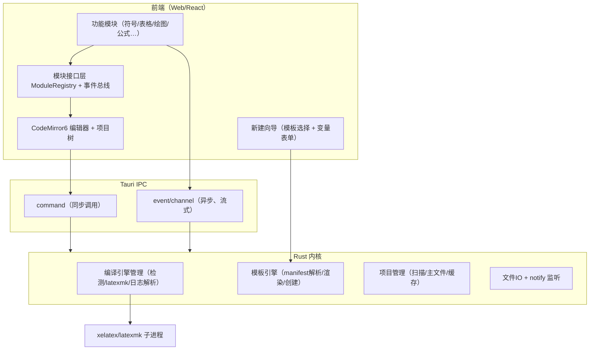

# LaTeX 工作台 · 开发文档（Tauri 版）

> 文档状态：技术方案 · 研发可执行 · v 0.4
> 读者：AI 辅助的个人开发者（自己 / 身边协作）
> 对应 PRD：v1.0（模块化本地 LaTeX 效率工具）
> MVP 基准：`docs/MVP.md` —— **M0 = MVP 完整闭环，只保留核心链路**
> 目标平台：**Windows 优先** · Linux/WSL 次之 · macOS 延后
---

## 0. 决策摘要

| 决策点 | 结论 | 理由 |
|---|---|---|
| 产品形态 | 独立桌面 App（非 VS Code 插件） | 用户明确要求 |
| 外壳框架 | **Tauri 2.x** | Rust 后端 + Web UI，避开 Electron 重壳 |
| 前端框架 | React + Vite + TypeScript | AI 出码最稳、可视化生态最强 |
| 编辑器组件 | **CodeMirror 6**（备选 Monaco） | 轻量、模块化哲学与本产品一致、易嵌自定义模块 |
| 绘图画布 | **fabric.js** | 对 WebKit 兼容较好，拖拽/连线/缩放成熟 |
| 内核语言 | Rust（Tauri 后端即内核） | 进程/IO/文件监听强，适合编译引擎管理 |
| 前端状态 | zustand + 自建事件总线 | 轻量、模块间解耦 |
| 项目结构 | **模板清单（manifest）驱动，不硬编码** | 任意类型项目（论文/简历/幻灯片…）都靠模板声明生成 |
| MVP 策略 | **M0 = MVP 完整闭环，只保留核心链路** | 尽快可自测可用，非必要功能一律后置（见 §0.1 与 `docs/MVP.md`） |
| 渲染一致性 | 接受 Tauri 跨端差异，风险集中在 Linux | Windows 用 WebView2（Chromium），主战场最稳 |

**关键取舍**：Tauri 用系统 WebView，不捆绑引擎 → Windows(Chromium)/macOS(Safari)/Linux(WebKitGTK) 渲染存在差异。主目标 Windows 是 Chromium，风险最低；Linux 端 WebKitGTK 最老，是差异集中区，开发时每轮在 Linux 顺带验证。

### 0.1 MVP 范围边界（M0 = MVP）

**M0 即交付 MVP**：完成「**打开项目 → 新建 TeX 文档 → 编写代码 → 一键 XeLaTeX 编译 → 查看 PDF 预览**」完整闭环；只保留核心链路，砍掉所有非必要功能，保证第一版可自测可用（依据 `docs/MVP.md`）。

| 范围 | 内容 |
|---|---|
| ✅ 必须实现（M0 全量交付） | 项目树、多标签编辑器、一键编译 + 日志报错跳转、PDF 预览、三栏布局 + 底部日志面板、基础 IPC 文件读写与子进程管理、2 套内置单文件模板新建文档、记住上次打开项目、窗口尺寸记忆、GBK 编码兼容、30 秒自动保存 |
| ❌ 一律后置（M0 不做） | 自定义模板导入/另存为模板、Synctex 双向跳转、暗色主题、图片管理、绘图、全局设置面板、自动更新、aux 一键清理、公式面板、表格编辑器、代码格式化、拼写检查、多编译引擎切换、多语言 |

---

## 1. 技术栈总览

| 层 | 技术 | 用途 | 选型理由 |
|---|---|---|---|
| 内核 | Rust + Tauri 2 | 编译引擎、项目、模板、文件 IO、事件 | 进程/IO 强，天然做内核 |
| 通信 | Tauri IPC（command/event/channel） | 前端 ↔ 内核 | 框架自带，无需额外 sidecar 进程 |
| UI 壳 | React + Vite + TS | 主界面、侧边栏、状态栏、新建向导 | AI 出码可靠、生态大 |
| 编辑器 | CodeMirror 6 | LaTeX 源码编辑 | 模块化、轻量、可深度定制 |
| 画布 | fabric.js | TikZ 可视化绘图模块 | WebKit 兼容好、图元/拖拽成熟 |
| 状态 | zustand + 事件总线 | 模块间解耦通信 | 轻量 |
| 表格 | 自研网格组件（或 AG-Grid 备选） | 可视化表格编辑 | P0 自研足够，避免重依赖 |
| PDF 预览 | **PDF.js**（`pdfjs-dist` / `@react-pdf-viewer`） | webview 内嵌 PDF 渲染 + synctex | 跨平台 Canvas 渲染，可自定义点击/高亮 |
| 模板渲染 | P0 自研轻量占位替换；进阶可上 handlebars（自定义分隔符） | 模板文件变量替换 | 避开 LaTeX 大括号冲突 |

**依赖清单**

- Rust：`tauri`、`serde/serde_json`、`tokio`、`walkdir`、`notify`（文件监听）、`regex`（日志解析）、`dirs`、`tracing`；synctex 同步 shell 调 `synctex` 二进制（TeX Live/MiKTeX 自带，M3），或用 `synctex` crate；模板条件/循环需要时再加 `handlebars`
- 前端：`@tauri-apps/api`、`@tauri-apps/plugin-dialog`、`react`、`vite`、`typescript`、`@uiw/react-codemirror`、`fabric`、`zustand`、`pdfjs-dist`（或 `@react-pdf-viewer/core`）
- 打包：Tauri bundler（Windows=NSIS/MSI，Linux=deb/AppImage）

---

## 2. 总体架构

PRD 三层与本实现三层一一对应：

```
┌──────────────────────────── 前端（Web UI + 模块层）────────────────────────────┐
│  功能模块层：符号 │ 表格 │ 图片 │ 绘图(fabric) │ 模板 │ 公式 │ 预览 │ 引用 │ AI   │
│  模块接口层：ModuleRegistry（注册/钩子/依赖）+ 事件总线(TS)                     │
│  编辑壳：CodeMirror6 + 项目树 + 新建向导 + 状态栏                               │
├──────────────────────────── Tauri IPC（command/event/channel）────────────────┤
│                          Rust 内核（稳定，少改）                                │
│   编译引擎管理 · 模板引擎 · 项目管理 · 文件IO/监听 · 事件总线(Rust)            │
└─────────────────────────────────────────────────────────────────────────────┘
```



### 进程边界说明（简化决策）

- **不需要独立 sidecar 进程**。Tauri 的 Rust 后端就是内核，与 Web 前端天然分进程（WebView 进程隔离），编译时再 spawn `xelatex/latexmk` 子进程。
- **通信两通道**：
  - `command`（同步/短任务）：读文件、扫描项目、列模板、创建项目、执行编译启动、写配置。
  - `event` / `channel`（异步/流式）：编译进度、日志增量、文件变更通知。

---

## 3. Rust 内核设计

内核只做五件稳定的事：文档模型、编译引擎管理、模板引擎、项目管理、事件分发。不做任何"业务功能"。

### 3.1 职责划分

| 模块 | 职责 | 关键点 |
|---|---|---|
| 文档模型 | 单文件编辑/持久化/结构解析（**详见 §3.4**） | 多文件标签、编码/原子写、外部变更、符号索引 |
| 编译引擎管理 | 发行版检测、引擎选择、多遍编译、日志解析、错误定位 | 核心价值，见 3.3 |
| 模板引擎 | 模板清单解析、变量校验、渲染、按结构生成项目 | 纯声明式，见 §5 |
| 项目管理 | 项目树扫描、多文件、主文件识别、缓存清理 | 主文件优先读 `.ltex/config.json`，回退启发式 |
| 文件 IO/监听 | 读写、notify 监听变化（**notify → M1，MVP 只做读写**） | 回发文件变更事件 |

### 3.2 通信接口清单（Tauri commands）

> 标注 `[MVP]` = M0 必须交付；`[后置]` = MVP 一律不做，按阶段后置。

```
# 环境/编译
detect_tex_distribution() -> TexDistInfo        [MVP] // 发行版、引擎、版本（M0-3 已完成）
                                                      // 未检测到 TeX 时仅简单缺失提示；完整安装引导 → M1 [后置]
init_environment() -> InstallResult             [后置 M1] // 引导/触发安装
compile_project(root, mainFile, engine) -> ()   [MVP] // 启动编译，立即返回；M0-9 已实现（引擎来自 .ltex/config.json）
cancel_compile() -> ()                          [MVP] // 取消当前编译（kill 子进程，无残留）；全局单并发
parse_tex_log(logPath) -> Vec<TexError>         [MVP] // 日志→结构化错误（也可编译时自动产出）

# 模板（MVP 只交付最小子集，见 §5「MVP 收敛口径」；M0-7 已完成）
list_templates() -> Vec<TemplateMeta>           [MVP] // 仅扫描内置 2 套单文件模板（article/ctex-cn，随 bundle.resources 打包）
get_template(id) -> TemplateManifest            [MVP] // 取清单；id 白名单校验防穿越
create_project(templateId, vars, targetPath) -> ProjectInfo [MVP] // 渲染→写 main.tex→写 .ltex/config.json；主文件已存在报错不覆盖
list_user_templates / import_template / save_project_as_template [后置 M1/M3] // 用户模板目录、导入、另存为模板

# 项目/文档
scan_project(path) -> ProjectTree               [MVP] // 树形结构 + 主文件识别（读 config，回退启发式）+ engine（M0-9）
read_file(path) -> FileDoc                      [MVP] // {content, encoding, eol}，自动解码（含 GBK）
write_file(path, content, options)              [MVP] // 原子写；options 可指定 encoding/eol
create_entry(path, kind) / remove_entry(path) / rename_entry(from, to)  [MVP] // 项目树右键：新建 .tex/文件夹、删除、重命名
copy_entry(from, to)                              [MVP] // 树复制粘贴：文件/目录递归复制（冲突报错不覆盖；剪切复用 rename_entry）
load_app_config() / save_app_config(json)       [MVP] // 本地 JSON：上次打开项目根路径 + 窗口尺寸（MVP Phase 0-4）
revert_file(path) -> FileDoc                    [后置 M1] // 外部变更后放弃缓冲、重新读盘（配合 notify）
get_symbol_index(path) -> SymbolIndex           [后置 M1/M3] // 章节/label/ref/cite/graphics 索引（见 §3.4-C）
clean_aux(path)                                 [后置 M1] // 清理 aux/log 缓存（MVP 不做）

# PDF 预览（见 §7.1；M0 仅用 pdfPath 加载，M3 加 synctex 命令）
synctex_view(inputFile, line, col, pdf) -> {page, x, y}   [后置 M3] // 正向：源码→PDF（单位 pt）
synctex_edit(pdf, page, x, y) -> {file, line, col}        [后置 M3] // 反向：PDF→源码（Ctrl+点击）

# 事件（Rust → 前端，经 event/channel）
compile_progress {stage, pct, current}          [MVP] // 实时日志行
compile_finished {status, errors, pdfPath?, passes, durationMs}  [MVP] // 编译结果 + 结构化错误（errors 于 M0-10 填充）
file_changed {path, kind}                       [后置 M1] // 来自 notify（含外部改动，提示重载）
symbols_updated {path, index}                   [后置 M1/M3] // 文档结构索引变更（防抖重算）
```

### 3.3 编译引擎管理（内核核心价值）

1. **发行版检测**：`PATH` 中探测 `xelatex`/`pdflatex`/`latexmk`；Windows 检测 MiKTeX 安装目录；Linux 检测 TeX Live。
   - Windows 优先用 **MiKTeX**：能自动按需装缺失宏包，直接化解"宏包缺失"痛点，对新手最友好。
2. **多遍编译管线**（M0-9 已实现）：
   - 引擎取 `.ltex/config.json` 的 `engine`（`scan_project` 一并返回，缺省 `xelatex`）；MVP **不做引擎切换 UI**（M1）。
   - **输出目录 = `main.tex` 所在目录**（不传 `-output-directory`；`outputDir` 配置留 M1）。
   - 首选 `latexmk -xelatex|-pdf|-lualatex -synctex=1 -interaction=nonstopmode -file-line-error <mainFile>`（自动处理 bibliography/目录多遍）。
   - 兜底手写：`<engine> ×1 → biber（存在 .bcf）→ <engine> ×2`。
   - `tokio` spawn 子进程，`stdout/stderr` 合并逐行推 `compile_progress`；Windows 加 `CREATE_NO_WINDOW`。
   - 全局 `CompileState{busy, child, cancelled}` 保证单并发，`cancel_compile` 取走句柄 kill。
3. **日志解析**：`regex` 从 `.log` 提取 `{file, line, message}`，映射**大白话解释 + 修复建议**（见 §6 错误 schema）。
4. **错误定位**：编译完成把错误列表发前端，点击 → 跳 CodeMirror 对应行（R3）。
5. **缓存清理**：`clean_aux` 删 `.aux/.log/.bbl/.blg/.toc/.out/.synctex.gz`（**MVP 不做 → M1**）。

### 3.4 文档模型（编辑层 / 持久层 / 结构解析）

> **边界**：文档模型管**单个文件**的编辑、持久化与结构；多文件集合、主文件、编译归项目模型（§3.3 / §5）。

#### A. 编辑层（前端 CodeMirror 6，内存态）

| 功能 | 优先级 | 说明 |
|---|---|---|
| 多文件标签页（multi-buffer） | P0 | 论文多 chapter 必需，每个文件一个独立 `EditorState` |
| 打开/编辑/保存/另存为 | P0 | 基础读写 |
| 脏状态（未保存标记）+ 关闭前提示 | P0 | 防丢内容 |
| 撤销/重做 | P0 | CM6 自带 |
| 行号 / 自动缩进 / 括号匹配 / 自动配对 | P0 | `{ } $` 自动配对；`\begin/\end` 配对放 P1 |
| 查找/替换（含正则） | P0 | 先单文件，多文件搜索放 P2 |
| 代码折叠（章节/环境） | P1（→ M1） | 长文档导航；**MVP 暂不做**（`MVP.md` Phase 1-2） |
| 语法高亮（LaTeX grammar） | P0 | CM6 LaTeX 语言包 |
| 程序化跳转（定位到行） | P0 | 错误定位 R3、synctex 都依赖它 |
| 命令/引用补全（`\command`、`\ref/\cite`） | P1 | 依赖 C 层符号索引 |
| 大纲/章节树导航 | P1 | 侧栏点击跳章节 |
| 多光标/多选择 | P1 | CM6 自带，配快捷键 |
| 代码片段 snippets | P1 | `\begin{document}` 等 |
| 只读模式 | P1 | 查看生成文件 |
| synctex 双向跳转 | P1（M3） | 点 PDF 跳源码、点源码跳 PDF，见 §7.1 |

#### B. 持久层（Rust，文件态）

| 功能 | 优先级 | 说明 |
|---|---|---|
| 读/写/原子写 | P0 | 写临时文件再 rename，避免写一半损坏 |
| 编码检测与转换 | P0 | 中文老文档常是 GBK：读取时解码，保存默认 UTF-8（可配置） |
| 换行符保持（LF/CRLF） | P0 | Windows 老文件常见 CRLF，不破坏原格式 |
| 外部变更检测 | P1（→ M1） | notify 发现文件被外部改动 → 提示"重载/对比"，配合 `revert_file`；**MVP 不做** |
| 二进制资源处理 | P0 | 图片走复制/转换，不进文本编辑器 |
| 自动保存 | P0（MVP） | 30 秒轮询检测脏文件自动落盘（固定策略，无配置）；可配置化 → M3 |
| 崩溃恢复/备份 | P1 | `.ltex` 存未保存缓冲，异常退出可恢复 |
| 同一项目多窗口冲突 | P2 | 个人阶段简化，先不做 |

#### C. 结构解析（共享内核能力，给模块用）

对应 PRD 的"代码结构解析"，是被多个模块共用的内核能力，P0 先用正则/轻量扫描（**不写完整 LaTeX AST**，语法复杂、投入产出不划算；不够再升级）。

- 解析对象：**章节结构**（`\part/chapter/section...`）、**环境**（`\begin/\end`）、**`\label` / `\ref` / `\cite`**、**`\includegraphics`**、**数学环境**。
- 产出**符号索引**，供大纲、`\ref/\cite` 补全、引用/公式/图片模块、错误定位、synctex 复用。
- 更新时机：打开文件算一次；编辑时防抖（debounce）重算，经 `symbols_updated` 事件推送。

```ts
// 符号索引（types/ 与 Rust struct 对齐）
interface SymbolIndex {
  sections:     { level: number; title: string; line: number }[];
  labels:       { key: string; kind: string; line: number }[];   // \label
  refs:         { key: string; cmd: string; line: number }[];    // \ref \eqref
  cites:        { key: string; line: number }[];                 // \cite
  graphics:     { path: string; line: number }[];                // \includegraphics
  environments: { name: string; beginLine: number; endLine: number }[];
}
```

### 3.5 关键 Rust 依赖与骨架（示意）

```rust
// src-tauri/src/main.rs（示意）
fn main() {
    tauri::Builder::default()
        .invoke_handler(tauri::generate_handler![
            detect_tex_distribution, init_environment,
            compile_project, cancel_compile, parse_tex_log,
            list_templates, get_template, create_project,
            import_template, save_project_as_template,
            scan_project, read_file, write_file, clean_aux
        ])
        .run(tauri::generate_context!())
        .expect("tauri error");
}
```

> **MVP 注册子集（M0）**：只需注册 §3.2 标 `[MVP]` 的命令 + 文件操作 `create_entry/remove_entry/rename_entry` + 配置 `load_app_config/save_app_config`；`init_environment`、`import_template`、`save_project_as_template`、`clean_aux`、`revert_file`、`get_symbol_index`、`synctex_*` 等随对应切片（M1/M3）到达时再加入 `generate_handler![]`。

---

## 4. 前端设计（Web UI + 模块层）

### 4.1 三层落位

- **编辑壳（稳定）**：CodeMirror6 + 项目树侧栏 + **新建向导（模板选择 + 变量表单）** + 状态栏。不掺业务。
- **模块接口层（低频、谨慎）**：`ModuleRegistry` + 事件总线。定义模块生命周期。
- **功能模块层（高频新增）**：符号/表格/图片/绘图/模板/公式/预览/引用/AI。

### 4.2 模块接口层设计（决定扩展顺滑度）

```ts
// module-interface.ts（示意）
export interface LatexModule {
  id: string;                    // 唯一 id，如 "diagram"
  name: string;
  version: string;
  requires: string[];            // 依赖的内核能力，如 ["editor", "symbol"]
  deps?: string[];               // 依赖的其他模块 id
  hooks: ModuleHooks;            // 能力钩子
  component?: React.LazyExoticComponent; // 懒加载 UI
}

export interface ModuleHooks {
  onInsertSnippet?: (ctx) => void;   // 向编辑器插入代码
  onCompileDone?: (result) => void;  // 编译完成介入
  onFileChanged?: (ev) => void;
  onModuleEnabled?: (ctx) => void;
  onModuleDisabled?: (ctx) => void;
}
```

**接口设计原则（来自 PRD 5.3）**：
- 模块间不直接调用，一律走事件总线。
- 模块懒加载：`React.lazy` + 用到才 import。
- 模块可单独启停（设置里开关）。
- 接口向后兼容，内核升级不破坏模块。

```ts
// 注册示意
registry.register({
  id: "diagram", name: "绘图", version: "0.1",
  requires: ["editor", "symbol"],
  hooks: { onInsertSnippet: ({editor, sel}) => { /* 插入 TikZ 代码 */ } },
  component: lazy(() => import("@/modules/diagram/DiagramPanel")),
});
```

### 4.3 事件总线

- **前端总线**：zustand store + 轻量 pub/sub，模块间解耦通信（`bus.emit/on`）。
- **跨进程**：Rust 事件映射到前端 `listen()`（@tauri-apps/api/event）。
- 统一事件命名：`compile:progress`、`compile:done`、`file:changed`、`module:enabled`、`project:created`…

### 4.4 顶部菜单栏（**M0-12 前移** · `src/ui/MenuBar.tsx`）

> 用户提需求提前交付：自绘 32px 单行菜单栏，**保留系统原生标题栏**（自绘 titlebar + 窗口按钮仍留 M0-12）。对齐 `docs/UI/code.html` `.menubar/.drop/.mi`。

- **7 菜单**：文件 / 编辑 / 构建 / 视图 / 模板 / 设置 / 帮助。**只接通已有能力**，其余 `.mi.off` 置灰 + `title` 标注接通切片——不做假入口（构建 M0-9/10、日志 M0-10、PDF M0-13、查找替换/缩放/设置 M1、明暗主题 M3）。
- **命令桥 `src/editor/activeView.ts`**：模块级持有当前 `EditorView`；方案 A 多实例常驻下由 `EditorWorkspace` 在激活标签变化时登记（`LaTeXEditorHandle.getView()` 新增）。菜单「撤销/重做/切换注释」经 `@codemirror/commands` 派发；复制/粘贴不接（编辑区内键盘已接管）。
- **快捷键**：菜单项 `sc` 只显示**真实已绑定**的键——新增 Ctrl+W 关标签、Ctrl+Shift+S 全部保存、Ctrl+Shift+O 打开项目、Ctrl+Shift+N 新建项目；Ctrl+B→0 chord 切换资源树（单 Ctrl+B 留给 M0-9 编译）。编辑器内 Mod-s 由 CM 先行处理。
- **退出**：`dirtyCount()` > 0 时 `plugin-dialog` 原生确认 → `getCurrentWindow().close()`（capability 增 `core:window:allow-close`）。
- **共用动作下沉**：`useBuffers` 增 `saveAllBuffers()/dirtyCount()`，侧栏与菜单共用一份逻辑。
- **状态来源**：菜单可用性由 zustand 订阅驱动（`activePath` / `sidebarVisible`），不自存业务状态。

### 4.5 侧栏资源管理器 + 全局状态栏（**M0-12 前移** · VSCode 风格）

> 用户提需求提前交付，对齐 `docs/UI/UI.html`（用户已更新的 mockup）。相比 M0-6 版本：**侧栏只保留文件树**，编辑器内部状态行整体并入全局状态栏。

**侧栏 `src/project/Sidebar.tsx` + `src/project/ProjectTree.tsx`**
- `.side-head` **只保留「资源管理器」标签**（无右侧内容、无项目名）。
- **根目录行**：根目录名与图标组移入树容器，作为所有树节点的**父行**（由 `ProjectTree` 渲染，随树滚动，`paddingLeft: 8` 与 depth 0 对齐；子节点从 depth 1 起）。
- **展开态复用 `openDirs`**：`openProject` 时种入 `new Set([root])` → 根行默认展开；点根行即 `toggleDir(root)`（收起/展开整棵树）。`refresh()` 保留 `openDirs`，展开态不丢。
- **图标组**（根行右侧，`opacity: 0` → 根行 `:hover` / `:focus-within` 时显）：`file-plus` 新建文件、`folder-plus` 新建文件夹（均 → `openEntryDialog`，**VSCode 语义**：空 `.tex` / 空目录；模板向导仍走 文件/模板 菜单与树右键）、`refresh` 刷新、`collapse-all` 全部折叠。
- **全部折叠语义**：只折叠根以下目录，**根行保持展开**（`collapseAll()` 置为 `new Set([root])`）；根行被手动收起时点击它先展开根行。按钮仅在「根行展开且没有其他目录可折叠」（`openDirs.has(root) && openDirs.size === 1`）时置灰。根行自身的 `toggleDir(root)` 仍可整棵收起，且再展开时保留子目录的展开态（同 VSCode）。
- **根行右键**复用「空白」菜单（新建/模板/粘贴/刷新），**不含**重命名/删除/剪切 —— 避免误操作项目根。
- **已移除**：`.side-title`「项目资源」标题、`.proj-name` 项目名卡片、`.side-foot` 项目概要面板（主入口/引擎/辅助工具/编译日志）、`.side-foot-act` 底部「保存全部」按钮（该能力保留在 菜单→全部保存 与 `Ctrl+Shift+S`）。

**状态栏 `src/ui/StatusBar.tsx`**
- 右侧新增两项：**光标位置**「行 L，列 C」（`.caret-info`）与 **语言标识**「LaTeX」。
- 光标数据不留在组件内：`useBuffers` 增 `cursor: CursorPos` + `setCursor()`，`EditorWorkspace` 的 `onCursorChange` 与激活切换时写入，状态栏订阅展示。这样切标签时立即回填该缓冲的光标，不依赖首次移动。
- **已移除**：`.editor-status` 编辑器内部状态行（行/列、空格 2、完整路径、脏点、编码/换行/语言/Tab宽、跳转行输入框）；状态栏最右侧「设置」按钮（M1 接通，菜单栏「设置」仍置灰可用）；mockup 中的「主题」按钮本就未实现。
- 编码 / 换行保持只读展示（真实切换按钮 M1）。
- **M0-9 接通**：左侧编译文案按钮 = 开始编译（运行中点击即取消，`disabled` 条件为「无主文件且未在编译」）；「日志」按钮开合底部日志面板（`.sbtn.on` 高亮）；引擎 chip 显示 `ProjectTree.engine`（来自 `.ltex/config.json`，真实值但**切换仍置灰**，M1）。

**编译日志面板 `src/ui/LogPanel.tsx`（M0-9）**
- 位置：`.workspace` 与 `.statusbar` 之间，`height: 0 → var(--log-h)` 过渡（`--log-h: 212px`），对齐 mockup `.logpanel`。
- 头部：`终端图标 + 编译日志 + 行数 + 清空 + 收起`；正文等宽 11px、自动贴底滚动，空态提示「点击 ▶ 或 Ctrl+B」。
- 数据：`useAppStore.compileLog`（上限 800 行，`appendLog/clearLog`）；编译开始自动打开面板并清空上一轮日志。
- **M0-10 扩展点**：同一面板内加「错误 / 警告 / 全部」筛选与结构化错误列表，当前只渲染原始行。

**偏离 mockup 之处**：① 用户后续要求将「根目录名 + 图标组」从 `.side-head` 移入树容器作为父行（mockup 仍是头部一行式），以实现为准；② 原 `.editor-status` 的「跳转到行」输入框随之移除，M1 复原为状态栏点击跳转（M0-11 错误定位走 `openFiles` + `setActive`，不受影响）；③ `.kv` / `.side-actions .wide` / `.log-link` / `.side-foot-act` 相关样式已清理。


### 4.6 前端目录结构（Tauri 标准布局）

```
LaTeX工作台/
├─ src/                          # Web 前端
│  ├─ main.tsx / App.tsx
│  ├─ editor/                   # CodeMirror6 封装、LaTeX 高亮配置
│  ├─ core/                     # 编辑壳：项目树、新建向导、状态栏、事件总线、registry
│  ├─ compile/                  # M0-9：编译事件桥（useCompile）+ startCompile/cancelCompile
│  ├─ modules/
│  │  ├─ symbol/                # 符号面板（P0）
│  │  ├─ table/                 # 可视化表格（P0）
│  │  ├─ image/                 # 拖拽图片（P0）
│  │  ├─ diagram/               # 绘图组件（M2，fabric）
│  │  ├─ template/ formula/ preview/ bib/ ai/ ...
│  ├─ ipc/                      # invoke/event 封装（类型安全）
│  └─ types/                    # 协议类型（与 Rust 对齐）
├─ src-tauri/
│  ├─ src/
│  │  └─ commands/              # 按域分文件：core/compile/fsdoc/project/template.rs
│  │                            #   template.rs = 模板引擎（manifest 解析/渲染/创建）
│  ├─ templates/                # 内置模板包（bundle.resources 打包随 App 发布；M0-7 已落 2 套）
│  ├─ capabilities/             # 权限配置（fs/shell/dialog）
│  ├─ tauri.conf.json
│  └─ Cargo.toml
└─ package.json
```

> **目录说明**：`docs/MVP.md` Phase 0 建议的 `src/{types, ipc, store, components}` 已在 M0-1 落位为现有结构——`src/types/`（协议类型）、`src/ipc/`（invoke/listen 封装）、`src/core/`（zustand store + 事件总线 + 编辑壳组件）、`src/editor/`（CM6 封装）、`src/modules/`（功能模块，MVP 仅占位）。**保持现有结构，不再改名**。

---

## 5. 模板系统（项目结构解耦）

> 目标：项目结构**不硬编码**，由模板清单（manifest）声明；新建项目时按清单生成文件/目录。纯声明式，加模板不改内核。

### 5.0 MVP 收敛口径（M0 只做最小子集）

MVP 的模板诉求只有一条：**「新建 TeX 文档 → 自动生成可编译的 main.tex → 打开到编辑器 → 标记为项目主编译文件」**。因此 M0 对模板系统做如下收敛（设计方向不变，实现取子集，保证向前兼容）：

1. **只内置 2 套单文件模板**：`article`（单文件英文文档）、`ctex-cn`（中文 LaTeX 文档），放 `src-tauri/templates/`，随包发布。
2. **向导极简**：新建文档 → 选择模板 →（可选填标题/作者）→ 生成 `main.tex` → 自动打开并写入 `.ltex/config.json` 的 `mainFile`。**不做**复杂变量表单渲染。
3. **schema 只解析子集**：`schemaVersion / id / name / build / structure.files[]`，未知键一律忽略（§5.2 原则 3 不变），后续扩到完整 schema 无需迁移旧模板。
4. **明确后置**：多文件模板（thesis-cn / beamer-cn / resume-cn 扩展）、`condition` 条件文件、用户模板目录扫描、自定义模板导入、"另存为模板"、模板市场（→ M1/M3）。

> 内核"项目结构由 manifest 驱动、不硬编码"的原则**不变**，MVP 只是先把模板库收敛到 2 套单文件模板。
>
> **✅ M0-7 落地**：实现于 `src-tauri/src/commands/template.rs`（清单全解析、未知键忽略）。打包 = `tauri.conf.json` `bundle.resources: ["templates"]`（**目录形式**；`templates/**` 尾缀 glob 会触发 tauri-build「未匹配任何文件」错误）+ dev 兜底（CWD/`src-tauri/templates`）。渲染细节：未提供变量回退 manifest 默认值再回退空串；未闭合的 `<%=` 原样保留；`guard_id`（id 白名单）+ `safe_join`（拒空/绝对/`..`）防穿越；目标已存在主文件 → 报错不覆盖。

### 5.1 设计原则

1. **manifest 是项目结构的唯一真相源**。内核不假设任何项目类型（论文/简历/幻灯片/报告/书籍都行）。
2. **领域相关字段全部进 `variables`**（学位、学校、期刊名、岗位…），schema 顶层不出现任何领域专有字段。
3. **未知键一律忽略** → 模板可加自定义元数据，向前兼容，内核升级不破坏旧模板。
4. **三类模板来源**：内置模板（随包发布）、用户模板（用户目录）、"把当前项目另存为模板"（主要自定义入口）。
5. **最小模板内核前移到 M0**（否则无法新建项目；MVP 按 §5.0 收敛为 2 套单文件模板）；丰富模板库/市场放 M1/M3。

### 5.2 通用模板清单 schema（内核只认这些键）

```json
{
  "schemaVersion": "1.0",
  "id": "thesis-cn",
  "name": "中文毕业论文",
  "description": "基于 ctex 的中文毕业论文模板",
  "category": "thesis",
  "tags": ["论文", "中文", "ctex"],
  "version": "1.0",

  "build": {
    "engine": "xelatex",
    "mainFile": "main.tex",
    "outputDir": "build",
    "synctex": true
  },

  "dependencies": {
    "packages": ["ctex", "booktabs", "graphicx", "biblatex"],
    "assets": ["thesis.cls", "my.sty"]
  },

  "variables": [
    {"key": "title",  "label": "标题", "type": "string", "required": true},
    {"key": "author", "label": "作者", "type": "string", "default": ""},
    {"key": "degree", "label": "学位", "type": "select",
     "options": ["学士","硕士","博士"], "default": "硕士"}
  ],

  "structure": {
    "dirs":  ["chapters", "figures", "bib"],
    "files": [
      {"target": "main.tex",           "source": "main.tex.tmpl", "render": true},
      {"target": "chapters/intro.tex", "source": "chapters/intro.tex.tmpl", "render": true},
      {"target": "ack.tex",            "source": "ack.tex.tmpl",
       "render": true, "condition": "include_ack"}
    ]
  }
}
```

**字段说明**

| 字段 | 说明 |
|---|---|
| `schemaVersion` | 清单格式版本，用于未来兼容 |
| `id/name/version` | 模板标识与展示名；`description/category/tags` 仅用于分组展示 |
| `category` | 自由字符串标签（thesis/journal/resume/slides/report/book/custom…），内核不据此分支 |
| `build.engine` | 引擎：xelatex / pdflatex / lualatex |
| `build.mainFile` | 主文件（编译入口） |
| `build.outputDir` | 产物目录（aux/pdf/log） |
| `build.synctex` | 是否启用源码↔PDF 同步 |
| `dependencies.packages` | 声明的系统宏包（环境检测/缺失提示用） |
| `dependencies.assets` | 随模板打包、需原样复制的 cls/sty/资源 |
| `variables[]` | 表单变量；类型 `string/text/select/multiselect/bool/number/date`，可选 `required/default/options/group/placeholder/help` |
| `structure.dirs[]` | 需创建的空目录（文件所在目录可自动创建，此处用于空目录） |
| `structure.files[]` | `target` 项目内路径、`source` 模板包内路径、`render` 是否渲染、`condition`（P1）变量为真才生成 |

### 5.3 模板包目录布局

```
templates/
├─ thesis-cn/
│  ├─ manifest.json
│  ├─ main.tex.tmpl            # 含 <%= title %> 占位
│  ├─ chapters/intro.tex.tmpl
│  ├─ ack.tex.tmpl
│  └─ assets/
│     ├─ thesis.cls            # 静态 cls/sty，原样复制
│     └─ my.sty
├─ resume-cn/
│  ├─ manifest.json
│  └─ resume.tex.tmpl
└─ beamer-cn/
   ├─ manifest.json
   └─ slides.tex.tmpl
```

### 5.4 占位符与渲染规则（关键：避开 LaTeX 大括号）

- LaTeX 里 `{{ }}` 很常见，**禁止用 `{{var}}`**；统一用 ERB 风格 **`<%= var %>`**（与 LaTeX 语法零冲突）。
- P0：自研约 30 行的占位替换器，只做变量替换。
- 需要条件/循环时（如按 `degree` 生成不同段落）再引入 `handlebars`（Rust 端支持自定义分隔符）。
- 渲染仅作用于 `render:true` 的 `.tmpl`；cls/sty/图片等一律原样复制。

### 5.5 通用性验证（同一 schema，差异极大的项目）

**简历**：单文件、无 chapters，变量为姓名/电话/邮箱。

```json
{
  "schemaVersion": "1.0", "id": "resume-cn", "name": "中文简历",
  "category": "resume",
  "build": {"engine": "xelatex", "mainFile": "resume.tex", "outputDir": "build"},
  "dependencies": {"packages": ["ctex", "geometry", "enumitem"]},
  "variables": [
    {"key": "name",  "label": "姓名", "type": "string", "required": true},
    {"key": "phone", "label": "电话", "type": "string"},
    {"key": "email", "label": "邮箱", "type": "string"}
  ],
  "structure": {
    "dirs": [],
    "files": [{"target": "resume.tex", "source": "resume.tex.tmpl", "render": true}]
  }
}
```

**Beamer 幻灯片**：主文件 `slides.tex`，变量为标题/演讲者/主题。

```json
{
  "schemaVersion": "1.0", "id": "beamer-cn", "name": "中文 Beamer 幻灯片",
  "category": "slides",
  "build": {"engine": "xelatex", "mainFile": "slides.tex", "outputDir": "build"},
  "dependencies": {"packages": ["ctex", "beamer"]},
  "variables": [
    {"key": "title",  "label": "标题", "type": "string", "required": true},
    {"key": "author", "label": "演讲者", "type": "string"},
    {"key": "theme",  "label": "主题", "type": "select",
     "options": ["Madrid","Berlin","Copenhagen"], "default": "Madrid"}
  ],
  "structure": {
    "dirs": ["figures"],
    "files": [{"target": "slides.tex", "source": "slides.tex.tmpl", "render": true}]
  }
}
```

### 5.6 新建项目流程（前端向导 ↔ Rust 模板引擎）

```
选模板:  list_templates() → TemplateMeta[]
填表单:  get_template(id) → manifest.variables → 前端按 type 渲染表单
创建:    create_project(id, vars, targetPath)
   ├─ 读 manifest，校验必填变量
   ├─ 按 structure.dirs 建目录
   ├─ 遍历 structure.files：condition 为真才处理；render=true 用 vars 渲染，否则原样复制
   ├─ 复制 dependencies.assets（cls/sty）
   ├─ 写 .ltex/config.json（engine / mainFile / outputDir / templateId / 模块开关）
   └─ 返回 ProjectInfo → 前端打开项目
```

### 5.7 Rust 模板引擎骨架（示意）

> **✅ M0-7 已实现**：实际位于 `src-tauri/src/commands/template.rs`；下方为早期示意，实现时各结构体加 `#[serde(rename_all = "camelCase")]`（manifest JSON 与 `src/types/template.ts` 同为 camelCase），并为字段补 `#[serde(default)]` 兼容简写清单。

```rust
// src-tauri/src/commands/template.rs
use serde::{Deserialize, Serialize};
use std::path::Path;
use std::collections::HashMap;
use serde_json::Value;

#[derive(Debug, Deserialize, Serialize)]
pub struct TemplateManifest {
    pub schema_version: String,
    pub id: String,
    pub name: String,
    #[serde(default)]
    pub description: Option<String>,
    #[serde(default)]
    pub category: Option<String>,
    #[serde(default)]
    pub tags: Vec<String>,
    #[serde(default)]
    pub version: String,
    pub build: BuildConfig,
    #[serde(default)]
    pub dependencies: Dependencies,
    #[serde(default)]
    pub variables: Vec<TemplateVar>,
    pub structure: Structure,
}

#[derive(Debug, Deserialize, Serialize)]
pub struct BuildConfig {
    pub engine: String,
    pub main_file: String,
    #[serde(default = "default_build_dir")]
    pub output_dir: String,
    #[serde(default)]
    pub synctex: bool,
}
fn default_build_dir() -> String { "build".into() }

#[derive(Default, Debug, Deserialize, Serialize)]
pub struct Dependencies {
    #[serde(default)]
    pub packages: Vec<String>,
    #[serde(default)]
    pub assets: Vec<String>,
}

#[derive(Debug, Deserialize, Serialize)]
pub struct TemplateVar {
    pub key: String,
    pub label: String,
    #[serde(rename = "type")]
    pub var_type: VarType,
    #[serde(default)]
    pub required: bool,
    #[serde(default)]
    pub default: Option<Value>,
    #[serde(default)]
    pub options: Vec<String>,
    #[serde(default)]
    pub when: Option<String>,     // P1：表单条件显示
}

#[derive(Debug, Deserialize, Serialize)]
#[serde(rename_all = "lowercase")]
pub enum VarType { String, Text, Select, Multiselect, Bool, Number, Date }

#[derive(Debug, Deserialize, Serialize)]
pub struct Structure {
    #[serde(default)]
    pub dirs: Vec<String>,
    pub files: Vec<FileSpec>,
}

#[derive(Debug, Deserialize, Serialize)]
pub struct FileSpec {
    pub target: String,
    pub source: String,
    #[serde(default = "default_true")]
    pub render: bool,
    #[serde(default)]
    pub condition: Option<String>, // P1
}
fn default_true() -> bool { true }

#[tauri::command]
pub fn create_project(
    template_id: String,
    variables: HashMap<String, Value>,
    target_path: String,
) -> Result<ProjectInfo, String> {
    let manifest = load_template(&template_id)?;
    let root = Path::new(&target_path);
    validate_vars(&manifest, &variables)?;                 // 必填校验
    for d in &manifest.structure.dirs {
        std::fs::create_dir_all(root.join(d)).map_err(|e| e.to_string())?;
    }
    for f in &manifest.structure.files {
        if let Some(cond) = &f.condition {
            if !truthy(&variables, cond) { continue; }    // P1 条件文件
        }
        let src = template_dir(&manifest.id).join(&f.source);
        let dst = root.join(&f.target);
        if let Some(p) = dst.parent() { std::fs::create_dir_all(p)?; }
        if f.render {
            let tpl = std::fs::read_to_string(&src).map_err(|e| e.to_string())?;
            let out = render_vars(&tpl, &variables);      // 替换 <%= key %>
            std::fs::write(&dst, out).map_err(|e| e.to_string())?;
        } else {
            std::fs::copy(&src, &dst).map_err(|e| e.to_string())?;
        }
    }
    for a in &manifest.dependencies.assets { /* 复制 assets */ }
    write_project_config(root, &manifest)?;               // 写 .ltex/config.json
    Ok(ProjectInfo::from(&manifest, &target_path))
}
```

### 5.8 项目产物与配置（生成后）

```
项目根/
├─ .ltex/config.json    # engine/mainFile/outputDir/templateId/模块开关（由模板写入）
├─ <mainFile>           # 由 build.mainFile 决定，不固定叫 main.tex
├─ ...其余结构完全由 manifest 决定（可能没有 chapters/ 或 bib/）
└─ <outputDir>/         # 编译产物（aux/pdf/log），由 build.outputDir 决定
```

> **M0-9 实际口径**：`build.outputDir` 仅写入 config 备用，**编译产物一律落在 `main.tex` 同目录**（用户定稿）；按 outputDir 输出留 M1。

`.ltex/config.json` 是扫描与编译的权威入口：`scan_project` 优先读 `mainFile`；读取不到时回退到"`\documentclass` 优先、被 `\input/\include` 引用"启发式。

---

## 6. 数据模型与协议（前后端对齐）

### 6.1 错误对象 schema（R3 大白话解释）

```ts
interface TexError {
  file: string;           // 源文件
  line: number;           // 行号
  col?: number;
  raw: string;            // 原始报错（Missing $ inserted）
  readable: string;       // 大白话："公式环境里缺了数学模式，写 $ 开头"
  fix?: string;           // 修复建议
  hint?: string;          // 常见错误规则命中（如缺 $ / 缺 \end{} / 宏包缺失）
}
```

常见错误规则表（先内建 20~30 条高频）：缺 `$`、缺 `\end{...}`、未定义引用、宏包缺失、`\usepackage` 找不到、中文字体缺失等。

### 6.2 编译结果 schema

```ts
interface CompileResult {
  status: "ok" | "error" | "cancelled";
  pdfPath?: string;
  errors: TexError[];
  passes: number;         // 实际几遍
  durationMs: number;
}
```

---

## 7. 模块实现规格（MVP 核心链路 + 后置模块）

> 验收口径：MVP 模块沿用 `docs/MVP.md` §四验收清单，其余沿用 PRD。以下每个模块给"触发/行为/结果/技术要点"。**标「MVP 不做」的模块不进 M0。**

### R1 环境初始化（MVP 仅检测，完整引导 → M1）
- **MVP（M0）**：保留 `detect_tex_distribution()` 发行版检测（M0-3 已完成）+ 未检测到 TeX 时的**简单缺失提示**（编译前/状态栏一行提示即可），不做引导流程。
- 触发：首次启动（M1 起）。
- 行为（M1）：引导检测 TeX 发行版；Windows 建议安装/检测 **MiKTeX**（自动装宏包），Linux 检测 TeX Live；引擎默认 `xelatex`，模板里可覆盖。
- 技术：Rust `detect_tex_distribution`；缺失时弹引导面板（前端），Windows 用 plugin-dialog + 打开 MiKTeX 安装器，或引导到官网。
- 验收（M1）：全新机器按引导，30 分钟内产出可编译中文 PDF。

### R2 项目工作区（模板驱动，P0 · MVP 核心链路）
- 触发：**打开已有项目文件夹**（MVP 入口）/ 新建文档。
- 行为：`plugin-dialog` 选文件夹 → `scan_project` 出项目树；选 2 套内置单文件模板之一 → `create_project` 生成 `main.tex` 并打开到编辑器、标记主编译文件；支持多文件，主文件识别（读 config 的 `mainFile`，回退启发式）。
- 技术：Rust 模板引擎（§5.7，按 §5.0 收敛）+ `scan_project`（walkdir）；前端向导 + 项目树。
- 【MVP 不做 → M1/M3】notify 外部变更监听、多文件模板（thesis 等）、复杂变量表单、"选多文件模板生成整个项目"。
- 验收（MVP）：打开文件夹正常列文件 → 模板新建 main.tex → 编译识别主文件产出 PDF；单文件模板不生成多余目录。

### R3 编译错误定位（P0）
- 行为：编译失败 → 解析 `.log` → 前端错误列表，点击跳到 CodeMirror 对应行，附大白话 + 修复建议。
- 技术：Rust regex 解析 → `TexError[]`；前端 `editor.dispatch` 定位行。
- 验收：缺 `$` 公式编译失败点报错 → 光标跳到出错行 + 可读解释。

### R4 一键多遍编译（P0）
- 行为：`latexmk -xelatex -synctex=1` 一次点击得到正确引用与目录；失败兜底手写多遍。
- 技术：Rust spawn + tokio 异步 + channel 推送进度。
- 验收：含 cite + 目录的文档点编译 → 引用与目录均正确。

### R5 拖拽图片导入（**MVP 不做 → M1**）
- 行为：拖图入编辑器 → 自动生成 `figure` 环境 + `\includegraphics[width=...]{...}` + `\centering` + `\caption{}`；图片写入该模板的图片目录（从 config 读，不写死 `figures/`）；记录 dpi。
- 技术：前端拖拽 → 写文件到项目 → 生成代码块插入 CodeMirror。
- 验收：一张 PNG 拖入 → 生成可编译 figure 块，PDF 渲染正常。

### R6 可视化表格编辑器（**MVP 不做 → M1**）
- 行为：类 Excel 网格编辑 → 生成 `booktabs` 三线表代码，可导入 Excel/CSV。
- 技术：自研轻量网格组件（表头/合并/对齐）；输出 booktabs 代码；CSV 解析前端做或 Rust 做。
- 验收：3×3 输入保存 → 生成对应代码，PDF 排版正确。

### R7 符号面板（**MVP 不做 → M1**）
- 行为：分类展示 + 按名称/命令搜索（如 `alpha` → `\alpha`），一键插入。
- 技术：符号库 JSON（name/cmd/category/预览）；前端搜索 + 插入。
- 验收：搜 "alpha" 点结果 → 光标处插入 `\alpha`。

### R8 基础 PDF 预览（**P0 · 提至 M0 / MVP，详见 §7.1**）
- 行为：侧栏内嵌 PDF 面板，编译完成后显示 PDF；再次编译刷新并**保留页码/滚动/缩放**。
- 技术：PDF.js 渲染（canvas），经 `convertFileSrc(pdfPath)` 加载本地 PDF；监听 `compile_finished` 重载。
- 验收：编译成功 → 右侧显示 PDF；改文档重编译后 PDF 更新且不跳回第一页。

### 绘图组件（**MVP 不做 → M2**，杀手锏）
- 行为：fabric.js 画布拖拽图元（节点/箭头/框/坐标轴）→ **单向"代码→可视化"首版**（PRD 风险应对：双向同步放 P1），生成 TikZ 代码插入。
- 技术：fabric.js 画布；图元库（节点/箭头/流程框）；样式对齐文档（字体/线宽/颜色，读 `.ltex` 或主文件）；矢量导出 PDF/SVG 占位（P1）。
- 验收：拖出流程框图 → 生成可编译 TikZ 代码。

### 7.1 PDF 预览模块（**M0 基础 / M3 同步**）

预览拆两档交付：**基础内嵌预览提到 M0（MVP 必做，闭环要看到产物）**；**synctex 双向同步留 M3**（PRD 原 P1）。

**渲染方案**

- 前端模块 `modules/preview/`：用 **PDF.js（`pdfjs-dist`，或 `@react-pdf-viewer/core`）** 在 webview 内渲染到 canvas，编辑器左右分栏。
- 本地 PDF 经 Tauri 2 `convertFileSrc(pdfPath)` 走 asset 协议加载（需在 capabilities 开启 asset 协议）；PDF.js worker 需在 Vite 中正确配置。
- 选 PDF.js 而非系统阅读器：跨平台一致（Canvas 在 WebView2/WebKit 行为接近），且可自定义点击/高亮，为 M3 synctex 铺路。Windows 可选 SumatraPDF 作为外部对照（其自动重载和 synctex 很好），但不是主路径。

**M0 · 基础预览（R8 · MVP 必做，切片 M0-13）**

- 编译成功后用 `compile_finished.pdfPath` 打开 PDF；未编译或编译失败时显示空态/错误提示。
- 监听 `compile_finished` → 重新加载，**保持当前页码、滚动位置、缩放**（不跳回首页）。
- 基础缩放、翻页、页码显示；不做双向跳转。

**M3 · 高级同步**

- 编译已带 `-synctex=1`，产物含 `.synctex.gz`；Rust spawn `synctex` 二进制（TeX Live/MiKTeX 自带）或用 `synctex` crate。
- **正向（源码→PDF）**：光标处触发 → `synctex_view(input,line,col,pdf)` → `{page,x,y}`（pt）→ 前端按当前缩放换算像素 → 滚动并高亮。
- **反向（PDF→源码）**：Ctrl+点击 PDF → `synctex_edit(pdf,page,x,y)` → `{file,line,col}` → CodeMirror 跳行。
- 保存即自动重编译（防抖）或 `latexmk -pvc` 持续编译；滚动跟随。

**相关命令（M3 部分，M0 只用 pdfPath）**

```
synctex_view(inputFile, line, col, pdf) -> {page, x, y}
synctex_edit(pdf, page, x, y) -> {file, line, col}
```

---

## 8. 开发路线（映射 PRD M0–M4 · **M0 = MVP 完整闭环**）

| 阶段 | 范围 | 本文档落位 |
|---|---|---|
| **M0 · MVP 完整闭环** | 「打开项目 → 新建 TeX 文档 → 编写代码 → 一键 XeLaTeX 编译 → 查看 PDF 预览」核心链路全量交付：类型安全 IPC + 文件读写（GBK/原子写）+ 三栏布局/顶部菜单/窗口记忆/记住上次项目 + 项目树（含右键新建/删除/重命名）+ CM6 多标签编辑器 + 脏标记/查找替换/30 秒自动保存 + 2 套内置单文件模板新建 + `latexmk -xelatex` 一键多遍编译 + 实时日志 + 错误解析点击跳转 + **基础 PDF 预览（R8）** | §3 内核 + §3.4 文档模型 + §5.0 模板 MVP 子集 + §6 协议 + §7 R1(仅检测)/R2/R3/R4/R8 + §7.1(M0) + 编辑壳 + §12.1 |
| M1 · 创作增强 | MVP 之外首波：R1 完整环境引导、R5 拖拽图片、R6 表格编辑器、R7 符号面板、ModuleRegistry 模块接口层、notify 外部变更重载、`clean_aux`、多文件模板库 | §4.2 模块接口层 + §7 R1/R5/R6/R7 |
| M2 · 杀手锏 | 绘图组件 | §7 绘图组件 |
| M3 · 增强 | Synctex 双向跳转（源码↔PDF）、`condition` 条件模板、模板市场/自定义模板导入、`\ref/\cite` 补全、大纲导航、暗色主题、全局设置面板、多编译引擎切换 | §5 模板 + §7.1 M3 + 模块扩展 |
| M4 · 进阶 | AI、版本、批量、导出、图片管理增强、代码格式化/拼写检查、自动更新、安装包签名、多语言 | 模块扩展 |

> 范围说明：模板系统在 PRD 中原为 P1，但项目结构由模板驱动，因此**最小模板内核前移到 M0**（按 §5.0 收敛为 2 套单文件模板）；模板"数量/市场/条件逻辑"等丰富能力仍放 M1/M3。预览同理，**基础内嵌预览前移到 M0（MVP 必做）**，synctex 双向同步仍留 M3。R5/R6/R7/绘图等非核心链路一律不进 M0。

### 8.1 M0 = MVP 任务拆解（与 `docs/开发计划.md` 切片编号对齐）

| MVP 阶段 | 任务 | 开发计划切片 |
|---|---|---|
| Phase 0 | 目录结构 + TS/Rust 双向类型 + capabilities 文件权限 + 类型安全 IPC 封装 | M0-1 ✅ |
| Phase 0 | 持久层：UTF-8/GBK 读取、原子写、EOL 保持 | M0-2 ✅ |
| Phase 0 | 编译环境检测 + 未安装简单提示（完整引导 → M1） | M0-3 ✅（检测） |
| Phase 0 | 三栏布局（左文件树｜中编辑器｜右 PDF）+ 底部日志面板可收起 + 顶部菜单占位 + 窗口尺寸记忆 | M0-12 |
| Phase 0 | 记住上次打开项目（Rust 读写本地 JSON，启动自动加载） | M0-12 |
| Phase 1 | 项目文件树：渲染目录、右键新建 .tex/文件夹、删除、重命名、点击打开标签 | M0-6 |
| Phase 1 | CM6 编辑器：LaTeX 高亮/行号、打开读取、Ctrl+S 保存、查找替换、撤销重做、GBK 不乱码 | M0-4 |
| Phase 1 | 多标签 Tab：独立 EditorState、`*` 脏标记、关闭未保存拦截 | M0-5 |
| Phase 1 | 30 秒轮询自动保存脏文件 | M0-14 |
| Phase 1 | 模板新建文档：选 `article`/`ctex-cn` → 生成 `main.tex` → 打开并标记主编译文件 | M0-7 |
| Phase 2 | `latexmk -xelatex -synctex=1` 多遍编译 + 兜底管线 + 单编译锁/取消 + 逐行实时日志事件 | M0-9 |
| Phase 2 | 底部日志面板实时滚动 + 编译按钮置灰/取消按钮 | M0-9（前端） |
| Phase 2 | 日志解析：定位模式 + 15–20 条规则表 → 结构化 `TexError`（中文可读提示） | M0-10 |
| Phase 2 | 错误列表 + 点击 `gotoLine` 跳转编辑器并高亮 | M0-11 |
| Phase 3 | PDF 预览：pdfjs + `convertFileSrc` + 编译成功自动加载 + 缩放/翻页/刷新 + 重编译保留页码缩放 | M0-13 |
| Phase 3 | 全链路冒烟测试 + Bug 修复（见 §12.1） | M0-14 |

**AI 辅助个人开发者建议节奏**：先立编辑壳（M0-4/5/6/12，能开项目、能写）→ 再立编译链（M0-9/10/11，一键编译→看日志→点报错跳源码，这是留存核心）→ 最后 M0-13 PDF 预览接上，M0-14 收尾冒烟，MVP 闭环即成；之后再按 M1 补 R5/R6/R7 与完整引导，M2 绘图组件验证口碑。

---

## 9. 构建与打包（Windows 优先）

- **Windows**：Tauri bundler 出 NSIS/MSI。MiKTeX 处理：检测已装则直接用；未装引导安装。是否随包捆绑 MiKTeX 便携版放 M1 后决策（体积 vs 新手零安装体验）。内置模板放 `src-tauri/templates/` 随包发布。
- **Linux**：deb / AppImage。**注意**：Linux 用 WebKitGTK，需系统装 `webkit2gtk` 依赖；WSL 需 WSLg。开发期在 Linux 顺带验证渲染差异。
- 代码签名/自动更新：个人阶段延后。

---

## 10. 风险与应对（承自 PRD + 技术讨论）

| 风险 | 影响 | 应对 |
|---|---|---|
| Tauri 跨端渲染不一致（Linux WebKitGTK） | Linux 端界面/画布差异 | Windows 主战场是 Chromium 最稳；每轮在 Linux 验证；fabric.js 兼容性较好 |
| 编辑器组件（CodeMirror）定制深度 | 补全/折叠/LaTeX 特性 | CM6 模块化，按需扩展；不行再切 Monaco |
| 模板 schema 设计不周 | 后续模板表达力不足 | 未知键忽略 + schemaVersion 向前兼容；MVP 只做变量替换，条件/循环后置 |
| 可视化↔代码双向同步复杂 | 开发量大 | M2 先"代码→可视化"单向，双向放 P1 |
| 绘图组件 ROI 不确定 | 投入产出 | 聚焦 LaTeX 矢量差异化，先验证价值 |
| 摊子铺大 | 精力分散 | 严格守 P0，每加功能问"身边人真的需要吗" |

---

## 11. AI 辅助开发工作流（针对本开发者）

1. **切片提交**：每次只让 AI 生成一个小模块（如"R6 表格网格组件"或"模板渲染器"），生成后立即本地跑通，不攒大 diff。
2. **内核优先验证**：先用一个最小模板跑通 `create_project` + `compile_project` + 日志解析，用真实缺 `$` 文档自测错误定位。
3. **类型即协议**：`types/` 与 Rust 的 struct 一一对应（manifest 字段尤其要对齐），前后端对不上时编译器立刻报错。
4. **每轮 Linux 过一眼**：渲染/字体/画布差异提前拦截。
5. **自测清单**：M0 按开发文档 §12.1 的 MVP 验收清单跑一遍；后续模块按 PRD 验收口径跑一遍，失败就改产物本身，不绕过。

---

## 12. 验收清单

### 12.1 M0 / MVP 验收清单（M0 完成即必须全绿）

| 模块 | 验收标准 |
|---|---|
| 项目文件树 | 选择文件夹正常列出所有文件；新建 tex、文件夹、删除、重命名功能正常；重启自动恢复上次项目 |
| 编辑器 | 多 Tab 打开 TeX，修改带 `*` 脏标记；LaTeX 语法高亮、行号；查找替换、撤销重做；定时自动保存；GBK 文件打开不乱码 |
| 编译管线 | 选定主文件，一键调用 latexmk + xelatex 多轮编译；可随时终止编译；实时输出日志；自动解析报错，提取文件 + 行号 |
| 错误定位 | 点击日志错误条目，编辑器自动跳转到对应代码行，展示中文可读修复提示 |
| PDF 预览 | 编译成功自动加载 PDF；支持缩放、翻页、刷新；重新编译保留浏览位置 |
| IPC 与进程 | 文件读写稳定；子进程可正常 kill，无进程残留；前后端类型无不一致 |
| UI 布局 | 三栏布局可自由显示/隐藏；底部日志面板可收起；顶部基础菜单可用；仅亮色主题 |

**全链路冒烟（MVP 决定性验收）**：打开软件 → 打开项目文件夹 → 从模板新建 `main.tex` → 编写代码 → 一键编译 → 查看日志 → 报错点击跳转 → 修正代码重新编译 → 预览 PDF；切换文件、保存、关闭标签全部验证，流程无阻断、无内存/进程残留。

### 12.2 后续版本验收（M1 及以后，M0 一律不做）

- [ ] 全新机器 30 分钟完成环境初始化并编译中文 PDF（R1 完整引导）
- [ ] notify 外部改动重载提示、`clean_aux` 清理辅助文件（§3.3）
- [ ] 至少 2 个多文件/差异模板（论文多文件 / 简历单文件）能通过向导生成项目（R2/§5）
- [ ] 拖图生成 figure、表格生成 booktabs、符号搜索插入（R5/R6/R7）
- [ ] 绘图组件生成可编译 TikZ（M2）
- [ ] Synctex 双向跳转、暗色主题、全局设置、自定义模板导入（M3）
- [ ] Windows 打包 NSIS 可装可跑；Linux/WSL 可运行且渲染正常