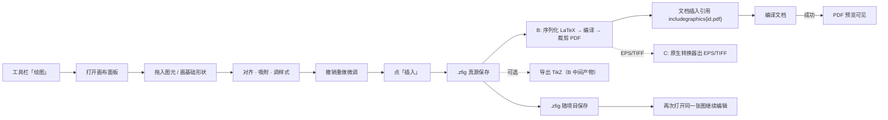

# PRD：Zetla 绘图模块

> **文档状态**：草案 · 待评审
> **版本**：v0.4（v0.3 将唯一真源自 TikZ 改为自研 `.zfig`；v0.4 拍定渲染后端：**默认 B（LaTeX 编译渲染）+ C（随包原生转换器补 EPS/TIFF）**，并修正字体/EPS 表述）
> **最后更新**：2026-10-28
> **关联文档**：`docs/开发文档.md`（§7 绘图组件、技术选型 fabric.js）、`docs/开发计划.md`（**M2-1 绘图组件**）
> **本文定位**：只回答"为什么做、做什么、做到什么程度"。数据结构、模块拆分、接口签名等实现细节在 M2-1 技术方案中给出，本文只在必要处给约束。

---

## 1. 模块定位

**一句话**：Zetla 编辑器内置的科研与教学插图能力——在写 LaTeX 的地方直接画图，图的可编辑真源留在项目里，一键渲染成投稿可用的图、可选导出为 TikZ。

**核心价值**：消除"画图工具 → 导出 → 导入"的往返损耗。图不是外部附件，而是**项目内的可重编辑真源**：随项目保存、随论文返修一起迭代、随编译一起进入 PDF。

**三条主张**（从上到下权重递减，冲突时保上舍下）：

1. **可重编辑的真源**：图的完整信息以自研格式 `.zfig` 存于项目，任何导出产物都可从真源重新生成；改图 = 改真源 = 重渲染 = 文档更新。
2. **投稿就绪**：渲染/导出产物（PDF/SVG/PNG/EPS/TIFF）直接满足出版社要求，字体、线宽、dpi、配色合规且默认不发生"投稿翻车"。
3. **简单**：PPT 级操作复杂度，拒绝专业绘图软件的功能堆叠。

> **与 v0.2 的关键区别**：不再要求"文档里必须是 TikZ 文本"。TikZ 仅是**可选的、默认渲染路径（B）自然产出的导出格式**；文档侧默认插入的是渲染好的矢量图引用，不是内联 TikZ。

---

## 2. 目标用户与场景

| 人群 | 首要场景 | 优先级 | 证据状态 |
|---|---|---|---|
| 理工科研究生 | 机理框图、技术路线图、论文配图 | **P0** | 假设，待验证 |
| 科研人员 | 投稿配图（示意图 + 子图拼图） | **P0** | 假设，待验证 |
| 高校教师 | 课件插图、实验装置图、讲义图（含中文标注） | P1（D2 才做专项优化） | 假设，待验证 |

**痛点假设**（定性判断，需按下述验证动作确认）：

1. 通用绘图工具（Illustrator/Inkscape）学习成本远高于使用频率所需。
2. PPT 导出位图分辨率与跨设备排版不可控，图内字体与正文不一致。
3. 图与 LaTeX 工程割裂，返修时需要重新导出、重新插入、重新对齐。

**验证动作**（D0 启动前完成，结论回写本节）：

- 访谈 5 位目标用户（研究生 3 / 科研 2 / 教师 1），确认最高频三个出图任务。
- 抓取 10 篇目标用户已发表论文，统计"纯示意图 / 位图拼图 / 混合"比例，决定拼图投入顺序。

---

## 3. 产品原则与边界

### 3.1 原则

- **唯一真源**：自研图元源格式（`.zfig`）是图的全部信息的唯一来源；所有导出（图、TikZ、SVG、EPS）都从它派生，反向不可改真源。
- **零参数**：样式有默认值且默认值即合规值；高级设置默认折叠。
- **可预测**：同样的操作生成结构一致的源；渲染结果可复现。
- **可迁出**：真源之外，至少能导出 PDF/SVG/TikZ/EPS 四种开放格式，杜绝格式锁定。
- **渲染后端可插拔**：文档侧只引用渲染产物，不绑定具体渲染实现（见 §6.3.1）。

### 3.2 本版不做（Out of Scope）

| 项 | 说明 |
|---|---|
| 自由贝塞尔/钢笔路径编辑 | 仅提供控制点受限的预设曲线（圆弧、抛物线、正弦、C1 连接线） |
| 图层、蒙版、通道、滤镜 | 专业图像处理能力 |
| 插画、海报、艺术排版、特效 | 非学术场景 |
| 三维建模与渲染 | 超出能力边界 |
| 复杂布尔运算、设计类快捷键 | 使用频率极低 |
| 从 TikZ 代码反向生成 `.zfig` | TikZ 导出是单向派生，反向解析不保证；D3 再评估 |

### 3.3 关键取舍

| 取舍 | 理由 |
|---|---|
| 唯一真源是自研 `.zfig`，而非 TikZ | TikZ codegen 是整块最脆的工程；`.zfig` 由 fabric 自然产出、无损、可重渲染，且天然覆盖拼图/手绘 |
| 文档侧默认插入"渲染矢量图引用"而非内联 TikZ | 投稿系统多收图文件而非 TikZ 源码；引用方式保真、保字体、易重渲染 |
| **默认渲染走 B（LaTeX 编译），EPS/TIFF 走 C（原生转换器）** | B 让字体（含中文）与文档完全一致、TikZ 导出免费且完整、零新增依赖；C 是唯一干净覆盖 EPS/TIFF 的路径 |
| 操作对标 PPT | 用户已有心智模型，学习成本最低 |
| 规范内置、参数隐藏 | "不用调参数"本身就是卖点 |
| 本版只做单向（源 → 多格式导出） | 双向同步开发量数倍且冲突需先解决（见 §7.4） |

---

## 4. 范围切分

> 本节使用 **D0–D3**，D0 对应项目 **M2-1**。v0.1/0.2 曾用 M0–M3，与项目里程碑同名不同义，已弃用。

| 阶段 | 范围 | 对应项目里程碑 | 预估 |
|---|---|---|---|
| **D0（本版）** | 画布 + 基础编辑 + 撤销重做 + `.zfig` 源格式 + **B 渲染 PDF** + 插入引用 + 源持久化 | M2-1 | 1–2 周 |
| **D1** | 图元库扩充 + 子图拼图与标注 + 学术色板 + SVG/PNG 导出 + **C 补 EPS/TIFF** | M2-1 后续 | 2–3 周 |
| **D2** | 文字符号规范纠错 + 教学场景（beamer）+ 更多素材 + 字体跟随精修 | M3 | 2 周 |
| **D3** | TikZ 导出增强 + 批量导出 + 素材市场 + 反向解析评估 | M3/M4 | 待评估 |

**P0 收敛说明**：D0 的 P0 只有"画布—图元—`.zfig`—渲染—插入"最小闭环。TikZ 导出不在 D0 强制范围（B 下它随渲染自然可得，但保真度打磨放到 D3）。

---

## 5. 主流程与入口

### 5.1 端到端主路径（D0）



### 5.2 入口与容器形态

- **入口**：主工具栏「绘图」按钮（与表格、图片、符号面板同级），快捷键 `Ctrl+Shift+D`。
- **容器**：默认占用**右侧栏**（复用现有三栏布局，与预览互斥切换），画布随窗口缩放；图元数量 > 50 或点「放大」时可弹出为独立标签页。
- **与预览关系**：绘图时右栏显示画布，预览让位；关闭画布恢复原栏内容与宽度比例。

---

## 6. 功能需求

### 6.1 画布与基础编辑（P0）

| 能力 | 说明 | 验收 |
|---|---|---|
| 画布 | 白底、可缩放（25%–400%）、可平移、网格与吸附（阈值 6px，可关） | 缩放平移后图元位置不失真；吸附开启时边缘吸附到网格线与同类元素边缘 |
| 基础形状 | 矩形、圆/椭圆、直线、箭头、折线（含肘形连接线）、文本 | 每种形状拖出后 3 秒内可完成"画—改—删" |
| 变换 | 移动、缩放、旋转（框选整体）、对齐（左/中/右/上/中/下）、等距分布 | 框选 5 个元素执行"水平等距分布"，间距误差 ≤ 1px |
| 组合 | 组合/解组、层级上移下移、复制粘贴（`Ctrl+C/V`，跨图可粘贴） | 解组后子元素相对位置不变 |
| **撤销/重做** | 全部编辑操作入栈，≥ 50 步，`Ctrl+Z` / `Ctrl+Shift+Z` | 连续 50 次操作后可完整回退；撤销后重做结果逐像素一致 |
| 删除与锁定 | 删除、锁定图元（锁定后不可选中拖动） | 锁定的图元不响应拖拽与框选 |
| 键盘 | 方向键微移 1px、`Shift+方向键` 10px、`Delete`、`Esc` 取消选择 | — |

> **撤销/重做是 D0 验收门槛**，不是增强项。

### 6.2 图元库（D0 最小集，D1 扩充）

**D0 内置（12 个）**：流程框、圆角框、判定菱形、文档框、数据库柱、箭头、双向箭头、肘形连接线、文本框、坐标轴（十字）、括号、分组框。

**D1 扩充方向**（每类先做 5–8 个高频项，不做全量覆盖）：

| 领域 | 素材方向 |
|---|---|
| 通用 | 实验流程图、技术路线图、机理框图、因果逻辑图 |
| 光电/物理 | 光路组件（光源、透镜、反射镜、探测器）、简易电路框图 |
| 材料/化学 | 层状结构、纳米颗粒、反应流程示意 |
| 机械/土木 | 力学约束、载荷箭头、构件简图 |
| 计算机/AI | 模型结构图、模块堆叠、消融实验框图 |
| 教学 | 学科原理图、实验步骤图（D2，含中文标注） |

**约束**：纯线框 + 学术配色，无卡通化、无阴影渐变、无立体效果。

**验收**：拖入任一图元 → 画布出现对应图形 → 序列化进 `.zfig` → 从该 `.zfig` 重新渲染出的图与原画布视觉一致。

### 6.3 源格式、渲染与导出（P0 · 本模块存在的意义）

**唯一真源——`.zfig`（自研 JSON 图元源格式）**：保存图的完整信息，包括图元几何、样式、文本与语义角色、位图引用、拼图布局、创建/修改时间。它是所有产物的派生起点。结构约束见 §8。

**6.3.1 渲染后端（已拍定：B 默认 + C 补 EPS/TIFF）**

- **B（默认 · LaTeX 编译渲染）**：`.zfig` → 序列化为独立 LaTeX（`tikzpicture` + 必要的 `\includegraphics`）→ 用**项目同款引擎**（xelatex/lualatex/pdflatex，取自 `.ltex/config.json`）编译 → 裁剪 bbox 得到 PDF。
  - *优点*：字体随文档（**含中文，经 ctex/文档配置自动正确**）；矢量质量最高；**TikZ 导出免费且完整**（本就是中间产物）；复用已有 TeX 链，**零新增依赖**。
  - *约束*：单图编译 0.5–3s，仅"插入/导出"时触发（实时预览用 canvas，不编译）；序列化器必须对用户文本做 **LaTeX 转义/ sanitize**。
- **C（EPS/TIFF · 随包原生转换器）**：对需要 EPS/TIFF 的投稿场景，将 SVG/PS 交给**随包发布的原生转换器**（Ghostscript 出 EPS/PS/TIFF，resvg 出 PDF）生成。C 是**唯一干净覆盖 EPS/TIFF** 的路径；代价是随包带原生二进制（Tauri sidecar，需维护 win/linux/mac 三平台构建）。
- **可插拔**：文档侧只引用渲染产物（见 §7.2），不关心后端。A（纯 JS）/D（Chromium 打印）留作**无 TeX 环境或批量即时的 fast path**，后续可加，不影响主线。

**导出多态表**：

| 导出目标 | 后端 | 说明 |
|---|---|---|
| PDF（矢量） | B（主） | 文档默认引用；文本可选中、字体嵌入、bbox 精确无白边 |
| SVG | B/C | 矢量，便于二次编辑 |
| PNG（600dpi） | B/D | 位图投稿备选，按文档字体渲染 |
| **EPS** | **C** | Ghostscript 原生产出，投稿常用 |
| **TIFF（300/600dpi）** | **C** | Ghostscript 产出，现代投稿备选 |
| **TikZ** | **B 原生** | 默认渲染的中间产物，完整导出受支持图元集（自由笔迹除外） |
| RGB / Grayscale | P1 | 色彩模式随导出选项 |

**验收**（D0 门槛）：

- 拖出"3 框 + 2 箭头"流程图（含中文标号）→ 保存 `.zfig` → B 渲染 PDF → 在模板项目 `\includegraphics` 引用 → 编译通过，PDF 中图形与画布视觉一致（位置误差 ≤ 2pt，线宽一致），中文标号字体与文档一致。
- 同一 `.zfig` 重复渲染，产物逐字节一致（幂等）。
- `.zfig` 经手工改样式字段后重新渲染，结果符合修改且仍可编译引用。

### 6.4 子图拼图与标注（D1）

> 在新架构下，拼图与示意图走**同一套 `.zfig` 模型**——区别只是图元类型含"位图引用图元"。B 渲染时位图经 `\includegraphics` 进入 `tikzpicture`，标号用真实 LaTeX 字体渲染，中文自动正确。

| 能力 | 说明 | 产物 |
|---|---|---|
| 多图导入 | 一次导入多张 PNG/JPG/PDF，作为位图引用图元进入画布 | `.zfig` 记录源文件相对路径，不复制副本（可选复制到 `assets/`） |
| 自动排版 | 2×1 / 1×2 / 2×2 / 2×3 预设，等尺寸等间距 | B 渲染时按布局摆放；导出 PDF 即拼好图 |
| 子图标号 | 一键 (a)(b)(c)(d)，字号位置统一 | 标号作为矢量文本渲染进图，字号取文档 caption 字号 |
| 标注 | 箭头、文字、局部放大框 | 作为画布图元渲染；提示"标注随图渲染，不随被标位图缩放而失真" |
| 统一处理 | 统一裁切、留白、尺寸 | 写入 `.zfig` 布局参数，渲染时生效 |

**验收**：导入 4 张尺寸不一的图 → 自动 2×2 → 加 (a)–(d) → B 渲染 PDF → 四图等宽、间距一致、标号对齐、中文正确，位图保持原始分辨率（不被二次压缩）。

### 6.5 文字与符号规范（D2）

| 能力 | 说明 |
|---|---|
| 字体策略 | **默认跟随文档**：B 渲染时直接取文档正文/无衬线设定（含中文 ctex）；另提供"期刊无衬线"预设（Helvetica/Arial）切换 |
| 自动规范 | 物理量斜体（`$v$`）、单位正体（`$\mathrm{m/s}$`）、下标规范、希腊字母标准写法（作用于文本图元的渲染） |
| 符号库 | 复用现有符号面板（`get_symbol_index` + 符号库 JSON），不重复建设 |
| 全局统一 | 图内字号在限差内自动统一，一键修正不一致项 |

**验收**：含不规范下标/单位的文本 → 一键修正 → B 重新渲染后图中文字符合规范（斜体/正体/字号一致、中文正确）。

### 6.6 配色（D1）

| 能力 | 说明 |
|---|---|
| 分类色板 | Okabe-Ito（8 色，色盲友好）、ColorBrewer Set2/Set3、学术灰阶 —— **分类用离散色板** |
| 连续色阶 | Viridis / Cividis，仅用于热力、渐变、密度类表达 |
| 默认合规 | 默认禁用高饱和撞色；线框默认 `black` + 0.5pt |
| 一键统一 | 按语义角色（主/次/强调/背景）重映射全图配色 |
| 黑白模式 | 一键转灰阶，保证灰度下相邻元素亮度差 ≥ 15% |

**验收**：混合配色图应用 Okabe-Ito → 相邻色块在 protanopia/deuteranopia 模拟下仍可区分；切黑白后相邻元素灰阶差 ≥ 15%。

### 6.7 导出（D1）

| 格式 | 优先级 | 后端 | 说明 |
|---|---|---|---|
| PDF（矢量） | P0 | B | 默认、投稿通用、文本可选中 |
| SVG | P1 | B/C | 矢量，便于二次编辑 |
| PNG（600dpi） | P1 | B/D | 位图备选 |
| **EPS** | **P1** | **C** | Ghostscript 原生产出，投稿常用 |
| **TIFF（300/600dpi）** | **P1** | **C** | Ghostscript 产出 |
| TikZ | 可选 | B 原生 | 见 §6.3 |
| RGB / Grayscale | P1 | — | 色彩模式随导出选项 |

**验收**：导出 PDF → bounding box 与内容边界误差 ≤ 1pt（无白边）；文本可选中（字体嵌入成功）。导出 EPS（经 C）→ 主流投稿系统可识别、字体嵌入。

### 6.8 教学场景（D2）

| 能力 | 说明 |
|---|---|
| 画布比例 | 16:9、4:3 预设（对应 beamer 幻灯片版心），按比例渲染单张图 |
| 可读性 | 投屏场景下图内字号 ≥ 8pt，低于阈值提示 |
| 批量导出 | 一张画布内多个画板（artboard）分别渲染为多张图，供 beamer 多页引用 |
| 手绘辅助 | 简单自由笔迹（仅教学示意，渲染为图，不进 TikZ 导出） |

---

## 7. 与文档 / 内核的集成

### 7.1 依赖关系

- **文档模型**：插入的是对渲染产物的引用（一条 `\includegraphics{...}` + 注释锚点），不把图内联进文档正文，不改文档模型。
- **编译引擎**：引用的是已渲染的 PDF/图文件，文档编译负担不增；TikZ 仅在用户选择内联导出时才参与编译。
- **项目管理**：`.zfig` 真源随项目保存（见 §8）。
- **符号面板**：复用其符号库与索引接口。
- **PDF 预览**：编译后按现有 `compile_finished` 流程刷新，无新增逻辑。
- **图片模块**：图片模块管"导入已有图文件"，绘图模块管"从零画图/拼图并生成真源"，边界不重叠。

### 7.2 文档侧引用机制

- 插入时生成：`% @zfig <id> <hash>` 注释 + `\includegraphics[width=...]{<proj>/diagrams/<id>.pdf}`。
- 重新编辑：改 `.zfig` → 重渲染同名 PDF（默认 B）→ 文档引用不变，下次编译即更新。
- **内联 TikZ 可选模式**：用户勾选"内联导出"时，把 B 产出的 `tikzpicture` 内联进文档替代 `\includegraphics`。代价：失去像素级渲染保真、TikZ 不完整部分（自由笔迹）会被省略，换取"可手改文本"。
- 默认建议：**引用渲染 PDF**（投稿友好、保真、易重渲染）。内联 TikZ 作为进阶选项。

### 7.3 字体一致性（硬约束 · B 下完美，C/D 近似）

- **B 渲染**：图由同一 TeX 引擎、同一文档配置排版，**字体（含中文，经 ctex/文档字体设置）与文档完全一致**，矢量文本可选中并嵌入字体子集。这是新架构下"图与正文字体一致"承诺的等价实现，且比 v0.2 的"TikZ 自动用正文字体"更强（覆盖中文）。
- **C/D 路径**：字体近似（取系统/内置字体），列为已知限制；EPS/TIFF 投稿对字体一致性要求通常低于内嵌矢量。
- 若字体不匹配，投稿图与正文不符——B 下基本不发生，列为 D0 验收（见 §10）。

### 7.4 编辑冲突策略（数据丢失风险）

`.zfig` 是唯一真源，但用户可能手工改了文档里的引用（如换图、删引用）或外部改了 `.zfig`。策略：

1. 插入时在文档写 `% @zfig <id> <hash>`，`<hash>` 取 `.zfig` 内容的摘要。
2. 再次打开画布时比对 `.zfig` 当前 hash 与文档锚点 hash：
   - **一致** → 正常编辑，重渲染后原位替换引用目标。
   - **不一致**（真源被外部改动）→ 提示"真源已变，将按最新真源重渲染"。
   - **文档锚点缺失** → 视为新图，生成新 id，不静默覆盖任何已有图。
3. 禁止静默覆盖、禁止"找不到就追加一份"（会产生重复图）。

### 7.5 渲染/导出失败定位

- 因图以预渲染产物插入文档，**文档编译基本不再因图而报错**——这是相对 v0.2"内联 TikZ"模型的核心稳定性收益。
- **B 编译失败**：序列化器生成的 LaTeX 报错时，按报错行号向上找 `% @el <id>` 锚点（序列化时写入每个图元前），映射回 `.zfig` 图元，提示"图元 X 的标签含非法字符/样式异常"。根因多为未转义文本，序列化器强制 sanitize 可前置规避。
- **C 转换器失败**：转换器报错同样映射到源图元；缺字体的图元回退内置字体并告警，不中断整体导出。
- 渲染层须捕获失败、定位到图元、给出可读错误而非崩溃（见 §9）。

---

## 8. 数据与持久化（唯一真源）

| 项 | 方案 |
|---|---|
| 源格式 | **`.zfig`**：自研 JSON，存完整信息（图元几何、样式、文本、语义角色、位图引用、拼图布局、meta） |
| 存放位置 | `<项目根>/.ltex/diagrams/<id>.zfig`（与 `.ltex` 配置同级，随项目目录迁移） |
| 与文档关联 | 文档中 `% @zfig <id>` 锚点单向引用渲染产物；真源不知道文档位置 |
| 无项目场景 | 单文件模式存 `~/.zetla/diagrams/`，插入时提示"当前图未随项目保存" |
| 版本兼容 | JSON 带 `schemaVersion`，低版本打开高版本数据时只读并提示 |
| 可迁出 | 任意 `.zfig` 可导出 PDF/SVG/PNG/TikZ/EPS；无私有锁定 |
| 清理 | 文档中锚点全部删除后，真源保留 30 天（防误删），由用户手动或设置页清理 |

**`.zfig` 最小结构约束**（实现细节待技术方案，此处定义约束）：

```json
{
  "schemaVersion": 1,
  "canvas": { "width": 0, "height": 0, "dpi": 600, "background": "#FFFFFF" },
  "elements": [
    {
      "id": "string",
      "type": "rect|ellipse|line|arrow|polyline|text|image|group",
      "geometry": { },
      "style": { "stroke": "#000000", "strokeWidth": 0.5, "fill": "none", "font": "sans" },
      "text": { "content": "v", "role": "label|caption|normal", "italic": false },
      "src": "相对路径(位图类)"
    }
  ],
  "layout": { "subfigures": [ { "cols": 2, "rows": 2, "gap": 4 } ] },
  "meta": { "created": 0, "modified": 0 }
}
```

---

## 9. 非功能需求

| 维度 | 指标 |
|---|---|
| 性能 | 200 图元画布拖拽/缩放稳定 ≥ 50fps；打开画布 ≤ 500ms（含反序列化）；B 单图编译 ≤ 3s（仅导出触发）；C 转换 ≤ 1s |
| 体积 | 单图源 `.zfig` ≤ 5MB；渲染 PDF ≤ 10MB；随包原生转换器（resvg 小 / Ghostscript 较大）按体积评估取舍 |
| 稳定性 | 画布崩溃不影响文档；B/C 失败不崩溃、定位到图元；源数据异常时自动落盘 |
| 字体 | B 下字体与文档完全一致（含中文）；暗色主题下画布可切纸白/暗色，导出恒白底 |
| 低配可用 | 集成显卡 + 4GB 内存 + WebView2 满足上述指标 |
| 可访问 | 全部操作有键盘路径；无鼠标可完成"画框—连线—插入" |

---

## 10. 验收标准汇总（D0 出口条件）

全部满足才可关闭 M2-1：

1. 打开画布 → 拖 3 框 + 2 箭头（含中文标号）→ 对齐 → 插入 → B 渲染 PDF → 编译通过 → 预览可见，**全程 ≤ 3 分钟**。
2. 连续 50 次编辑可完整撤销并重做，状态逐像素一致。
3. 同一 `.zfig` 重复渲染产物逐字节一致（幂等）；手工改源字段重渲染后仍可编译引用。
4. 关闭 Zetla 重开项目，同一张图可再次打开并保持所有图元、位置、样式。
5. 200 图元画布拖拽 ≥ 50fps，打开 ≤ 500ms。
6. 代码（引用）被手工改后再打开画布，触发冲突提示而非静默覆盖。
7. B 渲染 PDF 中文本为可选中矢量字形且**字体（含中文）与文档一致**；暗色主题下导出为白底。
8. 5 位非绘图软件重度用户可用性测试：4 人可在 10 分钟内独立完成"画三框流程图并插入文档"。
9. 导出 EPS（经 C）成功、无白边、主流投稿系统可识别。

---

## 11. 成功指标

| 指标 | 定义 | 目标（D1 上线后 1 个月） |
|---|---|---|
| 北极星：含图文档占比 | 使用绘图模块的项目数 / 活跃项目数 | ≥ 25% |
| 首次出图时长 | 打开画布 → 点击插入 的中位耗时 | ≤ 4 分钟 |
| 渲染失败率 | 插入/重渲染失败比例 | ≤ 2% |
| 重开编辑率 | 插入后 7 日内再次打开同一张图比例 | ≥ 30%（衡量"可返修"是否成立） |
| TikZ 导出未转换率 | 导出 TikZ 触发"未完整转换"（自由笔迹等）的图元占比 | 仅作质量观测，预期极低（B 原生） |
| 素材使用集中度 | Top 10 图元占全部拖入次数比例 | 指导 D1 扩充方向 |

> 指标在内核侧打点（不含文档内容，仅计数与耗时）。若 D1 后含图文档占比 < 10%，应重新评估本模块 ROI（对应 `开发文档.md` 中"绘图组件 ROI 不确定"风险）。

---

## 12. 竞品与差异化

| 工具 | 优势 | 对 Zetla 的启示 |
|---|---|---|
| TikZit | TikZ 原生、可视化编辑 | 无 WYSIWYG 资产管线、无拼图、无中文教学场景，**且无"可重渲染真源 + 一键投稿图"闭环** |
| Ipe | 矢量强、可嵌 LaTeX 文本 | 产物是 PDF 而非源，无法在编辑器内重编辑；学习曲线陡 |
| draw.io / Excalidraw | 上手极快 | 导出 SVG/位图再导入，字体与正文不一致，返修需重做 |
| PowerPoint / Illustrator | 用户最熟 | 导出糊、分辨率与排版不可控 |
| Overleaf | 生态完整 | 无内置可视化绘图，仍需外部工具 |

**差异化落点**（按不可替代性排序）：

1. 画布在编辑器内，且**真源留在项目**（`.zfig`），可随时重编辑、重渲染——唯一真正"同源"的方案。
2. **B 渲染让字体（含中文）与文档完全一致**，一键产出投稿就绪的图（PDF/SVG/PNG/EPS/TIFF），把"投稿翻车"变成默认不发生。
3. 文档编译基本不因图报错（图是预渲染产物），稳定性显著优于内联 TikZ。
4. TikZ 导出作为进阶选项（B 下完整），满足想要可编辑文本的用户，但不绑架主线。

---

## 13. 风险与应对

| 风险 | 影响 | 应对 |
|---|---|---|
| **序列化文本未转义导致 B 编译失败** | 图渲染报错 | 序列化器强制 LaTeX sanitize/转义 + 单测覆盖；失败按 `% @el` 映射回图元 |
| **字体不匹配导致投稿退回** | 图与正文字体不符 | B 下字体=文档字体（含中文），基本不发生；仍列 D0 验收 |
| C 原生转换器打包体积/三平台维护 | 安装包变大、跨平台构建成本 | sidecar 形式；优先 resvg（小），Ghostscript 仅按需；评估体积取舍 |
| TikZ 导出不完整引发预期落差 | 用户以为能转却转不全 | B 下基本完整，仅自由笔迹跳过；导出时标注"未完整转换"的图元 |
| 自研格式锁定 | 用户难迁出 | §8 可迁出（PDF/SVG/TikZ/EPS）；schemaVersion 兼容 |
| 素材库覆盖面与维护成本 | 领域多、长尾重 | D0 仅 12 通用图元；D1 按 §11 数据决定顺序，不做全量 |
| 单开发者工期 | D1 延期连带 D2 | D0 严格按出口条件收口；D1 拼图与配色可再拆 D1a/D1b |
| ROI 不确定 | 投入产出失衡 | §11 指标 + D1 后复核阈值 |

---

## 14. 待决策事项（D0 启动前定稿）

| # | 决策 | 建议方案 | 状态 |
|---|---|---|---|
| 1 | 画布容器形态 | 右侧栏 + 可弹独立标签（§5.2 已定稿） | ✅ 已定 |
| 2 | 文档侧默认引用渲染 PDF 还是内联 TikZ | **默认引用渲染 PDF**；内联 TikZ 作可选模式 | ✅ 已定 |
| 3 | 渲染后端 | **B 默认 + C 补 EPS/TIFF**（A/D 留作 fast path） | ✅ **本次拍定** |
| 4 | D1 首发素材领域 | 通用四类 + 光电/物理（光路图最刚性），其余按指标后补 | 待 D0 期间 |
| 5 | TikZ 导出保真度范围 | B 下基本完整；自由笔迹/任意裁剪不支持，D3 前不承诺扩展 | 待 D0 期间 |
| 6 | 指标打点是否随 D0 一起上 | 建议 D0 埋基础计数（打开/插入/渲染失败），否则 D1 无法判断 ROI | 待 D0 启动前 |

---

## 15. 变更记录

| 版本 | 日期 | 变更 |
|---|---|---|
| v0.1 | — | 初稿 |
| v0.2 | 2026-10-28 | 里程碑改 D0–D3 对齐 M2-1；P0 收敛；补撤销重做、持久化、宏包依赖、报错反查、冲突策略；修正 Viridis/SCI/字体/贝塞尔/TIFF/beamer 表述；验收量化；新增竞品与成功指标 |
| v0.3 | 2026-10-28 | 架构转向：唯一真源由 TikZ 改为自研 `.zfig`，TikZ 降为可选导出；文档侧默认插入渲染矢量图引用；新增 §7.3 字体硬约束、§7.5 渲染失败定位、§8 `.zfig` schema |
| v0.4 | 2026-10-28 | **拍定渲染后端：B（LaTeX 编译，字体含中文与文档一致、TikZ 免费完整、零新增依赖）默认 + C（随包原生转换器 Ghostscript/resvg 补 EPS/TIFF）**；修正此前"字体近似/EPS 难做"措辞；§6.3.1 渲染后端可插拔结构；§6.7 EPS/TIFF 升 P1；§10 验收补中文一致与 EPS；§13/§14 更新风险与决策状态 |
